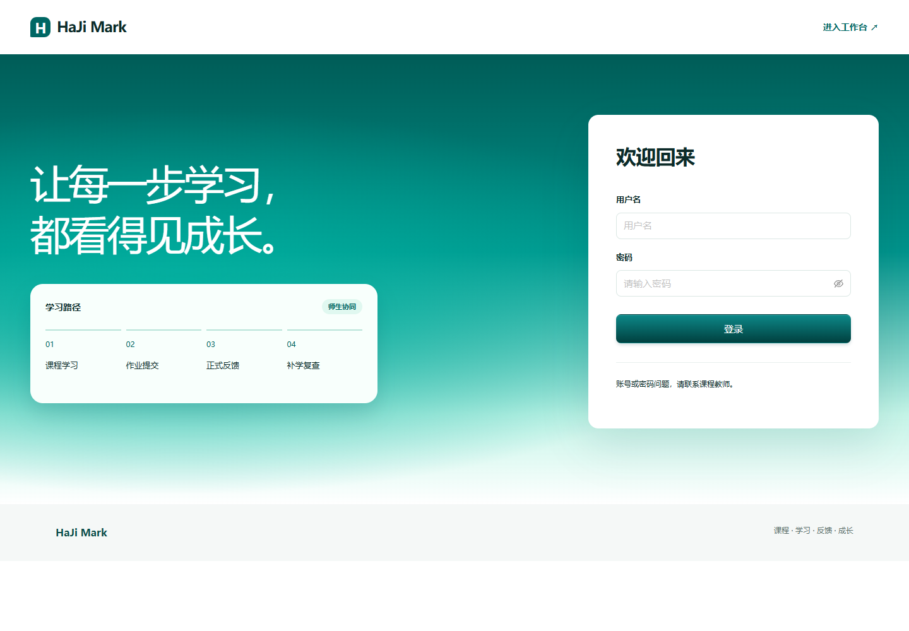
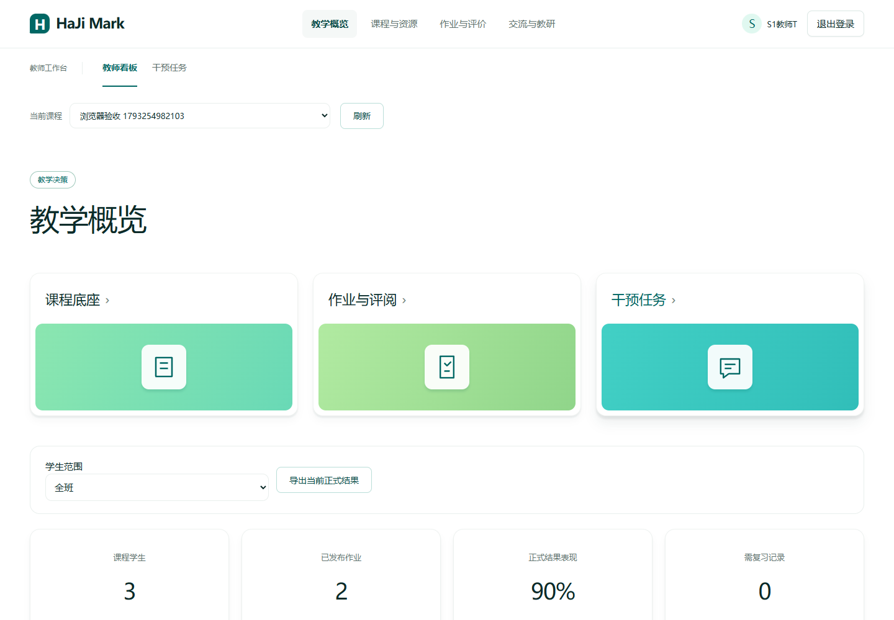
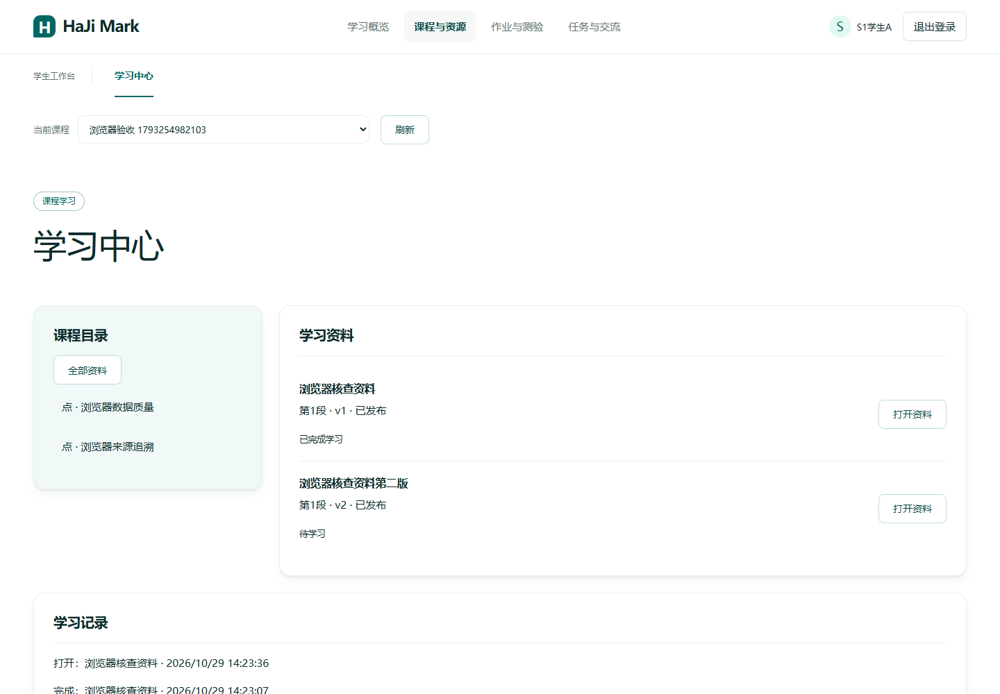
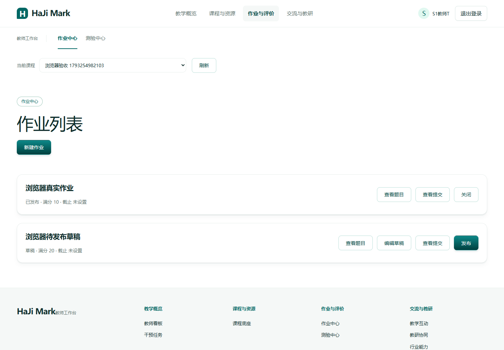
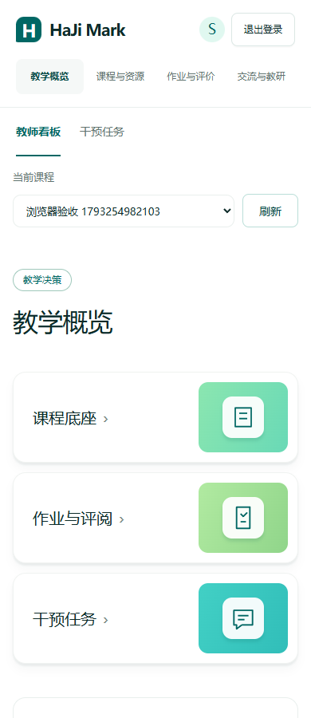

# HaJi Mark 界面设计与复刻指南

2026-10-29 第二轮视觉自检 · React 19 / TypeScript / Ant Design 5.27.4。当前设计用于真实师生平台，页面数据继续通过 learning API 读取 PostgreSQL。设计改造的验收范围是本地 Docker；生产状态另见部署记录。

## 设计来源与取舍

用户提供的根目录 `home.webp`、`platform.webp`、`pricing.webp`、`resources.webp`、`solutions.webp`、`why-lattice.webp`、`company.webp` 为 Lattice 风格参考。采用其中的深青主视觉、薄荷渐变、白色圆角卡片、胶囊标签、宽松留白和分栏页脚。业务内页保留清晰的表单与表格密度，长内容用可滚动表格和自动换行承载。

参考图保留在本地原位置。没有复制其品牌、人物、客户标识、销售文案或评价数字；界面中的学习流程插图由 HTML/CSS 构成。当前截图包含自动化验收创建的课程与真实数据库结果，分数只表示该构造课程的反馈。

登录页突出“课程 → 作答 → 反馈 → 补学复查”；身份由账户决定。没有角色切换模拟器、虚构模型回答、第三方登录或尚未实现的找回密码按钮。

## 实现入口

| 文件 | 职责 |
| --- | --- |
| `web/src/app/theme.ts` | Ant Design 颜色、字体、控件高度与圆角 |
| `web/src/styles.css` | 全局设计变量、登录页、应用框架、导航、卡片、按钮、表格与断点 |
| `web/src/live/styles.css` | 业务标题区、指标卡、知识点、表单、目录与快捷入口 |
| `web/src/app/Login.tsx` | 真实登录表单与平台说明 |
| `web/src/app/navigation.ts` | 教师/学生的四组主导航及二级入口，页脚共用 |
| `web/src/app/App.tsx` | 角色框架、账户操作、页面焦点与标题 |
| `web/src/live/routes.tsx` | 业务路由、角色入口、旧地址兼容重定向 |
| `web/src/live/insight.tsx` | 概览、快捷入口、真实证据与指标 |

`main.tsx` 的 ConfigProvider 使用 theme.ts；活动全局样式不再导入 `replica/styles/reference.css` 和 `replica/styles/local.css`。`replica` 原文件保留供历史核对，课程目录模板仍有明确的业务导入用途。旧 `replica/Login.tsx` 已退出活动路由。

## 第二轮对照结论

逐张查看七张 WebP 的完整页面，并放大顶部、按钮和卡片。第一版的胶囊按钮、整片浅绿后台背景、带边框的大标题卡片，以及多余的功能说明不符合参考，已修正。

| 对照项 | 参考图观察 | 当前实现 |
| --- | --- | --- |
| 按钮 | pricing/platform 顶部青绿纵向渐变、小圆角、底部阴影 | CSS 与 Ant Design 同步 8px 圆角和渐变；不再使用胶囊主按钮 |
| 画布 | 七图以白色为主，局部彩色区域 | 业务白底、轻边框；登录主视觉从深青渐变到白 |
| 卡片 | home 的标题在上，绿/薄荷/青色插图区在下 | 三张入口采用相同层级与色序，图形为学习业务 SVG |
| 标题 | 普通栏目标题直接位于画布上 | 移除全页通用的圆角横幅，保留标题与短分类标签 |
| 文案 | 按用户本轮要求进一步精简 | 移除入口说明、重复页头介绍、无意义英文编号和页脚宣传语 |

**复刻边界：当前是参考样式的业务适配，不是七个营销页的逐像素副本。** 页面内容、中文字体、Logo、照片/插画、二级业务导航与真实表单不同；没有原站字体和源组件，也未获得像素一致的证据。不能把浏览器流程通过称作“100%完全复刻”。本轮没有添加营销页、虚构客户评价或用参考整图覆盖可交互页面。

## 设计变量

| 语义 | 值 | 用途 |
| --- | --- | --- |
| 主色 | `#006764` | 主按钮、选中项、链接、进度条 |
| 深青 | `#0b4c48` | 悬停、较深文字 |
| 正文 | `#0d2b29` | 标题、数据与正文 |
| 次要文字 | `#61736f` | 说明、时间、来源 |
| 薄荷 | `#e0f8f0` | 标签、选中背景、插图区 |
| 背景 | `#ffffff` | 工作台白色画布 |
| 分隔线 | `#e9efed` | 卡片、表格、输入框 |
| 错误 / 成功 | `#b42318` / `#027a48` | Ant Design 语义状态 |

CSS 变量与 theme.ts 的同义颜色必须同步修改。不要在某个业务页另起紫色、蓝色或玻璃主题。登录页使用深青渐变并向白色过渡；业务标题直接置于白色画布上。彩色渐变集中在快捷卡片插图区，不给每个业务标题加背景卡片。

- 字体：Inter、PingFang SC、Microsoft YaHei、Segoe UI、system-ui 回退；不依赖外网字体。正文 15px，说明 12–14px，移动端表单 16px。
- 标题：登录页 36–64px，业务 h1 30–48px，h2 20px。长标题使用 `text-wrap: balance`；内容可以自然增高。
- 圆角：普通卡片 16px，输入框 8–10px，按钮 8px。只有小标签使用胶囊圆角。
- 间距：控件 8–12px、组件 16–24px、卡片内边距 28px、标题区 40px。桌面正文最大宽度 1344px。
- 阴影：`0 3px 2px #0b2b2910, 0 8px 12px #0b2b2908`；以细边框和留白区分层级。
- 交互：悬停约 180ms；可见焦点；`prefers-reduced-motion` 关闭非必要动画。按钮最小高度 42px，主登录按钮 46px。

## 导航与路由

主导航固定为四组，组内用第二行展示具体功能。账户设置位于右上角，退出单独显示。详情、编辑、评分页沿用所属功能的选中态。SPA 路径变化后焦点移到 `main-content`，页面标题同步到当前分组。

| 角色 | 分组 | 规范入口 |
| --- | --- | --- |
| 教师 | 教学概览 | `/teacher/dashboard`、`/teacher/intervention` |
| 教师 | 课程与资源 | `/teacher/course-twin` |
| 教师 | 作业与评价 | `/teacher/homework`、`/teacher/quiz` |
| 教师 | 交流与教研 | `/teacher/interaction`、`/teacher/research`、`/teacher/industry-intelligence` |
| 学生 | 学习概览 | `/student/home`、`/student/learning` |
| 学生 | 课程与资源 | `/student/course-content` |
| 学生 | 作业与测验 | `/student/homework`、`/student/quiz` |
| 学生 | 任务与交流 | `/student/intervention`、`/student/interaction` |
| 两者 | 账户 | `/<role>/profile` |

旧 `student-twin`、`teacher-twin/drilldown`、`insight` 重定向到对应角色概览；教师 `home`、学生 `dashboard` 也归一。教师 `course-content` 和学生 `course-twin` 转到各自课程入口。上述重定向保留查询参数；`grading` 转到作业列表。既有 `courses`、`assignments` 兼容入口保留。使用 replace，避免返回键陷入别名页面。

作业详情、编辑、提交列表、评分与正式反馈保留现有深链接和对象 ID。教研/行业路由只提供给教师，学习路径只提供给学生。实际授权仍由后端执行。

## 页面模板

界面只保留短标题、实际内容、数据状态和操作。禁止在标题或入口下方重复“维护…、准备…、基于…汇总”等静态功能说明；设计解释写在本文。错误、密码限制、发布不可逆提示及资料来源仍按需要展示。

新增业务页先复用下面的结构，再接现有 `useLiveQuery` / `useAction`。操作名称要表达实际行为，异步请求保留 busy/error/success 反馈；原生 select、fieldset 和 label 保留可访问语义。

```tsx
<div className="live-page">
  <header className="live-heading">
    <p>课程学习</p>
    <h1>页面标题</h1>
  </header>
  <Feedback error={query.error} message={action.message} />
  <section className="card-panel">
    <h2>具体任务</h2>
    {/* 表单用 live-form，操作组用 live-inline，表格外包 table-wrap。 */}
  </section>
</div>
```

Ant Design 用于主题、登录输入框、密码可见性、按钮、头像、提醒与空状态；业务表单继续使用已有原生语义控件，共享相同视觉变量。不要仅为换组件重写业务请求或将下拉框替换成不可访问的 div。两字 Ant Design 按钮需要稳定的可访问名称，例如登录按钮设置 `autoInsertSpace={false}`。

概览卡片只使用真实证据。未评分显示“证据不足”，保留原始提交、资料版本和评分发布状态的区分。加载失败不替换成虚构统计。

## 页面示例

以下截图由本地 Docker 镜像与真实验收账号生成；不包含密码。更新 UI 后重新生成，避免以旧截图证明新版本。

### 登录页



### 教师概览



### 学生概览


### 课程学习与作业列表





### 手机布局



760px 以下目录与内容改为单列，指标改为两列，快捷入口改为一列；主导航保留四组可见入口。1100px 以下导航移至独立行。宽表格只在表格容器内滚动，长 ID、链接与用户内容允许换行。

## 复验与截图更新

从仓库根目录执行，已有测试凭据在 `.local/s1-accounts.json`。首次环境按 README 初始化数据库与账号。

```powershell
docker compose build web
docker compose up -d --no-build
$taskNode = 'C:/Users/23396/.cache/codex-runtimes/codex-primary-runtime/dependencies/node'
$env:NODE_PATH = "$taskNode/node_modules"
& "$taskNode/bin/node.exe" scripts/check-platform-browser.cjs
& "$taskNode/bin/node.exe" scripts/check-design-browser.cjs
python scripts/check_docs.py
python -B F:/vibe-coding/scripts/workspace.py check --repo F:/vibe-coding/school/HaJi_Mark
git diff --check
```

完整浏览器回归创建带标签的课程、作业、评分和账号并保留数据；不要删除数据卷。设计检查只操作本机 18080 的测试会话，检查四组导航、焦点、别名和响应式并生成 `.local/design/*.png`。它依赖前一个脚本生成的“浏览器验收”课程。人工核对图像后，只复制本文列出的六张示例至 `docs/design-examples`；其余过程截图与账号文件保持忽略。

本轮结果见 [验证记录](docs/verification.md)。验收覆盖课堂流程与界面；未做像素相似度评分、大规模负载或完整无障碍认证。Vite 当前主 JS 包超过 500kB 的体积建议仍存在，后续可按真实性能测量进一步拆包。
