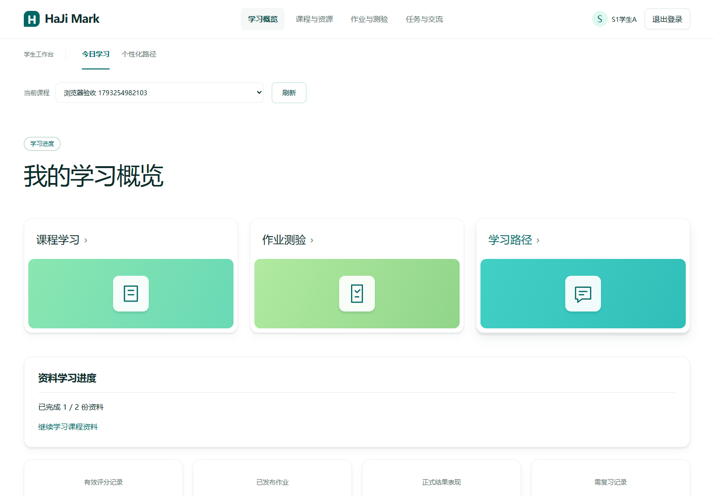

# HaJi Mark 界面设计与复刻指南

2026-10-31 UI 重构 · React 19 / TypeScript / Vite / Ant Design 5.27.4。页面数据继续通过 learning API 读取 PostgreSQL。设计验收范围是本地 Docker；生产状态另见 [部署记录](deploy/README.md) 与仓库根 RESULT.md。改动清单与取舍见 [ui-refresh-2026-10-31](docs/ui-refresh-2026-10-31.md)。

## 设计来源

仓库根目录 `home.webp`、`platform.webp`、`pricing.webp`、`solutions.webp`、`resources.webp`、`company.webp`、`why-lattice.webp` 为 Lattice 风格参考。从中提取的设计语言：

| 维度 | 参考图观察 | 本平台采用 |
| --- | --- | --- |
| 色彩 | 深青主色，薄荷/青绿渐变只出现在主视觉和插图区，画布以白色为主 | 主色 `#006764`；渐变只用于登录主视觉、流程卡和概览快捷卡插图区 |
| 字体层级 | 大标题细字重（约 500），正文小而清晰 | 主页面直接展示操作区；保留业务对象标题和卡片标题，正文 15px |
| 卡片 | 白底、细边框、轻阴影；标题在上，彩色插图区在下 | 工作台浅灰绿底，业务卡片12px圆角，快捷卡与登录卡16px圆角 |
| 按钮 | 纯色深青、小圆角、轻阴影 | 主按钮纯色，8px 圆角，hover/active 加深 |
| 导航 | 白色顶栏，主菜单分组，右上角账户和主操作 | 顶栏放品牌、唯一课程选择器和账户；业务导航使用 Ant Design Menu |
| 留白 | 宽松，内容最大宽度约 1200px | 内容区最大 1200px，组件间距 24px |
| 页脚 | 多列链接 | 工作台页脚只保留一行说明；侧栏已提供全部链接，不再重复 |

参考图保留在原位置。没有复制品牌、人物照片、客户标识、评分数字或销售文案。插图由 CSS 渐变和内联 SVG 构成。这是参考风格的业务适配，不是营销页的逐像素复刻，也没有做像素相似度评分。

## 实现入口

| 文件 | 职责 |
| --- | --- |
| `web/src/app/theme.ts` | Ant Design token（颜色、圆角、控件高度、字体），与 CSS 变量同名同值 |
| `web/src/styles.css` | `:root` 设计变量、应用壳（顶栏/侧栏/页脚）、按钮、表格、状态组件、登录页、断点 |
| `web/src/live/styles.css` | 业务页模板：操作区、表单、行列表、指标卡、知识点、快捷卡 |
| `web/src/shared/ui.tsx` | `EmptyState`、`ErrorState`、`LoadingState`、`StatusTag`、`MetaTag`、`MetaTags` |
| `web/src/shared/Field.tsx`、`FileUpload.tsx`、`confirm.ts` | 复用 Ant Design 表单项、文件选择和确认弹窗 |
| `web/src/live/content-render.tsx` | Markdown/GFM 与 KaTeX 正文渲染；原文保持不变，不执行 HTML |
| `web/src/app/navigation.ts` | 教师/学生导航分组与链接名称（验收脚本依赖链接名） |
| `web/src/app/App.tsx` | 应用壳：顶栏、侧栏、移动端抽屉、焦点与标题 |
| `web/src/app/Login.tsx` | 登录页 |
| `web/src/live/routes.tsx` | 业务路由、别名重定向、404 |
| `web/src/live/context.tsx` | 课程上下文、`useAction`（含 `failed` 状态）、`Feedback` |

`replica/` 为历史复刻源码，不挂活动路由，不导入其样式。`features/` 是原纵向责任入口（`check_docs.py` 检查其存在），不是活动页面。

## 设计变量

CSS 变量在 `styles.css :root`，颜色同步到 `theme.ts palette`。修改时两处一起改。

| 变量 | 值 | 用途 |
| --- | --- | --- |
| `--teal` | `#006764` | 主按钮、链接、选中、进度条 |
| `--teal-deep` / `--teal-pressed` | `#0b4c48` / `#083e3b` | 悬停 / 按下 |
| `--teal-bright` | `#00938b` | 焦点环 |
| `--ink` / `--ink-soft` / `--muted` | `#0d2b29` / `#3d5652` / `#61736f` | 标题正文 / 表单标签 / 说明 |
| `--mint` / `--mint-soft` / `--mint-line` | `#e0f8f0` / `#f3f9f7` / `#bfe0d9` | 选中背景 / 悬停背景 / 次按钮边框 |
| `--line` / `--surface` / `--canvas` | `#e3ebe8` / `#f7faf9` / `#fff` | 分隔线 / 工作台底色与次级面板 / 白色卡片 |
| `--danger` `--warning` `--success` 及 `-bg` | `#b42318` `#b54708` `#027a48` | 错误、草稿、已发布状态 |
| `--text-xs…--text-xl`, `--text-h1` | 12/13/15/18/22px，h1 `clamp(28px, 2.6vw, 38px)` | 字号 |
| `--space-1…--space-7` | 4/8/12/16/24/32/48px | 间距 |
| `--radius-sm/md/lg/pill` | 8/12/16/999px | 按钮输入 / 内嵌块 / 卡片 / 标签 |
| `--shadow` / `--shadow-raised` | 两层低透明度阴影 | 卡片 / 悬停与抽屉 |
| `--topbar-h` / `--sidebar-w` / `--content-max` | 64px / 248px / 1200px | 布局尺寸 |

规则：不用渐变按钮；不为某个业务页另起颜色；状态颜色只用于 `StatusTag` 和反馈条；交互过渡 180ms，`prefers-reduced-motion` 关闭动画；焦点环 3px `--teal-bright`。

## 导航与路由

顶栏：品牌 → 角色标签 → 当前课程 → 账户（头像+姓名，进入个人设置）→ 退出登录。课程选择只在顶栏出现一次，个人设置隐藏。左侧分组导航（`<nav aria-label="教师导航|学生导航">`，每组 `role="group"`）。1023px 以下侧栏收为抽屉，点击遮罩、按 Esc 或切换页面后关闭；640px 以下课程选择独占第二行。

| 角色 | 分组 | 链接 → 路径 |
| --- | --- | --- |
| 教师 | 教学概览 | 教学看板 `/teacher/dashboard`、干预任务 `/teacher/intervention` |
| 教师 | 课程与资源 | 课程管理 `/teacher/courses`、课程目录 `/teacher/curriculum`、学习资料 `/teacher/materials`、知识库 `/teacher/knowledge`、检索与问答 `/teacher/retrieval`、内容变更 `/teacher/content-impact` |
| 教师 | 作业与评价 | 题库 `/teacher/question-bank`、作业中心 `/teacher/homework`、测验 `/teacher/quiz`、整组重评 `/teacher/regrades` |
| 教师 | 交流与教研 | 课程互动 `/teacher/interaction`、教研记录 `/teacher/research`、行业能力 `/teacher/industry-intelligence` |
| 学生 | 学习概览 | 我的概览 `/student/home`、学习路径 `/student/learning` |
| 学生 | 课程与资源 | 课程学习 `/student/course-content`、知识库 `/student/knowledge`、资料问答 `/student/retrieval` |
| 学生 | 作业与测验 | 作业 `/student/homework`、测验 `/student/quiz` |
| 学生 | 任务与交流 | 老师任务 `/student/intervention`、课程互动 `/student/interaction` |
| 两者 | 账户 | 个人设置 `/<role>/profile` |

课程管理只负责创建、命名、发布和成员；课程目录只负责章节、小节、知识点及依赖。学习资料分为原始资料与学习内容，知识库独立维护精炼知识。资料页可跳到题库出题或整卷拆题，题目、参考解答与标准仍在题库分别确认。切换课程留在当前模块并清除旧对象和筛选，作业详情返回新课程作业列表；未保存编辑先确认，取消时保留原课程。

别名使用 `replace` 并保留课程与对象参数：`student-twin`、`teacher-twin/drilldown`、`insight`、教师 `home`、学生 `dashboard` → 角色概览；教师 `course-twin`／`course-content` 默认转课程目录，携带 `resource` 转学习资料的学习内容，`tab=members|settings` 转课程管理，`tab=work` 转作业；学生 `course-twin`／`courses` 转课程学习；`grading`／`assignments` 转作业列表。未知角色内路径显示404空状态；角色外未知路径回到登录。

教学页面不展示联调预算、调用流水或原始调试JSON；保留有业务意义的处理原因、时间与出处。服务端仍保留完整审计记录。自动化账号的构造课程不冒充教学内容；本地人工演示使用独立账号，不按标题过滤或删除测试记录。

作业详情、编辑、提交列表、评分、正式反馈保留原深链接与对象 ID。路由不是权限边界，授权由后端执行。

## 页面模板

```tsx
<div className="live-page">
  <div className="live-inline"><Link className="primary-link" to="…">新建作业</Link></div>
  <Feedback error={query.error} message={action.message} failed={action.failed} />
  <Card className="card-panel" title="全部作业">
    {query.isPending ? <LoadingState /> : !list.length ? <EmptyState title="当前没有作业">…</EmptyState> :
      list.map((a) => (
        <article className="live-row" key={a.id}>
          <div><h3>{a.title}</h3><MetaTags><StatusTag status={a.status} label={names[a.status]} /><MetaTag>满分 {a.max_score}</MetaTag></MetaTags></div>
          <div className="live-inline">{/* ghost-btn / primary-link */}</div>
        </article>
      ))}
  </Card>
</div>
```

- 主页面：不再重复侧栏中的分组名、页面名和账户身份说明；详情保留作业、资料等对象名称和返回操作。
- 卡片：使用 Ant Design `Card` 承载一组任务；列表内容保留 `.live-row` 排列。
- 两栏：`.live-grid`（窄侧栏 + 内容），`.live-grid.is-even`（等宽两栏）；1023px 以下单列。
- 表单：使用 `Form`、共享 `Field`（`Form.Item`）、`Input`、`Select`、`InputNumber`、`Radio`、`Checkbox`、`Upload`；可见标签与实际控件关联。`.live-form` 纵向，`.live-inline` 横排。
- 状态：加载 `LoadingState`（`Spin`），空 `EmptyState`（`Empty`），加载失败 `ErrorState`（`Alert`），操作结果 `Feedback`。失败为 `role="alert"`，成功为 `role="status"`。
- 元信息：状态用 `StatusTag`，数量、版本、类型、用途用中性 `MetaTag`，`MetaTags`负责间距与换行；均基于 Ant Design `Tag`。时间、出处和正文保留普通文字，不把整段说明塞进标签。状态同时有文字、颜色与圆点，长标签可换行。
- 列表：标题、元信息、操作分层；工具栏承载筛选和主要动作，操作列可折行，手机端落到内容下方。看板数字使用 `Statistic`，目录和表单仍使用原有 Ant Design 组件；不通过全局原生 input/label 样式覆盖抽屉内部控件。
- 角色动作：新建作业、测验和补学补练入口只向教师显示；界面权限不替代 API 授权。`ActionLink`保留布局类名和 React Router 行为，只将旧按钮样式标记转换为 Ant Design 的按钮类型。
- 文案：只写标题、实际数据和操作名；不在页面重复功能说明。概览只用真实证据，无评分时显示“证据不足”。
- Ant Design 统一菜单、按钮、表单、目录树、表格、分页、页签、折叠、抽屉和确认框。业务链接使用 `Button` 并保留 React Router 导航；正文中的表格和代码保持内容语义。两字按钮设 `autoInsertSpace={false}`。
- 资料、题干、参考解答、知识与问答正文用 `RichContent` 渲染 Markdown 和公式；编辑框与评分引用仍保留原文。减少动画通过主题 `motion` 控制，不全局覆盖下拉层动画或定位。

## 页面示例

以下图片保留原设计阶段的样例，不代表本轮组件迁移后的界面。本轮截图由本地 Docker 与验收账号生成，保存在忽略目录 `.local/design/`；数据来自带“浏览器验收”标签的测试课程，不含密码。

### 登录页


### 教师概览


### 学生概览



### 课程学习与作业列表


### 手机布局


断点：1023px 以下侧栏变抽屉、两栏变单列、指标四列变两列；640px 以下隐藏角色标签和姓名、行操作换到下方、快捷卡变横排、输入框 16px 防 iOS 缩放。宽表格只在 `.table-wrap` 内横向滚动。

## 复验步骤

从仓库根执行；测试凭据在被忽略的 `.local/s1-accounts.json`（首次按 README 运行 seed-s1）。

```powershell
cd web; npm run typecheck; npm run build; cd ..
docker compose build web
docker compose up -d --no-build
$taskNode = 'C:/Users/23396/.cache/codex-runtimes/codex-primary-runtime/dependencies/node'
$env:NODE_PATH = "$taskNode/node_modules"
& "$taskNode/bin/node.exe" scripts/check-platform-browser.cjs   # 业务回归，创建带标签课程并保留
& "$taskNode/bin/node.exe" scripts/check-design-browser.cjs     # 分组导航、别名、焦点、截图 → .local/design
& "$taskNode/bin/node.exe" scripts/check-ui-console.cjs         # 控制台错误、静态资源 4xx、390/768/1440 横向溢出
python scripts/check_docs.py
git diff --check
```

设计检查依赖前一个脚本生成的“浏览器验收”课程。人工核对后，把 `.local/design/*.png` 复制到 `docs/screenshots/`，并把上面六张示例复制到 `docs/design-examples/`。不要 `down -v`，不要删卷。

未覆盖：像素相似度、完整无障碍认证、暗色模式、大规模负载。2026-11-12组件统一后Vite主JS包约1.91MB（gzip约586KB），仍有大chunk提示，未完成首屏性能优化。


## 2026-11-05 操作工作台

保留青绿/白色视觉，按任务重新组织交互：教师批阅固定队列、原文和评分三个区域，历史抽屉按需打开；课程管理拆四个页签；学生逐题保存/提交，状态与按钮相邻；干预任务显示可执行入口和新证据条件。页面不增加功能清单式副标题。

宽屏批阅区各自滚动，移动端按队列→原文→评分排列；表格局部横向滚动，抽屉不超过屏宽。学生和正式证据列表、时间线分页，旧提交历史默认折叠。原文引用可点击高亮；相同原文多处出现时定位首次匹配。

复验入口：`scripts/check-workspace-browser.cjs`。本轮截图在`.local/workspace-grading.png`、`.local/workspace-course.png`、`.local/workspace-intervention.png`；上述旧截图仍表示原记录日期，不用于证明本轮交互。

本轮可查看：[三栏批阅](docs/design-examples/workspace-grading.png) · [课程分区](docs/design-examples/workspace-course.png) · [干预证据](docs/design-examples/workspace-intervention.png)。
