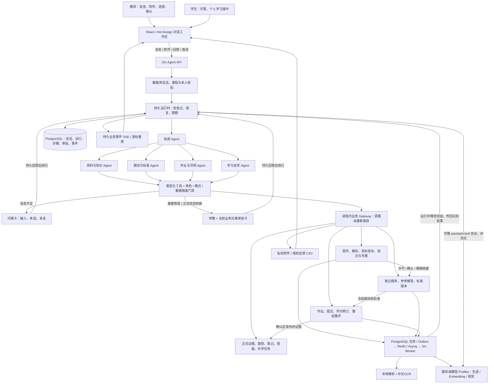

# 对话助理与执行运行时

2026-11-17，本地实现。教师入口 `/teacher/assistant`，学生入口 `/student/assistant`；课程由顶栏选择。助理通过现有业务接口读取和修改真实记录，既有表单仍可使用。部署公网须单独执行发布验收，本轮没有更新公网。

## 业务关系

资料、知识、题目、作业和学生反馈仍是独立业务对象。助理不另建一套资料库、评分表或发布状态；工具结果中的 ID、版本和后台任务结果来自原业务。

## 运行与边界

- 一个协调者按明确目标调用四类专家，每次只委派一层，专家顺序执行。运行时原样附上用户本轮请求、问题卡已验证的补充回答和协调者分派目标，避免只转述摘要丢失规则或重复询问；不传其他专家的完整对话。专家返回摘要及实际工具回执。不是同时运行四个无限循环，也不要求四个不同模型。
- 所有消息、运行、步骤、问题和审批保存在 PostgreSQL。API 每秒扫描可运行检查点，单进程最多两个运行推进，跨进程使用每运行 advisory lock。
- 每对话最多一个活动运行；一次运行最多48个工具操作、32次模型调用、每次模型回复最多8个工具调用。初版16次调用在完整出题／三项确认中触顶，按实测调整；协调者只编排，查询交给专家。超过上限停止，已完成业务保留。
- 创建的后台任务由运行时等待真实终态，再将结果放回专家上下文。入队不代表完成；等待不占执行槽，30分钟后明确报告尚未完成，不取消后台任务。
- 发送使用客户端 UUID 幂等键。成功工具步骤保存回执后不重放。进程在写入与回执之间中断时标为结果未知，禁止自动恢复该写操作，需核对真实对象。
- 模型调用在发出前保存标记；中断不自动重发收费请求。可恢复的模型失败须用户显式点击恢复，仍受共享预算约束。达到运行上限、检查点损坏或未知写入时不显示恢复按钮。
- 取消只停止后续推进，不回滚已完成操作、不撤销已提交后台任务，不把已发出的模型调用当作免费。
- 模型选择与模式只在会话空闲时修改。恢复和回答卡片时重新绑定当前有效登录会话；撤销课程访问或退出登录后，后台工具不能继续使用旧授权。

## 权限门禁

| 模式 | 读取 | 新建低风险草稿／处理任务 | 修改已有内容 | 正式发布、题目／解答／标准确认、成绩确认／发布 |
| --- | --- | --- | --- | --- |
| `read-only` 只读 | 按角色允许 | 禁止 | 禁止 | 禁止 |
| `auto-review` 自动审查 | 按角色允许 | 白名单自动执行 | 逐操作审批 | 始终审批 |
| `full-access` 完整操作 | 按角色允许 | 白名单自动执行 | 白名单自动执行 | 始终审批 |

`auto-review` 是**确定性风险分类与人工升级门禁**，没有声称另一个模型已独立评审操作安全。`full-access` 仅限当前身份、当前课程的已登记业务工具，不获得管理员、数据库 SQL、文件系统或 shell 权限；学生不可选择该模式。

审批卡绑定工具名、精确参数、模式和审批前业务快照。用户批准后再次比对；对象变化时拒绝旧审批，不能悄悄改参数。正式业务处理器继续核对归属、状态、版本、证据、分数加和与事务条件。问题卡支持1—4项文本、单选、多选，回答按字段和选项验证，8小时过期。

Gateway 使用仅 identity 包可构造的进程内上下文凭据携带会话哈希，重新查询有效会话并重走原 Gin 路由。不会保留原始 cookie、伪造浏览器请求头或提供任意 URL；浏览器的写请求继续要求 CSRF。

### 出题与评分独立

`questions` 不能调用学生作答、评分草稿或学情工具。会话一旦使用学习／作答数据工具，持久标记为 `learner_context`，后续关闭该会话的出题／标准工具及委派；出题请新建独立会话。任务读取也按领域检查，不能借评分 job 读取学生答案后交给出题专家。

这项门禁控制系统提供的数据。教师主动在消息中粘贴作答仍属于用户提供的数据，不能宣称语义上能识别并阻止所有人为混用。提示和页面均提醒保持标准起草独立。

### 文件与知识授权

上传先成为会话私有附件，调用导入工具后才成为课程原件；导入不等于学习资料发布。来源说明不得编造。未明确授权提炼时 `allow_derived=false`；设为 true 的导入额外提交审批。原文、提炼许可、知识确认、学生可见、学习用途、评分用途继续分别校验。

支持 PDF、DOCX、PPTX、TXT、Markdown、HTML、CSV；单文件非空且不超过30MiB，每消息最多10份，每会话最多30份上传、累计150MiB。私有文件卷和数据库元数据共同保留；下载检查课程和会话所有者。CSV 只导出有权读取的正式证据，对公式起始字符转义。

## 调用方式

| 链路 | 当前方式 |
| --- | --- |
| 普通业务查询／保存 | 浏览器 HTTP JSON → Gin → 身份和课程／对象检查 → PostgreSQL |
| 资料、知识、题目与评阅等长任务 | HTTP 返回任务 ID → PostgreSQL Outbox → Redis／Asynq → Go Worker → 任务终态 |
| Agent 推理 | 服务端非流式 `/chat/completions`，带 `tools` 和 assistant/tool 消息，保留 tool_call_id |
| 工具执行 | 参数验证 → 身份／领域／模式门禁 → 必要问题或审批 → 进程内 Gateway → 原业务路由 |
| 前端运行更新 | 自有业务 SSE：计划、步骤、问题、状态、结束事件；25秒短连接、心跳、Last-Event-ID 重放；5秒查询兜底 |
| RAG | 已有权限过滤、pgvector＋关键词／RRF；问答、查询向量、生成任务使用服务端模型 Profiles |

SSE 不代表供应商 token 流式输出。没有增加 WebSocket 或第二套远端编排服务。推理内容仅在服务端检查点保留，不作为前端“思考过程”展示。密钥、会话哈希、文件存储路径及 runtime 不返回页面。

当前 HTTP 全量表由源码注册入口生成，见 [API 清单](api-inventory.md) 和 [机器清单](api-inventory.json)。Agent 可用工具以 `GET /agent/status` 和 [catalog.go](../backend/internal/agent/catalog.go) 为准，**HTTP 接口数量不等于已工具化或逐项验收数量**。

## 数据和源码入口

迁移 `00013_agent_harness.sql` 新增 `agent_conversations`、`agent_messages`、`agent_runs`、`agent_steps`、`agent_requests`、`agent_attachments`、`agent_events` 七表。业务数据仍在既有领域表。查询位于 `db/queries/agent.sql`，store 由 sqlc 生成。

| 入口 | 职责 |
| --- | --- |
| [agent/http.go](../backend/internal/agent/http.go) | 对话、附件、消息、回答、恢复、取消及 SSE |
| [agent/service.go](../backend/internal/agent/service.go) | 检查点、调度锁、专家上下文、调用限制和后台等待 |
| [agent/execute.go](../backend/internal/agent/execute.go) | 工具执行、审批、快照、文件导入和反馈导出 |
| [agent/catalog.go](../backend/internal/agent/catalog.go) | 类型化工具与角色／领域边界 |
| [identity/gateway.go](../backend/internal/identity/gateway.go) | 复用原业务路由和有效会话 |
| [rag/agent.go](../backend/internal/rag/agent.go) | 模型工具协议、共享预算与收费调用台账 |
| [live/agent.tsx](../web/src/live/agent.tsx) | Ant Design 对话、上传、问题卡、审批卡和执行回执 |

## 验证入口

- [Go 集成用例](../backend/internal/agent/service_test.go)：真实数据库、真实鉴权与业务写入，模型回复使用明确的协议 fixture；不把它当真实模型效果验收。
- [真实模型闭环](../scripts/check-agent.py)：分阶段创建有标签课程，经真实模型和 Worker 完成导入、资料／知识、出题／标准、作业、学生提交、评分发布与私有 CSV；显式 `--real-model` 才会计费。
- [浏览器验收](../scripts/check-agent-browser.cjs)：真实 Ant Design 交互、上传与键盘发送、刷新恢复卡片、审批、解析、桌面和窄屏、浏览器异常与5xx检查。
- [本轮验收记录](research/agent-acceptance-2026-11-17.md)：实际执行结果、失败、修订和未验收范围。

工具仍是有界适配：超大原文读取会明确截断，完整片段校正仍可使用现有业务页；整卷拆分候选的人工采纳、学生交作业及部分课程管理继续使用既有页面，没有声称全站所有动作均可对话代办。当前没有大规模并发、浏览器外工具、任意 SQL、自动生产发布或独立教学效果验证。
