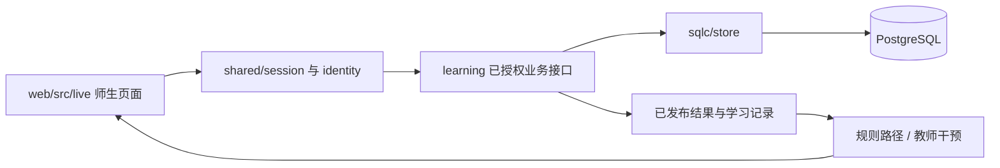
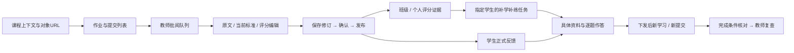
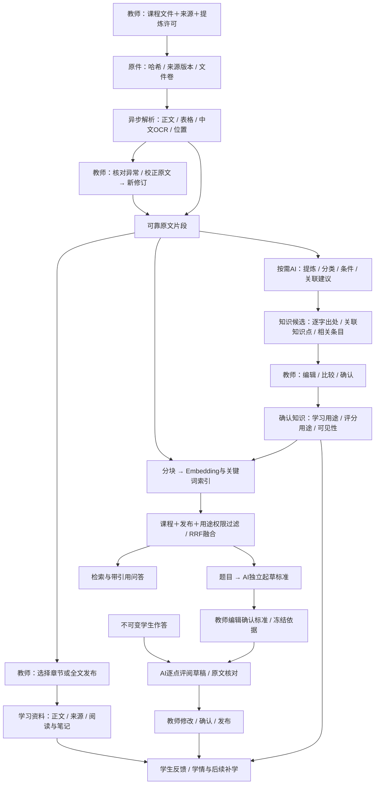
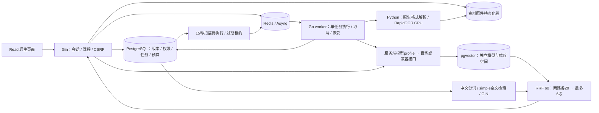

# 架构与实现边界

本地[自动演示](auto-demo.md)在网站外使用 Tkinter 控制 Node／Playwright，页面沿用既有 API 与后台任务，数据库只读核对。知识提炼模型选择原文片段ID，由服务端附上原文，避免模型翻译或改写引用。

2026-11-17，本地加入[对话助理与执行运行时](agent-harness.md)。`internal/agent`通过进程内`identity.Gateway`重走既有业务路由；协调 Agent 与四类专家共用服务端模型 Profiles、预算和任务。对话、运行、步骤、问题／审批、附件和事件使用00013新增表；资料、题库、作业、评分与学习数据继续由原领域负责。师生入口均为`assistant`，原检索问答保留独立页面。现有业务全景不改写为四个 Agent 的并列关系；新增[Agent 架构图](diagrams/agent/architecture.svg)展开编排、门禁、业务交接和持久运行关系。实际验收见[记录](research/agent-acceptance-2026-11-17.md)。

2026-10-28 · 本地整个平台完善。当前实现以本页和 [接口契约](contracts.md) 为准；旧立项范围与历史复刻证据保留在 references 和 research。

2026-11-11本地已接入独立题库、AI出题／分析／标准草稿、逐点依据和作业固定版本；[题库方案](research/question-bank-rubric-plan.md)保留设计与实施范围对照。公网仍为旧版，以下历史实现未迁移或重写既有成绩。

题库HTTP在`learning/question_bank.go`，生成与规则验证在`rag/question_bank.go`，页面在`live/question-bank.tsx`。`question_bank`保存稳定身份和停用状态，`bank_question_versions`保存不可变内容版本及题目/参考解答的独立确认状态；`rubric_versions`以互斥归属兼容旧作业题与新题库版本。`questions`仍是作业实例，固定题目版本和标准ID。题库父行锁串行化新增版本、确认与停用，作业事务再次核对选用组合及发布条件。

来源／知识的现有索引通过课程、状态、用途和来源许可核对后形成所选依据快照，最多8条、8000字；客户端不能传正文冒充依据。AI任务只接收教师要求、题干、参考解答和选中依据，输出先作草稿，题目、参考解答、标准分别确认。评分只按已绑定标准及快照，不临时检索新增扣分点；新标准不影响旧任务。学生仅从发布作业取得题干和选项，不能读题库、参考解答或内部标准。代码题按文本评阅，不执行代码。

2026-11-12的[全景架构与三个模块流程图](diagrams/README.md)按本地实现逐项标注状态，保留原全景19个业务节点、42条关系和模块边界，并展开API、worker、双数据库、文件卷及同步／异步模型调用关系。学习资料、知识库、题目与评分标准分别提供PNG／SVG；[交互入口](diagrams/current/index.html)支持切换、缩放和关系高亮。已实现范围不代表本轮更新公网。

## 主流程与调用链

2026-11-12，三模块下一轮的已确认业务范围与拟定验收见[完善与验收方案](research/three-module-acceptance-plan.md)。该增量已落地；实际验证及未覆盖边界见[本轮验收](research/three-module-acceptance-2026-11-12.md)，方案中的门槛不能替代实测。

教师发布课程、审核资料、发布作业/测验 → 学生阅读/笔记/作答 → 原文提交 → 客观题规则结果或教师评分草稿 → 教师确认并发布 → 学生反馈与知识点表现 → 规则学习路径或教师补学补练任务 → 新学习/新提交 → 教师复查。

`App.tsx` 装配角色路由、顶栏与分组侧栏；`app/navigation.ts` 管理导航分组，`app/Login.tsx` 提供活动登录页，`app/theme.ts` 与 `styles.css` 管理设计变量。主页面去掉重复分组与标题，统一使用 Ant Design 菜单、卡片、表单、树、表格、页签、抽屉和确认框；`shared/Field.tsx`、`FileUpload.tsx`、`confirm.ts`复用带标签控件与确认交互，`shared/ui.tsx`提供加载/空/错误状态。正文由`live/content-render.tsx`渲染Markdown/GFM与公式，原文和评分引用不改写。重复概览/课程地址通过 `live/routes.tsx` 重定向到角色规范入口，具体映射和截图见 [设计指南](../design.md)。

`LearningProvider` 在角色工作台外层提供课程上下文，供顶栏唯一选择器和页面共用。教师课程管理在 `live/course-management.tsx`，目录在 `live/curriculum.tsx`，原件在 `live/knowledge.tsx` 的资料页，发布内容复用 `live/course.tsx` 的资料阅读／编辑组件；不再以同一个课程页承担全部入口。题库 `live/question-bank.tsx` 与原件工作区共用 `material-assist.tsx` 的整卷拆题组件；原件内可直接打开抽屉，旧题库入口保留。知识库、检索、内容影响和作业继续承担全局管理，对象内嵌工作区承接当前任务。前端归属不改变后端权限、对象版本与发布规则。

`LearningProvider` 读取本人课程，URL 的 `course` 优先于浏览器记忆；对象深链、侧栏和跨模块返回保留课程。不存在或无权限的课程明确报错。Query 缓存来自 API，写入后只取消并刷新当前课程的关联查询。`editing.tsx` 将未保存编辑按账号和对象暂存在 sessionStorage，供失败或离页后恢复；正式草稿、提交、评分和状态仍以服务端为准。身份切换清空查询缓存，401 回到会话检查。页面异常边界允许重新加载。

## 模块位置

| 位置 | 当前职责 |
| --- | --- |
| backend/internal/identity | bcrypt、8小时数据库会话、角色/课程/本人权限、CSRF与登录频率限制 |
| backend/internal/learning | 课程/目录/资料/成员，作业/提交/评分，学情/路径/干预，互动和账号、教研/行业记录 |
| backend/internal/store；backend/db | sqlc类型查询，Goose迁移00001—00020；原文和修订的唯一事实源 |
| backend/internal/agent | 对话与附件、单层委派、工具策略、问题审批、检查点、取消恢复及业务SSE；不复制业务状态机 |
| web/src/live | course/curriculum/graph/notes、assessment、insight/path、communication、account、assistant |
| web/src/shared | API、会话与错误恢复；原课程示例保留但不作为活动主入口 |
| backend/internal/course | 兼容公开的已发布课程摘要；不包含学生数据 |
| backend/internal/assessment、grading、insight；web/src/features | 原责任入口与文档，实际共享实现定位到 learning/live；没有重复业务服务 |
| web/src/replica | 历史26页复刻源码、旧登录页和课程目录模板；原演示与全量旧样式不再挂到活动路由 |

本轮为跨模块完整实现，集中在 learning 以避免同时造四套身份/状态处理；后续按真实协作需求渐进拆分，不凭目录名称宣称模块已实现。原纵向负责人见 [team](team.md)，不代记贡献。

## 运行与数据

Compose 运行 Nginx Web、Gin API、PostgreSQL/pgvector、Redis、worker；migrate 一次性执行，API就绪后Web启动。仅Web绑定 `127.0.0.1:18080`，数据库/API/Redis无宿主端口。Nginx通过Docker DNS更新API地址，保留Host端口供同源校验；API有读写/空闲超时。普通教学写入仍同步事务提交；启用本地RAG配置后，数据库processing_jobs持久记录配合Asynq执行耗时任务。

| 对象 | 实际状态与版本 |
| --- | --- |
| Course / Resource | draft→published；资源审核发布，修订新增 v+1 并链到旧ID，旧资料仍可查 |
| Curriculum | chapter/section/point＋parent_id，知识点依赖有向无环；空课程可原子导入参考目录 |
| Assignment / Question | draft可编辑并递增版本；published→closed；发布后题目/标准冻结 |
| AnswerDraft / Submission | 私人草稿可更新；每题正式提交新attempt，原文/哈希/作业版本不可覆盖，截止或关闭后拒绝新提交 |
| RubricVersion | 单题标准draft→confirmed；criteria为JSONB评分点列表，确认版本不原地修改；旧评分继续绑定原标准 |
| GradingRevision | draft→confirmed→released；每次改分新增修订，仅最新可确认/发布；客观规则直接产生released |
| Evidence | 每学生/题目选择最新有发布结果的attempt，再取其最新released修订；新未评分attempt不会抹去旧正式结果 |
| StudyPath | 按无证据或表现低于60%的知识点及其前置依赖生成，保存顺序/理由/规则版本，不把规则称为模型预测 |
| Intervention | draft→assigned→submitted→reviewed；关联资源须有下发后completed，关联作业须逐题有下发后新提交 |

提交与评分使用 request_id 去重；并发提交/评分通过行锁串行分配版本。其他状态转换使用预期旧状态条件。学生看不到评分草稿、内部标准答案和他人原文/笔记/路径。所有业务对象重新核对课程归属；角色路由不是权限边界。

CO-01/AS-01已按[贡献映射](../references/contributions/README.md)适配到learning/live。资料来源同时支持source_note说明和source_url链接，新增资料至少具备一项；locator必填。00008保留历史原文并增加学习对象版本，正式提交与submission.submitted事件同事务落库，已有提交回填对应历史事件；重试不多写事件。/activity用于本人或教师授权学生时间线；/assignments/:id/roster按选课名单返回已交/部分/未交，与评分独立。

公网运行使用[独立生产Compose](../deploy/README.md)，OpenResty终止HTTPS→回环Web→API，数据库与Redis只在私网。PUBLIC_ORIGIN绑定公网HTTPS来源，Secure cookie；本地Compose仍沿用本地HTTP配置。AI保持关闭。

## 评据与未完成范围

教师评分同屏查看冻结题目标准、学生原文、资料版本/段落/来源；已发布结果保留submission/revision/resource ID。资料由教师录入并审核，平台不证明内容的学术正确性。知识点表现为得分/满分汇总并展示证据，不等于真实能力；无记录显示证据不足。

2026-11-11用户已授权本地RAG和真实模型联调，具体边界见下节；默认配置和公网仍关闭模型。原文引用按字符串定位并高亮首次匹配，保留中文、emoji和换行；尚无带位置编号的多处同文消歧。知识点图谱为依赖卡片，教研和行业功能为人工记录CRUD，没有招聘采集/自动能力推断；视频资料支持上传（魔数与单课2GiB配额校验）、Range流式播放及按时间窗转写与切分（≤45分钟/≤120片段，默认构建不含重型离线权重，可按需开启`INSTALL_LOCAL_ASR=true`或挂载模型卷）。班级表现与证据下钻已经可用，E4错因分类与独立教学效果评测仍是后续研究任务。

公网域名采用OpenResty/Let's Encrypt TLS，邮件/找回密码和多机构管理仍未配置，未做大规模并发/安全审计。当前按课堂试用验收，不声称与参考平台所有高级菜单或视觉完全等价。备份与隔离恢复见 [development](development.md)，历史三图保留在 references/diagrams。

## 2026-11-05 工作台交互（仅本地）

- `live/grading.tsx`：教师队列／原文／评分三栏，当前评分默认可见；修改复制当前版本，历史进抽屉。队列按学生与状态筛选、服务端分页、跨页上一份/下一份。切换有未保存编辑时提示，学生只读已发布结果。
- `live/assessment.tsx`、`notes.tsx`：逐题自动保存（900ms）和笔记自动保存（1200ms），保留保存状态、失败重试、当前会话恢复；旧保存响应不能将后续编辑标成已保存。正式提交单独确认并显示attempt回执，历史折叠。
- `live/course.tsx`：教师课程分为内容与目录、作业与标准、学生与进度、课程设置；目录树筛选，资料编辑/修订使用抽屉。资料深链定位具体版本。
- `live/insight.tsx`、`interventions.tsx`：班级/个人/证据分区；从具体反馈携带学生、作答与知识点进入任务创建。历史任务仍兼容说明中的关联作答编号；2026-11-19起新任务使用00016正式来源字段，由后端核对学生、作答及诊断证据，不再仅依赖说明文本。完成条件及新证据由后端查询，浏览器禁用按钮只是提示，最终转换仍由事务验证。
- `learning/workspace.go`、`db/queries/workspace.sql`：作业个人进度、提交队列的分页查询，以及干预下发后的学习/提交证据。沿既有课程和对象授权，学生无法查看他人任务、未下发任务或教师队列。无新迁移，未启用Redis评分任务或模型。

本次先完成本地Docker验收；随后按用户明确要求发布到公网hajistudy.online，release为hajimark-workspace-f40872a-20261105。部署与数据保全证据见验证记录。

## 资料与知识库

学习资料保存完整学习内容；知识库保存带条件、用途与出处的精炼条目。共享来源和检索能力，不共用发布状态。旧文本/外链资料继续有效；链接只保存地址，不等于已抓取网页全文。

`learning/materials.go`复用课程/角色/CSRF，`internal/rag`负责模型、检索与任务，`tools/parser/parse.py`仅做文件解析，`live/knowledge.tsx`提供资料核对、知识审核、检索、模型草稿界面。标准起草只接收题目和评分用途依据；评阅接收冻结题目、作答哈希、确认标准和当时依据，禁止检索追加扣分项。AI输出不自动改写教师编辑，不直接生成正式成绩。

向量从精确余弦检索起步，尚无HNSW或reranker。分块目标约800字、上限1200 Unicode字符；单次上下文最多4000字符。空间指纹包括profile、实际地址、模型、维度与分块版本；完整建索引成功才切换活动空间。供应商别名不当作不可变模型版本。兼容协议适配验证条数、index重排、维度、有限值和非零向量；专有协议需另写适配器。

原件保存SHA256；解析修订和资料发布绑定不可变片段。扫描/OCR与图表提示标为待核，核对前不能发布、提炼或索引。定位为PDF页、DOCX内容块/表格、PPTX幻灯片/对象、文本段落及音视频起止毫秒时间码（`time_start_ms`/`time_end_ms`）；新增图像区域裁剪与lineage、公开单页／直链快照、原生公式／图表与按需视觉核对、视频Range流式播放及时间窗分段转写；复杂公式／图表未全面验收，手写和Office版式还原不纳入。部分发布不允许整件下载（视频切片发布允许已发布课程内流式播放）。已公开的旧原文片段仍可供历史引用；归档来源或撤回提炼许可会立即限制派生知识未来检索，历史评分不覆盖。

模型任务由数据库保存输入/输出和状态，队列可恢复补投；失败显式创建新任务重试，不把超时视为免费。调用前全局事务预留50元预算，成功按配置保守费率与Token结算，未知调用按预留额保守计费；超过15分钟仍reserved的孤儿调用转unknown并结算一次。供应商真实账单、其他应用调用及价格变化不由本地预算控制。模型密钥只由API/worker环境变量读取，浏览器只得到脱敏profile。

2026-11-11自检补强：原文修订、知识状态变更与索引请求同事务保存；解析失败保留旧可用修订。解析/提炼/索引提交时锁定任务核对running及attempt，取消后不写最终结果或激活空间。Asynq以15秒Unique锁限制重复投递，数据库claim负责执行去重，恢复扫描也为15秒；不以长时间保留的固定TaskID阻断补投。该机制不是供应商调用的严格exactly-once保证。

知识确认携edit_version，拒绝确认未审核的新编辑；完整原件发布拒绝重复片段ID并锁定来源校验全体片段。AI草稿页按对象从持久任务恢复，教师可查看标准和评分所用的冻结依据；问答正文R标记与逐字引用列表交叉核对。引用存在和机械校验通过仍不证明语义正确。

## 2026-11-12 专题、图像证据、题卷与重评

保持单体API与持久worker。`learning/topics.go`装配本轮路由；`source_url.go`保存公开地址快照，抓取限制和DNS/IP固定在`rag/web.go`；Python解析保留页／对象定位、原生公式和图表数据。`material_assets`关联原片段和图像，`asset_revisions`分开保存模型候选与教师确认。教师确认追加整份原文修订，发布引用固定片段与图像修订；未核视觉内容不进入正式用途。原图、转写和原件分别受权限检查。

`knowledge_topics/topic_links/content_tags`独立于章节目录及Embedding空间；归类不复制原件或向量、不扩大权限。`rag/workflows.go`处理目录建议、相关知识比较和题卷拆分，校验输入引用、审核状态及全片段覆盖；`knowledge_decisions.go`事务保存五种教师决定，多来源合并采用用途／可见权限交集。`content_decisions`保留原输入、结果与处理理由，过期版本409，不静默覆盖。

`paper.go`原子采纳整卷草稿，保留原卷解答与教师补录区别；整页预览不得当作学生题图，须裁剪并核对。`question_bank.go`提供服务端关键词、题型、知识点、专题和状态分页以及任务／采纳反查。题库标准不读取待评作答，作业继续固定具体题目与规则版本。

`workflow_jobs.go`查询实际引用影响，普通新版不替换旧引用；保存新版处理决定时留存前版消费者快照，与页面预览一致。`regrade.go`冻结单个关闭作业的一道题、每人最新正式提交、哈希和既有评分基线；新规则统一，题干／题型／选项／满分须不变。批次行锁、作业锁、提交锁与数据库事务防止部分发布；取消保留原结果，重复发布幂等，输入／基线冲突整体回滚。历史作业绑定不改；正式结果消费者继续按当前已发布修订去重。

新增前端按职责分为`material-assets/material-assist/content-topics/knowledge-review/content-impact/regrades`，复用`context`查询失效和`editing`恢复；`content-render`用KaTeX显示核对公式，不执行HTML。后续智能分析与工作台的当前范围见下文00015；不从真实学生作答自动沉淀知识。

中断恢复：超过15分钟的生成类running任务转failed，须显式重试，避免后台自动重发付费生成；parse/index继续幂等恢复。调用结算返回实际更新行，恢复和后到结算不能重复扣账。该机制仍不提供供应商调用的严格exactly-once保证。

## 2026-11-17 部分实现项收口

`learning/submission_import.go`与`live/submission-import.tsx`接通单题CSV导入：预览名单/重复行/次数→确认哈希→作业行锁下整批新增不可变提交、批次来源与教师操作事件。仅已发布未截止作业；失败整批回滚，相同请求重放回原回执。`submission.imported`不冒充学生动作，不满足干预下发后的新提交条件。

`assist_turns`保存本人课程问答及当时引用快照，`retrieval-history.tsx`支持分页和深链；请求去重，失败/待核对不后台重发。`agent/http.go`对消息/执行记录进行游标分页，带出所属步骤、审批和附件，活跃及最近更新运行保留可操作；浏览器加载早期记录保留滚动位置。

`path.tsx`从授权知识查询接入各知识点的精炼内容。`learning-gaps.tsx`用现有正式去重证据按题/标准/评分点统计并下钻，其他标准及无正式结果单列，不推断错因。新增00014；更多规则与验收入口见[收口记录](research/partial-completion-2026-11-17.md)。

## 方案B：智能分析与业务工作台（00015）

`learning/intelligence.go`冻结规则候选或同题同标准的正式失分作答，报告与处理任务同事务落库；`rag/intelligence.go`在既有worker中生成并校验结果。规则推荐限制在已授权候选和先修分组内，选择偏好持久化但不推断掌握。共性问题保留逐字引用、未归类记录、实际有效分母，教师维护标签和确认；确认与正式结果发布使用同一作业锁，证据变化拒绝旧诊断。AI解释不是学生整体能力或心理原因结论。

教师自编示例是`knowledge_entries.origin=teacher_example`的独立来源，不能变成评分依据，也不从真实学生作答自动转换。来源知识继续要求逐字原文证据、提炼许可和用途过滤。

`live/agent-editor.tsx`用Drawer嵌入七类原有业务编辑器；草稿恢复仍由`editing.tsx`按账号/对象隔离，保存继续走原业务API。Agent返回请求从服务端重读实际对象与关联记录，原运行据回执续行，不接受客户端声称保存；正式确认/发布仍按原审批门禁。`rag/agent_stream.go`接入兼容SSE并累积完整工具协议，`stream_text/stream_turn`保存协调者公开文本，前端业务SSE可重放。中断不执行未完成工具、不自动重发收费请求；可按profile关闭流式。新增`intelligence_reports/diagnosis_labels/recommendation_choices`，没有增加独立编排服务或第二套业务数据库。自动生成并发布新补练仍未纳入。

## 2026-11-19 对象工作区与前后端协同（00016）

导航采用教师六主域、学生五主域，主域内二级入口保留原路由。`knowledge.tsx`的原件工作区在原文、知识候选、处理记录、学习发布间承接同一对象；逐文件上传保留部分成功回执，上传中锁定导入抽屉。任务接口按对象、组合种类和size/offset读取；打开任务与候选面板重新读取服务端，避免快速任务完成后仍沿用空缓存。手工学习资料发布和持久索引排队在同一事务中完成。

`live/context-agent.tsx`在八类业务对象内复用现有助理，不另建模型或工具运行时。`agent/context.go`经Gateway重新读取授权对象，只持久附加核验引用；作答、诊断、干预在执行前标记学生上下文。会话关联与输入草稿按账号／课程／对象隔离；结构化对象卡来自成功业务HTTP回执，不能把模型叙述或排队当成业务完成。

`learning/scoped_search.go`的resource_id范围只使用已授权且已发布的学习文本，不展开完整私有原件；文内关键词检索不要求模型与向量就绪。问答仍走原有引用校验与本人历史。前端独立展示模型可用性、实际片段／向量计数及索引任务，计数不是完整性保证。`live/location-state.ts`维护可分享的过滤、页码与选择，编辑草稿继续由`editing.tsx`暂存。

作业选题器嵌入原题目／解答／标准核对组件，保留作业草稿和固定版本规则。内容影响新增assignment_question精确引用，在原页打开重评并保留作业、题目和变更原因；切换标准会使预览失效，冻结与整组发布保持独立。诊断选项显示所属作业以区分同题干，确认且未过期报告才可按作答原位建单学生任务；迁移00016保存source_submission_id、diagnosis_report_id及diagnosis_label_id，后端锁定作业核验最新正式证据。正式结果改变后旧诊断不可继续安排任务。

F01—F16实施、真实浏览器与私有schema回归范围见[协同修正记录](research/frontend-integration-2026-11-19.md)。构造模型只验证业务链路，不作为真实AI效果或生产部署证明。

## 2026-11-19 本地架构加固（00019）

- **数据库与索引（00019）**：为 1024 与 1536 维 `embedding` 增加 pgvector HNSW 部分索引、高频外键／状态局部索引、`interactions.evidence_refs` 与更严格的状态检查约束；知识与资源修订链维持不可变审计。
- **后端与运行时**：`identity` 网关严格核对路径／方法及有界限流淘汰；`rag` 结算转为事务原子扣费、`4xx` 不扣费、Asynq 按恢复周期去重并关闭旧向量索引并发竞争；`agent` 事件持久化加行锁并使用线性 UTF-8 字节增量 SSE；`learning` 补齐课程存档／退课／目录点与专题 CRUD、流式上传限额（500 MiB）与 `REPEATABLE READ` + 最小堆 Kahn 学习路径排序。
- **前端与安全头**：移除 Catch-all `antd-vendor` 分块实现路由级按需加载；新增 `/theme-init.js` 同源首屏主题预初始化以兼容严格 `script-src 'self'` CSP 策略，并对齐深色主题对比度及响应式批阅布局；`deploy/compose.production.yaml` 与 Nginx 强化只读安全头及请求追踪 `X-Request-Id`。
