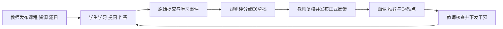
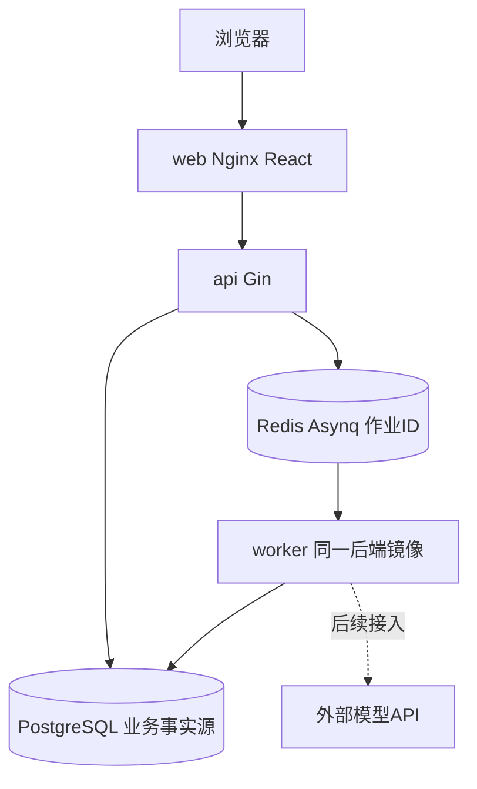

# 架构与实现边界

2026-10-28 · Sprint 0＋前端复刻 · 后端仍为工程骨架；前端实现边界和页面映射见 [复刻记录](research/frontend-rebuild.md)，旧立项材料保存在 references。

## 产品主线

一门课程的一个章节先跑通：教师发布知识点资料与作业 → 学生学习、提问、提交 → 客观题规则判分／主观题教师评分 → 正式反馈 → 有证据的表现画像与规则路径 → 教师查看、下发补学补练 → 学生执行并产生新证据。基础流程完整后深化 E6 有据主观题评阅和 E4 班级共性难点。

## 四个业务包

| 模块 | 前后端目录 | 提供给下一环 | 主责 |
| --- | --- | --- | --- |
| 课程与学习 course | web/src/features/course；backend/internal/course | 已发布课程/知识点/资源片段、学习记录与提问 | 徐铂尧 |
| 测验作业 assessment | web/src/features/assessment；backend/internal/assessment | 题目、原始提交版本、提交事件、客观题结果 | 张俊超 |
| 有据评阅 grading | web/src/features/grading；backend/internal/grading | rubric 版本、AI 原稿、检查与教师确认修订 | 李然 |
| 学情与干预 insight | web/src/features/insight；backend/internal/insight | 证据画像、推荐路径、班级下钻、干预和复查 | 葛炫毅 |

各包均包含学生/教师所需界面、HTTP、业务逻辑和查询；不按前端/后端分人。identity、platform、应用装配和部署为李然维护的共享基础，不算替代纵向模块。课程答疑先做教师维护资料片段检索＋无依据明确提示，模型解释在后续有授权时添加。

## 运行拓扑

当前实装：API 存活/就绪检查、数据库迁移与课程查询示例、课程已发布摘要只读接口；worker 运行 Asynq 服务但尚无业务任务处理器。web/src/replica 提供 26 个参考平台页面路由与浏览器本地交互，按学生端、教师流程、教师分析拆包；原只读课程 API 示例保留在 /development/catalog。身份切换、课程编辑、作业提交、评分、干预和互动目前仅操作 localStorage，尚未实现相应服务端业务。API 的课程示例仅返回已发布标题/知识点计数，无学生数据或教师专用答案。其他业务端点列在契约中，尚未注册，不能冒充已实现。

仅 web 绑定本机 127.0.0.1:18080。postgres/redis/api 不发布宿主端口。Compose 另含一次性 migrate 服务，完成后 api/worker 启动。数据库持久化卷保留；初始示例通过显式 seed profile 插入，不在每次重启时重建。

## 状态与数据归属

- Course/Resource：draft → published；教师草稿和发布快照分开，旧发布版本仍可追溯。正式学习内容按课程发布版本查询。
- Assignment：draft → published → closed；Submission 保存 immutable attempt，草稿编辑与正式提交分开。
- Rubric：draft → confirmed（不可原地覆盖）；评分绑定题目、标准、资料片段、原始提交四类版本。
- Job：queued/running/succeeded/failed，仅代表执行；GradingRevision：needs_review/confirmed/released，代表人工决策。成功调用不是确认成绩。
- 评分改动产生新修订；旧确认历史不删除。发布成绩产生 grade.released 事件；画像与 E4 排除被替代修订，按 submission_id 去重。
- Intervention：draft → assigned → submitted → reviewed；学生点击完成不等于教师复查通过。

目前仅迁移身份/课程底座表。后续表与接口在 docs/contracts.md 列为设计契约，随首次纵切面添加迁移；避免一次堆满空表。

## 一致性与权限边界

业务变更与事件/outbox 同 PostgreSQL 事务提交，队列消息只带 job_id；worker 幂等领取，检查任务状态和输入快照，不能覆盖教师确认。Redis 断线时保存 pending 派发记录，不丢失业务提交。此策略是后续任务，不是当前已验证能力。

服务端使用会话身份与 enrollment 验证归属，不信任客户端传入 student_id/teacher_id。教师只能访问授权课程，学生只能读本人作答、反馈与任务；参考答案、rubric 内部反例和未发布反馈不可通过学生接口读取。不要用 URL 角色或前端切换当登录。

## 先不引入

微服务、向量库、复杂 Agent、模型训练、知识追踪神经网络、多模态/OCR、外部平台运行时依赖。先人工绑定审核片段和透明规则，再按实际问题增加能力。三个历史业务/模块/部署图只说明旧 E6 子系统，保留见 references/diagrams，不删除。
