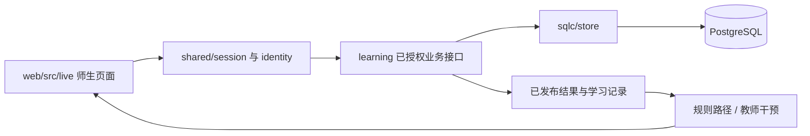
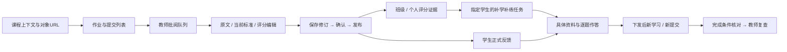

# 架构与实现边界

2026-10-28 · 本地整个平台完善。当前实现以本页和 [接口契约](contracts.md) 为准；旧立项范围与历史复刻证据保留在 references 和 research。

## 主流程与调用链

教师发布课程、审核资料、发布作业/测验 → 学生阅读/笔记/作答 → 原文提交 → 客观题规则结果或教师评分草稿 → 教师确认并发布 → 学生反馈与知识点表现 → 规则学习路径或教师补学补练任务 → 新学习/新提交 → 教师复查。

`App.tsx` 装配角色路由、顶栏与分组侧栏；`app/navigation.ts` 管理导航分组，`app/Login.tsx` 提供活动登录页，`app/theme.ts` 与 `styles.css` 管理设计变量，`shared/ui.tsx` 提供页头与加载/空/错误状态组件。重复概览/课程地址通过 `live/routes.tsx` 重定向到角色规范入口，具体映射和截图见 [设计指南](../design.md)。

`LearningProvider` 读取本人课程，URL 的 `course` 优先于浏览器记忆；对象深链、侧栏和跨模块返回保留课程。不存在或无权限的课程明确报错。Query 缓存来自 API，写入后只取消并刷新当前课程的关联查询。`editing.tsx` 将未保存编辑按账号和对象暂存在 sessionStorage，供失败或离页后恢复；正式草稿、提交、评分和状态仍以服务端为准。身份切换清空查询缓存，401 回到会话检查。页面异常边界允许重新加载。

## 模块位置

| 位置 | 当前职责 |
| --- | --- |
| backend/internal/identity | bcrypt、8小时数据库会话、角色/课程/本人权限、CSRF与登录频率限制 |
| backend/internal/learning | 课程/目录/资料/成员，作业/提交/评分，学情/路径/干预，互动和账号、教研/行业记录 |
| backend/internal/store；backend/db | sqlc类型查询，Goose迁移00001—00009；原文和修订的唯一事实源 |
| web/src/live | course/curriculum/graph/notes、assessment、insight/path、communication、account、assistant |
| web/src/shared | API、会话与错误恢复；原课程示例保留但不作为活动主入口 |
| backend/internal/course | 兼容公开的已发布课程摘要；不包含学生数据 |
| backend/internal/assessment、grading、insight；web/src/features | 原责任入口与文档，实际共享实现定位到 learning/live；没有重复业务服务 |
| web/src/replica | 历史26页复刻源码、旧登录页和课程目录模板；原演示与全量旧样式不再挂到活动路由 |

本轮为跨模块完整实现，集中在 learning 以避免同时造四套身份/状态处理；后续按真实协作需求渐进拆分，不凭目录名称宣称模块已实现。原纵向负责人见 [team](team.md)，不代记贡献。

## 运行与数据

Compose 运行 Nginx Web、Gin API、PostgreSQL、Redis、worker；migrate 一次性执行，API就绪后Web启动。仅Web绑定 `127.0.0.1:18080`，数据库/API/Redis无宿主端口。Nginx通过Docker DNS更新API地址，保留Host端口供同源校验；API有读写/空闲超时。Redis/Asynq和worker仍是保留基础，目前学习业务同步写PostgreSQL，没有已接入的评分队列或outbox。

| 对象 | 实际状态与版本 |
| --- | --- |
| Course / Resource | draft→published；资源审核发布，修订新增 v+1 并链到旧ID，旧资料仍可查 |
| Curriculum | chapter/section/point＋parent_id，知识点依赖有向无环；空课程可原子导入参考目录 |
| Assignment / Question | draft可编辑并递增版本；published→closed；发布后题目/标准冻结 |
| AnswerDraft / Submission | 私人草稿可更新；每题正式提交新attempt，原文/哈希/作业版本不可覆盖，截止或关闭后拒绝新提交 |
| RubricVersion | 单题标准draft→confirmed；criteria为JSONB评分点列表，确认版本不原地修改；旧评分继续绑定原标准 |
| GradingRevision | draft→confirmed→released；每次改分新增修订，仅最新可确认/发布；客观规则直接产生released |
| Evidence | 每学生/题目选择最新有发布结果的attempt，再取其最新released修订；新未评分attempt不会抹去旧正式结果 |
| StudyPath | 按无证据或表现低于60%的知识点及其前置依赖生成，保存顺序/理由/规则版本，不把规则称为模型预测 |
| Intervention | draft→assigned→submitted→reviewed；关联资源须有下发后completed，关联作业须逐题有下发后新提交 |

提交与评分使用 request_id 去重；并发提交/评分通过行锁串行分配版本。其他状态转换使用预期旧状态条件。学生看不到评分草稿、内部标准答案和他人原文/笔记/路径。所有业务对象重新核对课程归属；角色路由不是权限边界。

CO-01/AS-01已按[贡献映射](../references/contributions/README.md)适配到learning/live。资料来源同时支持source_note说明和source_url链接，新增资料至少具备一项；locator必填。00008保留历史原文并增加学习对象版本，正式提交与submission.submitted事件同事务落库，已有提交回填对应历史事件；重试不多写事件。/activity用于本人或教师授权学生时间线；/assignments/:id/roster按选课名单返回已交/部分/未交，与评分独立。

公网运行使用[独立生产Compose](../deploy/README.md)，OpenResty终止HTTPS→回环Web→API，数据库与Redis只在私网。PUBLIC_ORIGIN绑定公网HTTPS来源，Secure cookie；本地Compose仍沿用本地HTTP配置。AI保持关闭。

## 评据与未完成范围

教师评分同屏查看冻结题目标准、学生原文、资料版本/段落/来源；已发布结果保留submission/revision/resource ID。资料由教师录入并审核，平台不证明内容的学术正确性。知识点表现为得分/满分汇总并展示证据，不等于真实能力；无记录显示证据不足。

本轮AI按用户要求关闭，课程助手明确未配置，人工答疑/评分不受影响。兼容模型适配入口存在但未实测、未授权启用；已有人工作用的独立rubric版本、逐点评分和可选原文引用的字符串定位检查；没有AI评阅或E6效果实验。当前原文引用按字符串定位并高亮首次匹配，保留中文、emoji和换行；尚无带位置编号的多处同文消歧。知识点图谱为依赖卡片，教研和行业功能为人工记录CRUD，没有招聘采集/自动能力推断；资料目前支持文本和外部链接，没有文件上传/OCR/视频处理。班级表现与证据下钻已经可用，E4错因分类与独立研究评测仍是后续研究任务。

公网域名采用OpenResty/Let's Encrypt TLS，邮件/找回密码和多机构管理仍未配置，未做大规模并发/安全审计。当前按课堂试用验收，不声称与参考平台所有高级菜单或视觉完全等价。备份与隔离恢复见 [development](development.md)，历史三图保留在 references/diagrams。

## 2026-11-05 工作台交互（仅本地）

- `live/grading.tsx`：教师队列／原文／评分三栏，当前评分默认可见；修改复制当前版本，历史进抽屉。队列按学生与状态筛选、服务端分页、跨页上一份/下一份。切换有未保存编辑时提示，学生只读已发布结果。
- `live/assessment.tsx`、`notes.tsx`：逐题自动保存（900ms）和笔记自动保存（1200ms），保留保存状态、失败重试、当前会话恢复；旧保存响应不能将后续编辑标成已保存。正式提交单独确认并显示attempt回执，历史折叠。
- `live/course.tsx`：教师课程分为内容与目录、作业与标准、学生与进度、课程设置；目录树筛选，资料编辑/修订使用抽屉。资料深链定位具体版本。
- `live/insight.tsx`、`interventions.tsx`：班级/个人/证据分区；从具体反馈携带学生、作答与知识点进入任务创建。任务说明保留可读的关联作答编号，界面将其呈现为原文链接；它是上下文线索，不参与权限或评分计算。完成条件及新证据由后端查询，浏览器禁用按钮只是提示，最终转换仍由事务验证。
- `learning/workspace.go`、`db/queries/workspace.sql`：作业个人进度、提交队列的分页查询，以及干预下发后的学习/提交证据。沿既有课程和对象授权，学生无法查看他人任务、未下发任务或教师队列。无新迁移，未启用Redis评分任务或模型。

本次只更新本地Docker；公网版本不因这些文档或本地验收自动改变。
