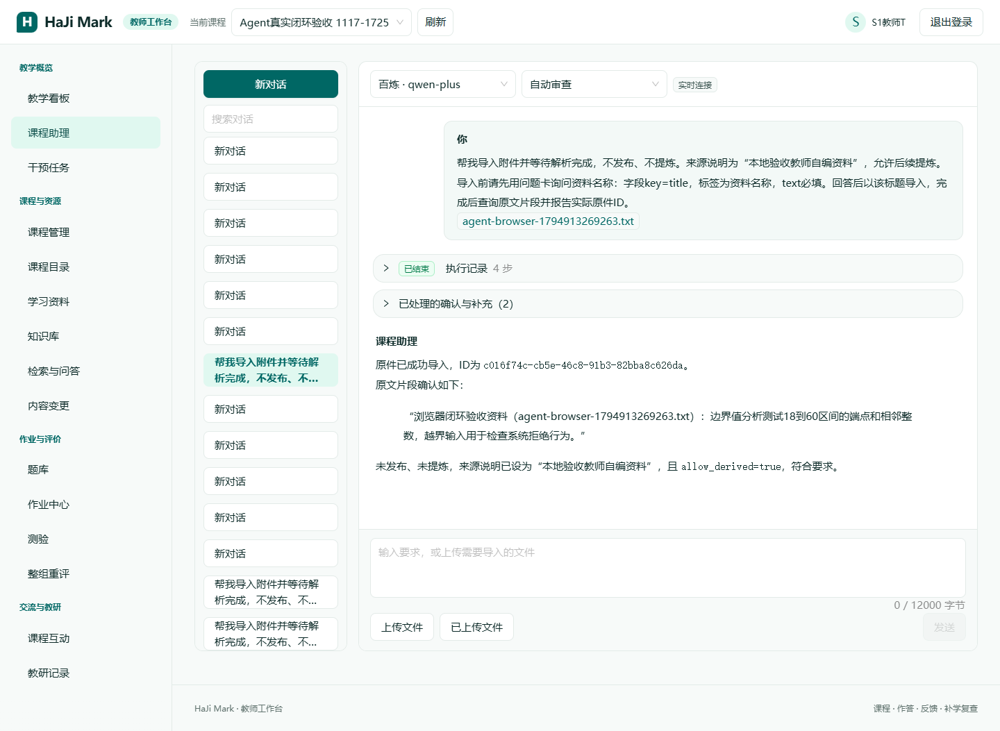
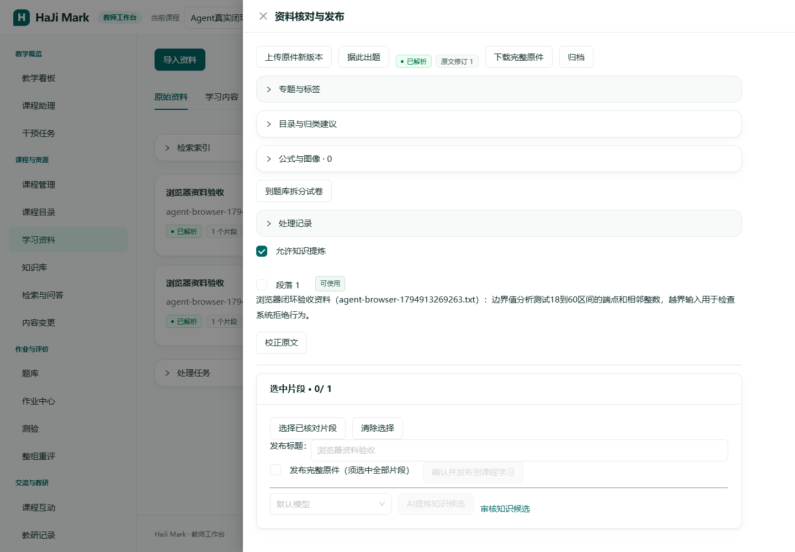
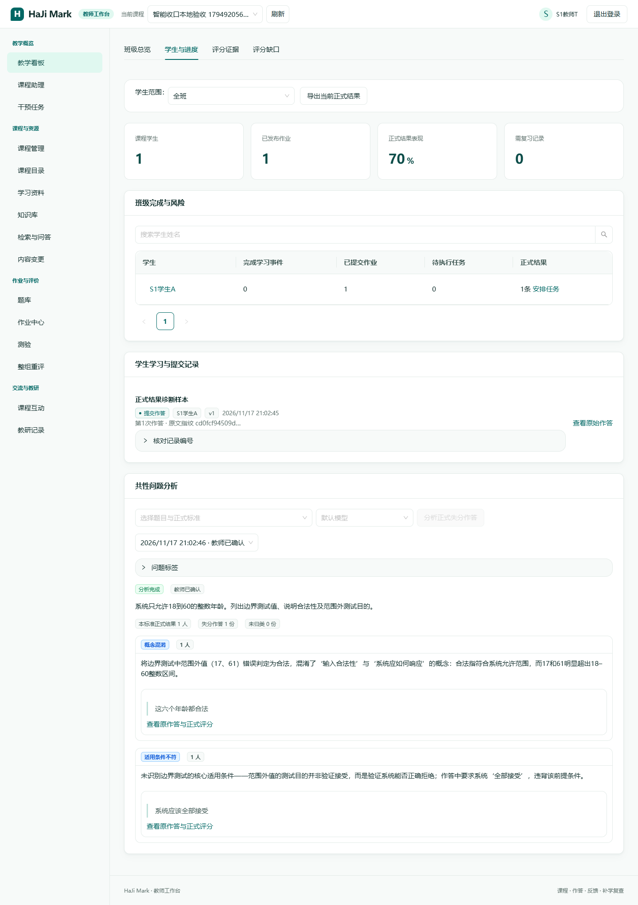
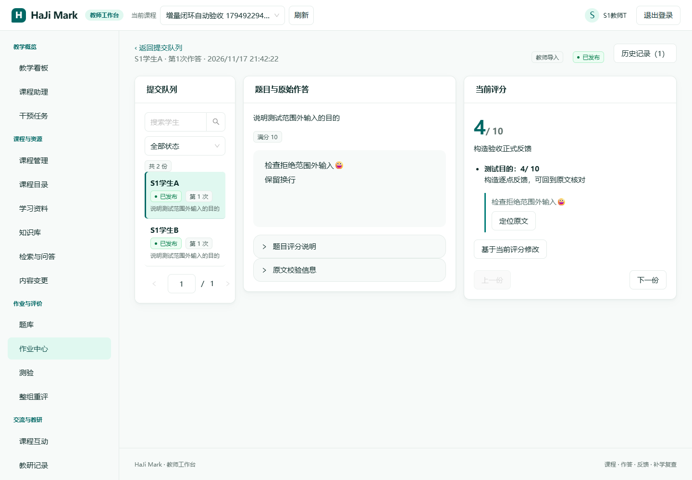

# 前端业务完整性、交互连续性与 Agent 承接调研

调研日期：2026-11-18。对象：HaJi Mark 当前本地工作树与本地 Docker 运行环境。任务性质：全域盘点、业务链追踪和只读复现；本报告中的页面调整、接口增补和验收用例是后续实施方案，并非本轮已完成的修复。

2026-11-19实施进展：本报告保留为修复前事实；F01—F16的当前实施及实际验证范围见[前后端协同修正记录](frontend-integration-2026-11-19.md)，不要将以下历史缺口当作当前运行结论。

## 1. 结论

用户反馈的前后端割裂成立。主要问题不是缺少页面数量，而是**系统按资料、知识、任务、题库、作业、诊断等技术／数据对象分别提供功能，却没有始终指定“这次教学任务由哪个页面负责完成”**。用户发起操作后，当前对象、处理任务、返回结果、人工确认和下一步动作经常分散。

当前不能认定“前端功能完整、业务闭环已经打通”。可以确认的状态是：

1. 主要业务模块已有真实 API 和数据库实现，多数也已有前端入口。基础列表可达不代表完整任务可完成。
2. Agent 已有师生页面、持久对话、运行记录、审批、问题卡和七类编辑工作台。不能写成“Agent 完全没有前端”。但普通业务页面没有携带当前对象发起助理任务的入口，结果也缺少稳定的业务对象卡片和下一步操作，因此用户仍会感到“新增能力没有体现在业务中”。
3. 资料导入返回的任务信息被前端丢弃；课程级任务列表不能充当当前资料的处理回执；发布学习资料、索引完成、知识候选生成、教师确认是不同状态，前端没有把它们组织成清楚的任务进程。
4. 手工创建的学习资料发布接口没有触发索引事件。这是前后端业务链本身的缺口，单纯重新排版无法解决。
5. 看板、诊断、干预、内容影响、重评都有实现，但存在标签职责错误和上下文交接丢失。
6. 一些局部链路已经相当完整，例如三栏批阅、作答导入的预览／确认、题库固定版本选题、学生阅读页内笔记、干预任务的新证据核对。应延用这些能力，而不是整体推倒重写。

建议的建设目标是：**一个教学任务一个主工作区，当前对象、处理进度、结果复核和后续动作尽量原位完成；独立模块继续承担全局查找和管理。** 这不要求把全部功能堆进一个长页面，也不要求取消后台领域边界。

## 2. 范围、基线与证据可信度

### 2.1 代码与运行边界

| 项目 | 本次依据 | 不代表什么 |
|---|---|---|
| 代码基线 | 分支 `codex/platform-completion`；HEAD `4d82dbf28131d799359ac4de737a4c1b02b0c7ab`；审查包含现有未提交增量 | HEAD 本身不包含全部新 Agent／智能分析代码 |
| 工作树 | 开始时大量既有脏文件；本轮只新增报告与报告证据 | 未把别人的未提交变更纳入本轮修复／提交 |
| 活动前端 | `web/src/app`、`web/src/live`、共享会话与路由组件 | `web/src/replica` 和未挂载的旧组件不算活动能力 |
| 业务后端 | `internal/learning`、`internal/agent`、`internal/rag`、对应 SQL 与注册路由 | 未进行独立的完整安全审计或模型效果评测 |
| 浏览器 | 本地 `127.0.0.1:18080`、Docker 现有服务、Edge 1440×1000 | 不代表生产环境或所有设备验收 |
| Web 镜像 | `hajimark-web:local`，镜像 ID `23e548145a4b8ebdfb67d63b2b2b7e8e608f4023e3e3463f29ed44abe4a00bb9` | 没有构建 SHA 证明其与最终工作树逐字节一致 |

审查期间 `backend/internal/rag/jobs.go`、`intelligence.go` 以及对应的 `integration_test.go`、`intelligence_test.go` 相对开始时哈希发生变化，已重新读取相关实现。当前提炼和诊断改为模型选择输入片段 ID、服务端附加引用，失败时保留原始输出；这加强了引用校验，但没有改变本报告关于前端任务反馈和结果承接的判断。报告中的状态区分、资料发布和解析后索引链均按复核后的代码说明。浏览器读取的旧报告不能证明这些并行修改已在镜像内执行通过。

### 2.2 做了哪些验证

- 盘点教师 **16 个一级业务导航入口**、学生 **10 个一级入口**，另核对个人设置和嵌套编辑／详情路由。
- 初次浏览器读取 **17 个教师视图**（含资料两个标签）、**10 个学生视图**，没有页面异常或读取 API 的 4xx／5xx。
- 定向复现看板四个标签、原件抽屉、导入表单、题库确切版本、作业详情、批阅界面、既有 Agent 会话与执行记录、重评创建表单。
- 全程复用已有本地验收数据。登录后页面写请求被拦截；最终检查没有触发被拦截的业务写入，也没有新发付费模型调用。
- 从当前注册源码重新生成清单到忽略目录，与现有清单的源码哈希一致：**155 个 method + path**，GET 67、POST 67、DELETE 3、PUT 17、PATCH 1。
- 从当前教师 `/agent/status` 读取到 **108 项工具描述**：资料 44、题目 15、评价 25、学习 20、控制 4。这是服务端公布的工具清单，不是108项执行成功证明。

证据分级：

| 标记 | 含义 |
|---|---|
| R | 本轮在本地运行界面观察／复现 |
| S | 当前源码与调用链可以直接支持 |
| H | 历史验收文档辅助说明；不作为本轮实测 |
| D | 建议设计／待实施验收标准 |

全量指活动模块与注册入口没有因只看首页而被遗漏。**本轮没有对155个接口执行所有写分支，也没有重跑全部导入、生成、发布、评分和并发测试。** 对源码支持、尚未动态复现的缺口均明确标注。

完整接口承接表见[155个接口与前端职责映射](frontend-api-presentation-audit-2026-11-18.md)。结构化证据边界见[证据摘要](assets/frontend-business-chain-audit-2026-11-18/evidence-summary.json)。

### 2.3 为什么之前的“UI 检查通过”没有发现这些问题

既有[前端 UI 审计](frontend-ui-audit-2026-11-17.md)主要证明组件迁移、页面可达、响应式检查和控制台范围内没有问题。它不等于以下任务通过：

- 上传后不靠记住文件名重新寻找，就能定位本批解析结果。
- 一条知识候选能从其来源任务原位审核、确认、看到索引反馈。
- 诊断选中受影响学生后，安排任务时无需重新选择人和依据。
- Agent 创建的对象能从回执直接打开并继续编辑。
- 同一资料在教师界面已发布后，学生界面可读、可检索且权限正确。

因此“控件统一、没有报错”和“教学任务完成”是两套验收，后续必须分别记录。

## 3. 全域前端能力与业务承接矩阵

表中的“已有”只指对应能力和入口存在；具体写入效果按第2节限制理解。

| 角色／区域 | 当前活动入口及能力 | 后端承接 | 当前完整性判断 |
|---|---|---|---|
| 公共／账户 | 登录、本人会话、个人资料、密码 | identity/session；learning/profile、password | 基础入口存在；本轮未重做密码写入、安全和恢复测试 |
| 教师／课程 | 建课、课程设置、发布、添加学生／成员 | courses、publish、members、students | 单个课程管理可用；与目录／资源靠模块导航衔接 |
| 教师／目录 | 层级、知识点、依赖边、导入目录 | curriculum、points、graph、edges | 有维护页面，Agent 复用目录编辑器；缺少普遍的当前节点到备课任务入口 |
| 教师／原始资料 | 文件／URL、原文核对、许可、图表公式、建议、片段发布 | sources、assets、suggestions | 功能多，但一次导入的回执、进度、结果、下一步没有集中承接 |
| 教师／学习内容 | 手工创建、资料修订、发布、正文查看 | resources、revisions、publish | 保存后关闭编辑器；手工发布与索引触发有缺口 |
| 教师／知识 | 候选、编辑、比较冲突、确认、归档、用途／可见性 | knowledge、decision、index | 局部审核完整；从原件任务进入时未精准限定本次产物 |
| 教师／检索问答 | 检索、生成回答、引用、本人回答历史 | retrieval、assist、history | 独立问答可用；缺少当前对象上下文与索引就绪提示 |
| 教师／题库 | 题目版本、参考解答、标准、证据、专题、使用记录 | question-bank、rubrics、jobs | 题内局部功能较完整；到作业和缺标准修复仍需跨工作区 |
| 教师／整卷导入 | 选择原件、拆题、候选校正与采纳 | paper_split、paper/adopt | 有独立抽屉与 Agent 编辑器；原件→题卷工作仍需转题库 |
| 教师／作业测验 | 分页筛选、编辑、选题、保存、发布、关闭 | assignment-worklist、assignments | 主流程入口齐；选题器遇到草稿／未确认标准不能原位解决 |
| 教师／批阅 | 队列、导入文本作答、原文、标准、逐点评分、确认／发布 | worklist、import、revisions | 本次观察最完整的工作台之一；应作为其他业务页的参考 |
| 教师／内容变更 | 变更对象、影响范围、对象跳转、决定留痕 | impact、decisions | 当前选中对象不写入URL；跳重评丢失影响范围 |
| 教师／重评 | 建批次、冻结名单、修改／确认、整组发布 | regrades、items、state | 批次内有闭环；上游影响对象到批次创建的交接弱 |
| 教师／学情 | 总览、学生、正式证据、评分缺口 | overview、evidence、activity | 数据与下钻已有；共性分析出现在四标签，职责混乱 |
| 教师／智能诊断 | 正式失分作答、标签、生成、复核、确认、证据 | intelligence、diagnosis-labels | 已落地，不能写成缺失；确认诊断到安排干预不带诊断上下文 |
| 教师／干预 | 草稿、下发、补学／补练证据、学生执行、教师复核 | interventions、evidence | 局部链存在；有些证据入口保留上下文，但诊断入口不保留 |
| 师生／Agent | 持久对话、模型模式、上传、SSE、问题、审批、恢复 | agent12个注册入口 | 专用页面有能力，尚未成为各业务工作台的上下文助手 |
| 学生／概览 | 正式反馈、学习与任务入口 | overview／evidence／events等 | 可达；概览不等于有统一“下一件事”的任务承接 |
| 学生／路径推荐 | 规则路径、AI排序、理由、知识与资料深链 | path、intelligence recommendation | 已集成；AI排序依赖规则候选，不是自动生成并发布补练 |
| 学生／课程学习 | 目录、资料阅读、图像、笔记收藏、完成事件 | resources、assets、notes、events | 阅读笔记同页是正例；资料问答按钮丢失当前对象 |
| 学生／知识问答 | 可见知识、检索引用、回答历史 | knowledge、retrieval、assist/history | 有实际入口；阅读／反馈和问答／助理各成独立页面 |
| 学生／作答反馈 | 按题草稿、正式提交、历史、已发布反馈 | draft、submissions、revisions读取 | 原文与正式反馈有边界；补学推荐与当前失分上下文衔接有限 |
| 学生／老师任务 | 资料／作业入口、完成证据、回复 | interventions、events、submissions | 有task返回和新证据规则；应继续复用而非去掉 |
| 师生／课程互动 | 提问、公告、讨论、回复 | interactions | 基础互动存在；回复去页首编辑，缺少对象定位和就地上下文 |
| 教师／教研与行业 | 人工记录新增、编辑、删除、来源技能 | research、industry | 是记录型CRUD；不能冒充自动行业采集／教学转化闭环 |

基础设施健康检查、身份上下文示例等API不需要都增加业务菜单。功能完整性不能用“155个接口对应155个按钮”衡量。

## 4. 优先级发现

P1：核心教学任务出现状态误解、结果难找或关键上下文断裂；P2：常见任务效率、恢复或规模使用存在明显摩擦。本轮没有证据将这些问题升级为生产数据泄漏或成绩损坏事故。

| 编号 | 优先级 | 发现 | 证据 |
|---|---|---|---|
| F01 | P1 | Agent与业务对象入口分离 | R+S |
| F02 | P1 | Agent结果缺少类型化对象卡与后续操作 | R+S |
| F03 | P1 | 上传／手工新建后丢弃对象或任务回执 | S，R观察表单与结果入口 |
| F04 | P1 | 异步任务只按课程集中展示，不能承接本次任务结果 | R+S |
| F05 | P1 | 多阶段处理没有统一、准确的用户反馈 | S |
| F06 | P1 | 手工学习资料发布未排队索引 | S，未新建资料动态复现 |
| F07 | P1 | 原件到发布／知识候选的业务交接不完整 | R+S |
| F08 | P1 | 看板四标签均显示共性分析 | R+S |
| F09 | P1 | 诊断到干预丢失报告、对象和证据上下文 | S |
| F10 | P1 | 内容影响到整组重评丢失处理范围 | S |
| F11 | P2 | 作业选题缺少题目／标准的原位修复 | S |
| F12 | P1 | 学生阅读到问答／Agent丢失当前学习上下文 | R+S |
| F13 | P2 | 页面恢复与选中对象／筛选的一致性不足 | S |
| F14 | P1 | 多文件导入部分成功／失败没有批次级承接 | S，未注入失败动态复现 |
| F15 | P2 | 互动回复不在问题上下文中完成 | R+S |
| F16 | P2 | 后端配置／索引状态未有效体现在问答入口 | S |

### F01：Agent有专用界面，但没有成为当前业务的助手

当前 `assistant` 路由挂载 `AgentPage`；业务操作、对话读取主要位于 `agent.tsx` 与 `agent-editor.tsx`。核对活动业务页，没有发现“把当前原件／知识版本／题目／作答交给助理”的上下文发起入口。

这迫使教师离开原任务页面、进入助理、重新描述业务对象；在已有对话中还可能混入不适合新任务的数据。后端实际上已经对含学生作答的会话限制题目领域委派，因此简单把全部页面共享到一个无限会话也不合适。

已有七类编辑器为：原文、知识、题目与标准、目录、作答导入、诊断、整卷拆题。它们由Agent运行提出编辑请求后打开，不等于教师在普通页面可以主动点击使用这些上下文能力。手工学习资料、作业编排、逐份批阅也没有对应的Agent复杂编辑器；这不代表相应后端写工具不存在。

依据：[路由](../../web/src/live/routes.tsx#L86)，[七类工作台](../../web/src/live/agent-editor.tsx#L26)，[待处理问题／审批与编辑器](../../web/src/live/agent.tsx#L58)，[领域与污染上下文门禁](../../backend/internal/agent/execute.go#L98)。

### F02：业务执行成功后，回执仍主要是文字／编号

`ValueView`是通用键值展示器，字符串和UUID通常是普通文本，嵌套过深会提示去业务页面查看，数组最多显示30项；专门处理的链接主要是下载地址。它不依据工具结果生成原件、知识版本、题目版本、作业或评分卡片。

本轮打开既有真实导入会话，最终回答列出原件ID和片段内容，但没有“打开此原件继续核对／发布”的对象操作。不能依赖模型恰好生成某个Markdown地址补齐业务导航。

应由前端根据**服务端确认过的对象类型、ID、版本和权限**渲染结果卡：发生了什么、当前状态、可打开哪里、下一步是什么。该动作无需再耗一次模型推理。

依据：[通用结果渲染](../../web/src/live/agent.tsx#L48)，[执行记录](../../web/src/live/agent.tsx#L77)。

### F03：导入／新建后没有自动进入刚创建的工作对象

文件上传处理器创建原件和解析任务，返回任务数组。上传前端 `await requestJSON(...)` 后不接收返回数据，关闭导入抽屉、刷新课程数据。手工学习资料创建成功后也关闭编辑器，没有将返回对象设为当前选择。

所以“提交成功”和“开始处理刚才的资料”之间仍要人工重新寻找。列表有多个同名文件或一次上传多个文件时尤其明显。不要把刷新了列表等同于已经给出导入回执。

依据：[上传丢弃响应](../../web/src/live/knowledge.tsx#L727)，[关闭导入表单](../../web/src/live/knowledge.tsx#L669)，[后端返回解析任务](../../backend/internal/learning/materials.go#L192)，[手工资料保存后关闭](../../web/src/live/course.tsx#L350)。

### F04：通用任务列表不能替代当前对象的处理反馈

`JobsPanel`读取全课程 `/jobs`，只按任务种类筛选，默认折叠，仅渲染前15项。显示种类、状态、时间、进度、取消或重试，但没有原件名称、结果对象定位、采纳结果和下一步入口。

已有轮询与结束后刷新是正向实现，但它解决的是数据刷新，不是任务可理解性。当前提炼worker还会保留失败原始输出，通用列表仍只展示错误字符串，不能把“后端留有恢复材料”写成“普通任务面板支持恢复编辑”。

需要对象内的阶段进度和结果面板；全局任务中心用于跨任务查找与恢复。两者共享同一任务ID，不重复排队。历史任务应分页／筛选，不能只截断。

依据：[任务列表](../../web/src/live/knowledge.tsx#L460)，[仅15项](../../web/src/live/knowledge.tsx#L497)，[提炼失败输出保留](../../backend/internal/rag/jobs.go#L464)。

### F05：状态真实存在，但用户反馈没有体现业务阶段

通用 `useAction`成功提示统一为“已保存”，包括排队、发布、取消等不相同的业务。解析完成后还可能排索引和目录建议，发布资料和确认知识又是独立动作。

这不是说当前界面明确宣称“解析完成=全部完成”，而是它缺少足够的信息防止这种误读。正确反馈至少应区分：

| 阶段 | 该阶段能承诺什么 | 不能承诺什么 |
|---|---|---|
| 文件接收／原件登记 | 文件与原件记录已保存，得到原件ID和解析任务ID | 已解析或可供学生阅读 |
| 解析成功 | 本修订的片段和资产已落库，原件可核对 | 全部片段已核对、知识已确认或向量就绪 |
| 索引排队／完成 | 某索引任务的处理状态 | 学生一定可见所有原始内容 |
| 片段发布 | 已创建并发布学习资料资源 | 全课程索引已是最新状态 |
| 知识提炼完成 | 已生成待复核知识候选 | 是正式教学结论或评分依据 |
| 知识确认 | 教师确认该版本、用途与可见性；按后端逻辑排队索引 | 新索引已经执行成功 |
| 评分保存／确认／发布 | 分别对应草稿、教师确认、学生可见的正式结果 | 不能合成一次模糊“保存” |

依据：[统一提示](../../web/src/live/context.tsx#L265)，[解析后排索引／建议](../../backend/internal/rag/jobs.go#L354)，[知识确认排索引](../../backend/internal/learning/materials.go#L474)。

### F06：手工资料发布缺少自动索引触发

`course.go:publishResource`只读取资料、检查草稿状态并发布，没有 `QueueIndex`。索引器确实会读取 `source_id IS NULL` 的已发布学习资料，所以这些资料只有在后续其他事件或手动重建索引时才有机会进入检索块。

这是明确的静态调用链缺口；本轮没有新建资料、调用模型或操作数据库来做完整动态复现。后续应验证一个新课程中只手工创建和发布一份资料的独立场景，不能让此前索引任务偶然掩盖问题。

需特别区分原件片段发布：原件解析后已经排过索引，检索SQL按已发布片段动态核对学生可见性，因此**不能由“片段发布接口没有QueueIndex”推出“原件资料发布必然不可检索”**。

依据：[手工发布](../../backend/internal/learning/course.go#L89)，[索引手工资源](../../backend/internal/rag/retrieval.go#L221)，[手工资源筛选SQL](../../backend/db/queries/rag.sql#L110)，[原件学生可见性SQL](../../backend/db/queries/rag.sql#L104)。

### F07：原件到知识与学习内容的交接不完整

原件内可以选片段、校正、发布、提炼，属于已有的局部工作台。但有三个关键断点：

1. 片段发布返回的学习资源没有被自动打开，没有本次发布的资源版本／学生可见范围回执。
2. 后端片段发布接受 `knowledge_point_id`，当前原件发布表单不提交该字段；手工资料表单却有知识点选择，导致两种资料创建路径的教学定位能力不一致。
3. “审核知识候选”只跳课程知识库，不携带当前原件、提炼任务、候选ID，教师要重新找本次产物。

依据：[原件发布与提炼操作](../../web/src/live/knowledge.tsx#L974)，[后端发布参数](../../backend/internal/learning/materials.go#L293)，[手工资料知识点表单](../../web/src/live/course.tsx#L375)。

### F08：看板标签没有真正隔离共性分析区域

本轮分别打开四个 `view` 值，四个页面均观察到“共性问题分析”。`OverviewPage`始终渲染 `DiagnosisPanel`，CSS试图在前三个标签隐藏 `.diagnosis-section`，但 `DiagnosisPanel`只使用 `card-panel`，没有匹配这个类。

这使总览和学生进度被大段诊断内容占据。应明确条件渲染或正确的面板归属；不能只继续给同一长页面叠加隐藏规则。

此外，当前学生筛选并没有被作为参数传给 `DiagnosisPanel`，题目／标准候选来自全课程正式证据。在学生视图下继续显示班级共性分析，容易让人误解分析范围。不能未经说明就把班级分析改成个人分析，两者应分别标明。

依据：[看板无条件挂载](../../web/src/live/insight.tsx#L440)，[缺少类名](../../web/src/live/intelligence.tsx#L340)，[CSS隐藏规则](../../web/src/live/workspace.css#L224)。

### F09：诊断确认后安排干预，当前诊断上下文消失

诊断复核内有正式作答／评分证据链接，但“安排补学补练”仅跳 `/teacher/intervention?new=1`，不带报告、问题发现、受影响学生、题目、标准或证据。

干预创建器本来就能读取 `student`、`submission`、`point`，并展示关联作答；评分缺口中的部分入口已经这样做。说明可复用的交接基础存在，只是诊断没有接上。

当前干预主要面向单个学生；从班级诊断对多名学生创建任务是新的编排需求，不能把一个无参数链接冒充已支持批量下发。后续设计必须先预览名单与资源，再显式确认。

依据：[诊断无参数跳转](../../web/src/live/intelligence.tsx#L703)，[干预表单上下文](../../web/src/live/interventions.tsx#L180)，[缺口证据入口](../../web/src/live/learning-gaps.tsx)。

### F10：内容影响和整组重评之间仍由教师人工重建范围

内容影响页已经能打开知识、确切题目版本、作业与资料，但重评入口只是 `/teacher/regrades`。选中变更对象也只存在组件状态中。

重评创建表单支持预填作业，仍需选择题目、新标准／答案和理由；从影响分析过来时这些上下文没有形成可审核的交接。作业详情到重评至少会带 `assignment`，比内容变更入口更连续，但仍需要手动展开创建。

建议在当前影响详情内创建重评草稿／预览面板，明确“旧对象→新对象、受影响作业、冻结提交数、处理理由”，之后进入批次内复核。保持原始提交与历史正式成绩，不可为了同页而直接覆盖。

依据：[影响对象跳转与重评入口](../../web/src/live/content-impact.tsx#L35)，[重评表单预填](../../web/src/live/regrades.tsx#L106)，[整组发布](../../web/src/live/regrades.tsx#L306)，[作业到重评](../../web/src/live/assessment.tsx#L707)。

### F11：作业选题器能正确挡住未确认版本，但不能原位补齐

选题器筛选已确认题目和参考解答，主观题要求已确认标准；选入作业时固定题目版本和标准ID。这是应保留的业务边界。

问题是当题目／参考解答未确认或标准缺失时，只提示“去题库审定”或禁用加入，没有在当前作业内打开该题审定、完成后返回选题。教师必须退出当前编辑上下文去另一模块。

应复用 `BankDetailView`，从选题抽屉进入题目工作区，完成必要的显式确认后回到原选题器，并保持作业草稿。不能把Agent生成或打开抽屉当成教师确认。

依据：[选题器与版本筛选](../../web/src/live/question-bank.tsx#L1485)，[固定版本加入作业](../../web/src/live/assessment.tsx#L628)。

### F12：阅读和问答／助理缺少当前学习对象

学生阅读页内笔记、完成事件已集成；但“资料问答”只跳 `/student/retrieval`。`RetrievalPage`从空问题和默认学习用途开始，没有读取资料、选段、作业、反馈或返回位置。

因此“这段没看懂”和“这道题为什么失分”到另一个页面后变成从零描述。反馈页有相关资料深链，这是正向实现，但通向学习路径仍是泛链接。

若产品只需“带着本段背景向全课程问答”，可以先传授权对象引用和选中文字，并明确检索范围。若要求“只在本资料内检索”，当前检索API只接受 `query/purpose`，需要后端增加受权限验证的对象范围；不能只改按钮文案假装完成范围过滤。

依据：[阅读页泛问答入口](../../web/src/live/course.tsx#L524)，[问答状态初始化](../../web/src/live/knowledge.tsx#L1570)，[检索API字段](../../backend/internal/learning/materials.go#L637)，[反馈后续入口](../../web/src/live/grading.tsx#L483)。

### F13：可恢复业务上下文没有统一标准

现有资料 `source/resource/fragment`、知识 `knowledge`、题目 `bank/version`、作业列表筛选和Agent `conversation`已有URL定位，是正例。也有明确不一致：

- 内容影响选中的变更仅保存在 `useState`，刷新后丢失。
- 智能报告选择仅保存在 `useReports` 的局部状态，刷新／重入会选历史首条，不能稳定分享某次报告。
- 题库搜索、状态、页码等过滤保存在局部状态，打开详情后跨模块回来不保证恢复。
- 原件和知识列表缺少与题库类似的搜索／分页承接；通用任务列表截15项。

这不是说数据库记录丢失，而是“用户刚才处理到了哪个对象、哪个列表位置”容易丢失。应分别定义可分享选择、URL筛选和未保存草稿；不可把浏览器草稿称为后端保存。

依据：[影响局部选择](../../web/src/live/content-impact.tsx#L36)，[报告选择](../../web/src/live/intelligence.tsx#L87)，[题库局部过滤](../../web/src/live/question-bank.tsx#L190)，[原件全列表](../../web/src/live/knowledge.tsx#L626)。

### F14：批量上传的部分成功不能被单一错误信息承接

上传后端按文件循环，逐个保存原件并创建解析任务，最后统一返回任务数组；不是整批事务。后面的文件保存／排队失败时，前面已完成的文件和任务可能仍存在，但前端只拿到本次请求失败，无法得到完整的逐文件成功／失败结果。

这会造成“显示失败，实际已有部分资料入库；重新上传又产生更多条目”的风险。此处是源码支持的失败路径，本轮没有注入文件系统／数据库故障来动态验证。

不应直接改成一个包含文件系统的巨大数据库事务。可先定义逐文件回执或批次记录，确保用户能看到已接收、待解析、失败及可显式重试的文件；是否允许重复文件也应按业务规则明示，不能静默去重删除既有资料。

依据：[上传循环和返回](../../backend/internal/learning/materials.go#L148)，[前端统一错误处理与回执丢弃](../../web/src/live/knowledge.tsx#L727)。

### F15：课程互动虽在一页，回复仍丢失局部上下文

点击某条问题的“回复”后，程序设置 `parent_id` 并滚动到页面顶部共用表单。数据有父子关系，但编辑时缺少原问题正文并排或就地下文；长列表中用户需要来回看。

可将回复表单放在对应讨论下，保留原问题和近期回复，提交后更新当前线程。教师公告和一般讨论仍可保留页首新建入口。

依据：[互动表单](../../web/src/live/communication.tsx#L34)，[回复滚动页首](../../web/src/live/communication.tsx#L127)。

### F16：状态读取接口存在，活动问答入口没有充分消费

后端有 `/retrieval/status`，返回课程级配置／索引空间状态。当前活动检索页没有消费它；旧 `LearningAssistant`读取 `/assist`配置状态，但该旧组件没有挂载到活动路由，不能作为现有页面已做预检的依据。

模型选择器读取 `/models`，所以不是完全没有模型状态能力；缺的是把配置不可用、课程未建索引、索引处理中、当前对象未就绪以及失败恢复组合成清楚的入口状态。

现有 `/retrieval/status`只表示课程级状态，也不足以证明“本资料当前版本已索引”。要实现准确的对象级反馈，需要补充对象／修订与索引任务的关联和时间，而不是把一个 `indexed=true`显示成全部资料最新。

依据：[后端状态](../../backend/internal/learning/materials.go#L632)，[活动检索页](../../web/src/live/knowledge.tsx#L1570)，[旧未挂载助教](../../web/src/live/assistant.tsx#L6)，[模型选择](../../web/src/live/knowledge.tsx#L217)。

## 5. 纵向业务链：现状、断点与同页目标

以下10个场景是具体教学任务，不是把所有模块强制合成一个页面。每个场景都有一个承担结果的主工作区；需要离开时携带对象和返回位置。

### 场景1：教师上传《边界值分析讲义》，直到学生可以使用

**当前链路（S；表单／已有结果R）**

`学习资料→导入抽屉→POST /sources→文件卷保存＋material_sources→processing_jobs(parse)→Asynq worker→material_fragments/material_assets→parse ready→排index／条件性source_suggest→教师另找原件核对→POST /sources/{id}/publish→resources与fragment绑定→学生课程学习`

1. 上传只返回解析任务，不代表发布。
2. 解析在事务内保存片段、资产和原件修订，完成后还排索引／建议。
3. 教师选择可用片段并发布，后端创建学习资料；学生按发布和权限规则读取。
4. 前端没有保留本次任务数组，所以“上传→等待→本次结果→继续发布”不是连续交互。
5. 若一次导入多个文件后半段失败，不能保证收到前半段的成功回执。

**建议主工作区（D）：资料工作区，以本次批次／原件为主线。**

- 导入成功后留在原页面，自动选中本批资料；多文件显示逐文件队列。
- 固定显示“已接收／解析中／待核对／已发布”等阶段，各阶段标明对应对象或任务。
- 主区核对原文和图像，旁区显示当前文件的问题／建议；操作区是保存校正、选择片段、绑定课程节点、发布。
- 发布后在原位给出资源标题、版本、学生可见范围、索引状态以及“以学生可见规则预览”的明确入口；没有真实权限预览机制前不能虚报学生视角。
- 若需提炼知识，当前工作区内切到本次候选，不跳全课程知识库。

**验收（D）**：不用回左侧导航即可完成上传、查看本次进度、核对、发布、看到发布对象；刷新能回到同一原件；失败只重试指定项，不重复排已成功项。

### 场景2：教师手工创建一份资料并发布到课程

**当前链路（S）**

`学习资料／学习内容→添加草稿抽屉→POST /resources→资料草稿→抽屉关闭→重新找到资料→POST /resources/{id}/publish→资源published`

手工表单已有正文、来源、定位、知识点；保存是创建草稿，发布是独立动作。后端发布没有自动排队索引，这是与场景1的重要差异。

**建议主工作区（D）**：保存后继续显示新资料详情，标题区明确“草稿已保存”，原位提供发布动作。发布后排索引并显示任务，不能把“已发布”改名为“检索已就绪”。修订新增版本并保留旧引用。

**验收（D）**：在无历史索引任务的新课程验证“创建→保存→刷新→发布→学生可读→索引完成→检索命中”，另验模型不可用／索引失败时正文仍可读且错误真实展示。此完整写入链本轮未实测。

### 场景3：教师从资料提炼知识、处理重复后正式入库

**当前链路（S；页面结构R）**

`原件选片段→POST /jobs(kind=extract)→worker验证输入／引用→knowledge_entries候选→课程知识库→编辑／比较→重复冲突决定→POST knowledge/{id}/state→confirmed→排index`

当前后端已保留证据、用途、可见性和版本，不能将“生成候选”当作“入库完成”。提炼失败原始输出和正式知识条目也应区分。

**断点**：原件中的候选审核链接不带来源任务；任务列表不提供本次候选定位；教师要从全课知识卡中寻找结果。

**建议主工作区（D）**：资料工作区的“本次知识候选”标签；左侧候选清单，中间正文与条件，右侧引用片段与冲突项。保存、比较、丢弃／合并／并存／替换／暂缓、确认均在当前上下文；每次显式决定保留后端留痕。确认后提示用途、学生可见性和待索引状态。

**验收（D）**：从特定原件发起只展示本次任务候选；修订冲突给出真实错误并可重读；未确认候选不作为学生正式知识／评分依据。

### 场景4：教师把一份试卷拆题并准备可用于作业的题目

**当前链路（S）**

`原件→跳题库paper_source→paper_split任务→候选校正→paper/adopt→独立题目版本→参考解答审核→标准草稿→分别确认`

已经有整卷导入与七类Agent编辑器之一的整卷校正，不能认定该功能缺失。但教师从原件离开到题库，仍需要理解题目、参考解答、标准三种独立状态。

**建议主工作区（D）**：保留整卷校正工作区，原件证据和候选逐题对照；顶部是“已采纳几题、哪些待确认、哪些缺标准”；从原件打开时保留来源和返回点。资料工作区可原位打开该工作区，题库仍做全局管理。

**验收（D）**：每题均保留原件修订、片段和图像；未确认候选不能被误当作业可用题；不丢已完成的题目校正，也不因返回原件重复采纳整卷。

### 场景5：教师从题库准备一次作业并发布

**当前链路（S；已确认题目R）**

`题库题目版本确认＋参考解答确认＋标准确认→新建作业→选题抽屉→固定bank_question_version_id/bound_rubric_id→保存草稿→发布`

准备充分时，作业编辑器内的选题是连续的。若题目或标准不完备，用户只能回题库，当前作业缺少“原位补齐并返回”的路径。

**建议主工作区（D）**：作业编排页。选题抽屉显示不可用原因并打开确切题目版本的复核工作区；教师明确完成确认后返回原选题，作业表单、顺序、截止时间不丢。发布前显示题目版本／标准组合预检。

**验收（D）**：不离开作业编辑主页面即可解决缺标准；不能静默替换已发布作业的题目／标准；未完成确认时发布仍被后端拒绝。

### 场景6：教师导入学生作答，逐份批阅并发布反馈

**当前链路（R+S）**

`作业→提交队列→内嵌SubmissionImport→CSV预览与名单／题目校验→preview_hash显式确认→整批落库→逐份三栏批阅→引用原文→评分修订draft→confirmed→released→学生反馈`

这是当前较完整的纵向局部链。队列与导入同页、前后份切换、原文引用、评分版本和确认／发布已经有承接。本轮查看了既有导入、原文换行、正式反馈和队列；未新导入或重发成绩。

**建议主工作区（D）**：沿用现有批阅工作台，补“围绕当前作答请求助理”与类型化运行卡。固定当前作答、题目版本、标准、资料证据；AI草稿和教师确认继续分离。缺标准时能打开原位标准核对，而不是把教师带回一个泛作业页。

**验收（D）**：队列筛选／页码、当前作答、标准和未保存评分不因开关助理丢失；发布只作用于当前明确对象；学生在发布前看不到草稿。

### 场景7：教师分析某题共性失分并安排干预

**当前链路（S；报告读取R）**

`已发布逐点评分证据→选择question+rubric→POST /intelligence(kind=diagnosis)→冻结输入／异步报告→标签和发现复核→教师确认→泛链接创建干预→重新选学生和材料→下发`

分析只应以正式评分为证据，AI标签不等于客观错因。当前已有正式输入、证据链接、复核和确认；问题发生在看板位置与确认后的行动交接。

**建议主工作区（D）**：学情诊断工作区，固定题目与标准，显示报告范围和缺证据人数。对某条发现选中学生后原位打开干预编排，预填诊断来源、作答、知识点，并让教师选择已存在的资料和练习。多学生批量下发若新增实现，须有明确名单／数量／权限及幂等语义。

**验收（D）**：报告、发现、学生、原文证据可回溯；班级和个人分析范围清楚；生成报告不能自动发布补练，教师确认报告也不能被解释为确认下发所有任务。

### 场景8：学生根据任务补学补练，教师复核效果

**当前链路（S；入口读取R）**

`老师任务→带task打开资料／作业→产生下发后新的学习完成事件和逐题新提交→intervention/evidence校验→学生提交执行结果→教师复核`

已有任务关联、返回位置和“下发之后的新证据”规则，这是正例。不能用学生点“完成”替代学习／练习证据，也不能以旧作答冒充本次执行。

**建议主工作区（D）**：学生任务详情承接资料阅读预览／作答入口和证据清单，教师任务详情承接新证据、执行说明与复核。确需完整资料／作业页面时保留 `task` 返回位置；这种跨页是可接受的有上下文跳转。

**验收（D）**：下发前记录不能满足新任务；部分题目未新交应显示未完成；读完／提交后返回原任务能看到服务端证据，而不是只改前端勾选。

### 场景9：学生阅读资料遇到问题，从问答回到原学习任务

**当前链路（S）**

`课程学习读资料→泛“资料问答”→空检索页→重述标题／内容→retrieval或assist→回答历史→再找原资料`

学习路径已有资料／知识深链，阅读也已有笔记，但问答／Agent没有复用当前学习上下文。

**建议主工作区（D）**：阅读页侧栏问答，带当前已授权资源、修订、选段和返回任务；回答引用可原位展开。需要多步Agent执行时保持同一任务面板，明确只读／写入权限；提交作答仍需学生明确确认。严禁把教师隐藏标准或其他学生资料传入。

**验收（D）**：选中一段点击“解释本段”无需复制标题／原文；问答仍可区分当前资料背景和全课程检索范围；关闭后阅读位置、笔记和任务不丢。

### 场景10：教师修订知识或资料，审查影响并统一重评

**当前链路（S）**

`原件／知识新增版本或许可变化→impact查询→查看受影响题目／标准／作业／结果→离开到regrades→重新选择作业和题目、新标准／答案、理由→预览数量→冻结→逐项确认→整组发布`

影响分析、版本冻结、重评批次实际存在；缺的是把同一个变更对象和待处理范围从上游带到下游。

**建议主工作区（D）**：内容影响详情原位创建重评预览，清楚并列旧新版本、作业、题目、冻结名单、理由和不能处理的原因。确认后进入该批次复核面板，始终能返回原影响决定。没有用户决定前，不自动重算和覆盖历史成绩。

**验收（D）**：刷新保留变更选择；创建重评无需重选本已确定的题目；新批次冻结后原始输入和既有正式结果保留；整组发布前学生继续看到旧正式结果。

## 6. 建议的信息架构与功能区排布

排布评审改用[可操作的产品工作台原型](../prototypes/task-workspace/index.html)：直接打开资料工作区，可切换师生视图，操作资料导入、候选核对、发布预览、逐点批阅、补学任务及讨论。说明和检查范围见[原型说明](../prototypes/task-workspace/README.md)。所有记录仅为本页内存中的示例，未连接业务后端或模型，不代表真实平台已经完成改造。

此前的[教师与学生工作区布局说明图](assets/frontend-business-chain-audit-2026-11-18/frontend-layout-proposal.svg)保留为历史说明材料，不再作为产品界面预览。

### 6.1 原则：保留全局管理，把同任务动作收回主工作区

目前教师16个一级入口并非都没有价值；混乱来自相近粒度并列，以及没有说明任务应该在哪个入口结束。建议先修上下文和回执，再调整菜单，避免只换名字。

| 一级工作域（建议） | 主职责 | 工作区内子区 | 不应混入 |
|---|---|---|---|
| 教学概览 | 待处理事项、班级和学生进度、正式结果概览 | 学生／作业范围、到具体任务深链 | 全量原文、全部诊断报告、全部模型配置 |
| 备课与内容 | 资料接收、核对、发布、知识审核、内容变更 | 资料／本次知识候选／题卷准备／影响 | 把课程级任务列表当某个原件的进度 |
| 作业与评价 | 编排、发布、收作业、批阅、重评 | 作业编辑／提交队列／批阅／重评批次 | 隐式改绑历史题目或标准 |
| 学情与干预 | 证据、诊断、发现、下发和复核任务 | 正式缺口／诊断／学生／任务执行 | 把未确认模型解释当正式成绩 |
| 课程管理 | 课程设置、成员、目录与依赖 | 设置／成员／目录 | 每次备课都要求返回管理页 |
| 交流与记录 | 课程讨论、教研、行业人工记录 | 线程／记录 | 未实现的自动情报和转化结果 |

Agent作为每个工作区可打开的辅助面板，同时保留独立会话中心用于跨任务查找与历史。不要求用户理解四类专家分工才能开展备课或批阅；专家名称可以在运行详情出现。

学生端建议按“我的任务→课程学习→作业与反馈→学习路径→交流”组织，知识和问答同时可在学习对象内打开。独立知识／问答页面保留全局检索用途，不能成为每次阅读必经的跳转站。

### 6.2 一个工作区内的区域职责

1. **顶部固定任务身份**：课程、对象名称、确切修订／版本、当前阶段、保存／发布状态。课程切换要清除旧对象，沿用现有未保存提醒。
2. **左侧对象／步骤**：本次批次文件、候选、题目、学生作答等。只放当前任务集合，提供搜索／分页和明确选中状态。
3. **中央主要操作**：原文核对、知识编辑、题目编排、评分等，每页有明确主要动作。
4. **右侧按需面板**：依据、资产、Agent、运行进度。默认不同时展开多层抽屉争抢焦点；复杂工作区复用现有组件。
5. **任务结果与下一步**：保存对象、任务状态、后续产物、失败范围和可执行操作；成功提示不是仅弹一次Toast。

“一页内完成”指用户在一个主任务上下文中工作，允许内嵌标签、抽屉和受控子工作区。原文、标准、版本、审批都是独立业务对象，仍保持各自后端门禁。

### 6.3 不应合并的边界

- 上传成功、解析成功、发布、知识确认、索引完成分别反馈。
- 题目确认、参考解答确认、标准确认分别保留。
- 评分草稿、教师确认、正式发布分别保留。
- 对话附件与正式资料入库分别保留。
- 模型建议、教师采纳和数据库持久结果分别保留。
- 班级诊断、个人结果和学生私有上下文分别保留。
- 干预下发、学生产生新证据、教师复核分别保留。

## 7. 必须补齐的前后端契约

以下是设计建议，不是本轮已经新增的接口。

### 7.1 创建／导入回执

前端应保留现有返回中的对象／任务ID，并将其变成持久可查的任务结果。批量导入需要明确逐文件结果，至少能说明哪些已入库、哪些排队、哪些失败；必要时新增批次对象，不要只在浏览器内拼出一个不可恢复的“批次”。

### 7.2 任务与产物关联

任务需要能被原件／知识／题目／作业工作区按对象、修订、种类查询，并返回当前可操作的产物引用。现有 `JobInput/Output`可作为起点；是否新增聚合接口应按查询需求决定，不必为此拆服务。结果面板不从模型自然语言猜对象ID。

### 7.3 对象级可用状态

资料状态至少分别说明：数据库已保存、解析修订、待核对片段、学习资源发布、学生可见规则、最近相关索引任务及失败原因。课程存在索引空间并不等于当前修订已索引。

### 7.4 页面／Agent共享对象引用

任务发起时使用经过服务端授权的对象类型、ID、版本和明确目标；不能信任URL传入的学生或课程。结果卡和工作台使用同一对象引用，编辑后由服务端重读真实保存结果。新会话／继续会话按是否含学生作答、是否跨任务决定，保持现有领域限制。

### 7.5 诊断到干预、影响到重评的显式交接

交接应包括来源报告／变更、候选目标、证据和用户选择，不把描述字符串当成全部可审计关联。当前干预描述中嵌入“关联作答：ID”可回链，但若要扩大到批量诊断编排，宜有正式关系和幂等语义。实现范围确认前，不宣称自动批量补练已完成。

### 7.6 统一反馈的含义，而不是统一成同一句话

保留统一请求与错误处理，但由操作声明成功语义和对象回执。例如“已保存草稿”“已排队解析”“已发布学习资料，索引待处理”“已确认评分，尚未发布给学生”。对于超时或未知写入，应先查询实际对象，不能只给“重试”导致重复写入。

## 8. 分阶段处理顺序与可验收标准

| 批次 | 范围 | 交付／验收 | 相关发现 |
|---|---|---|---|
| A：事实反馈与明确缺口 | 保留创建回执、对象内任务、看板标签、手工发布索引、精确状态反馈 | 首先打通资料创建／上传到本次结果；四标签内容符合职责；独立新课程手工资料索引通过 | F03—F08、F14、F16 |
| B：Agent融入现有工作台 | 当前对象发起、类型化结果卡、复用编辑器、返回当前对象 | 在资料、知识、题目、作业、批阅、诊断、学生阅读7类场景验证，不丢对象／版本／草稿 | F01、F02、F11、F12 |
| C：诊断和变更后续行动 | 诊断→干预、影响→重评、范围预览、恢复URL | 不重选已确定对象；确认前无正式副作用；版本／名单／原始证据不变 | F09、F10、F13 |
| D：功能区与规模使用 | 任务导向菜单、局部子区、列表搜索分页、就地互动 | 用真实混合课程数据评审10个场景；全局查找仍可用；历史任务可定位 | F04、F13、F15 |

不建议先大改颜色／间距，再用“UI已统一”作为业务完成结论。也不建议为减少点击而绕过教师确认、发布、固定版本和对象授权。

### 后续纵向验收清单（本轮未执行）

| 场景 | 必须验证的成功分支 | 必须验证的失败／恢复分支 |
|---|---|---|
| 文件资料 | 单文件、批量、同名文件；上传→解析→核对→发布→学生读取 | 部分失败、解析失败、刷新／重连、不重复提交 |
| 手工资料 | 草稿→发布→独立索引→检索命中 | 无模型／索引失败时状态明确，不阻断正文阅读 |
| 知识 | 当前来源→候选→比较→决定→确认→用途生效 | 引用不合法、乐观锁冲突、待确认不泄漏、失败原始输出可核对 |
| 题卷与题库 | 拆题→采纳→题／解答／标准分别确认→选入作业 | 候选未确认、图像未核对、重复采纳、版本不兼容 |
| 作业 | 原位补标准、固定版本、保存发布 | 草稿保护、关闭／逾期、错误标准绑定、跨课对象 |
| 批阅 | 导入确认、原文不变、逐点依据、确认发布、队列切换 | 超时核对实际写入、未发布学生不可见、不同学生隔离 |
| 诊断 | 同题同标准正式结果→报告→复核→选择学生→干预 | 无证据不当零分、旧报告过期、取消、未确认不下发 |
| 干预 | 下发后新学习／逐题作答→学生执行→教师复核 | 旧证据不能完成任务、缺题／未读资料、错学生 |
| 学生问答 | 当前可见资料／选段→引用回答→回原任务 | 教师私有依据、其他学生内容、当前资料范围与全课范围明确 |
| 内容变更 | 影响预览→冻结重评→逐项确认→整组发布 | 原结果不覆盖、未完成不得整组发布、旧审批失效 |
| Agent | 同页发起、真实对象卡、编辑后服务端回读、历史恢复 | 只读模式、拒绝审批、取消／未知写入、学生作答污染限制 |

这些是有教学含义的用例。页面没有抛异常、按钮能点、工具已注册、模型说“完成了”，都不能替代上述验收。

## 9. 本轮产物与未覆盖范围

本轮新增：本调研、[接口承接附表](frontend-api-presentation-audit-2026-11-18.md)、4张本地真实界面截图和[验证边界摘要](assets/frontend-business-chain-audit-2026-11-18/evidence-summary.json)。浏览器过程与包含会话状态的原始记录保存在忽略的本地目录，未写入报告制品。

交付检查结果：

- `python -B scripts/check_docs.py`：通过，42份当前文档、12份不可变历史快照与模块入口检查通过。
- `git diff --check`：通过；另核对本轮新增文本与截图制品。
- `workspace.py check --repo F:/vibe-coding/school/HaJi_Mark`：`pass`，检查范围为工作区元数据；不代表服务构建或生产发布通过。
- 根 `workspace.py audit`：`fail`，两个与本项目无关的问题为 `nai-workbench/shared/generation-plan.ts`缺失、`project/novelai/nai-iris-round2`为未登记的直接Git目录。本轮未修改这些项目，未扩大白名单掩盖失败。
- 已将两份报告登记为根清单中本项目的文档导航入口；未更改项目发布资格或生命周期。

没有修改业务代码、数据库业务记录、模型设置或生产配置；没有重新部署、构建完整服务、推送GitHub或触发新的模型推理。未做PDF／OCR／公式识别质量、模型语义准确性、大规模性能、全部浏览器设备和完整权限渗透验收。代码审查中的16项发现也不等于16项已经修复。

本轮可交付的结论是：**模块覆盖已经较广，但教学任务连续性和结果反馈尚未达到可以称为“前端完整”的程度；后续应以资料工作区为第一条纵向样板，再扩展到Agent、作业评价、诊断干预和内容变更。**
