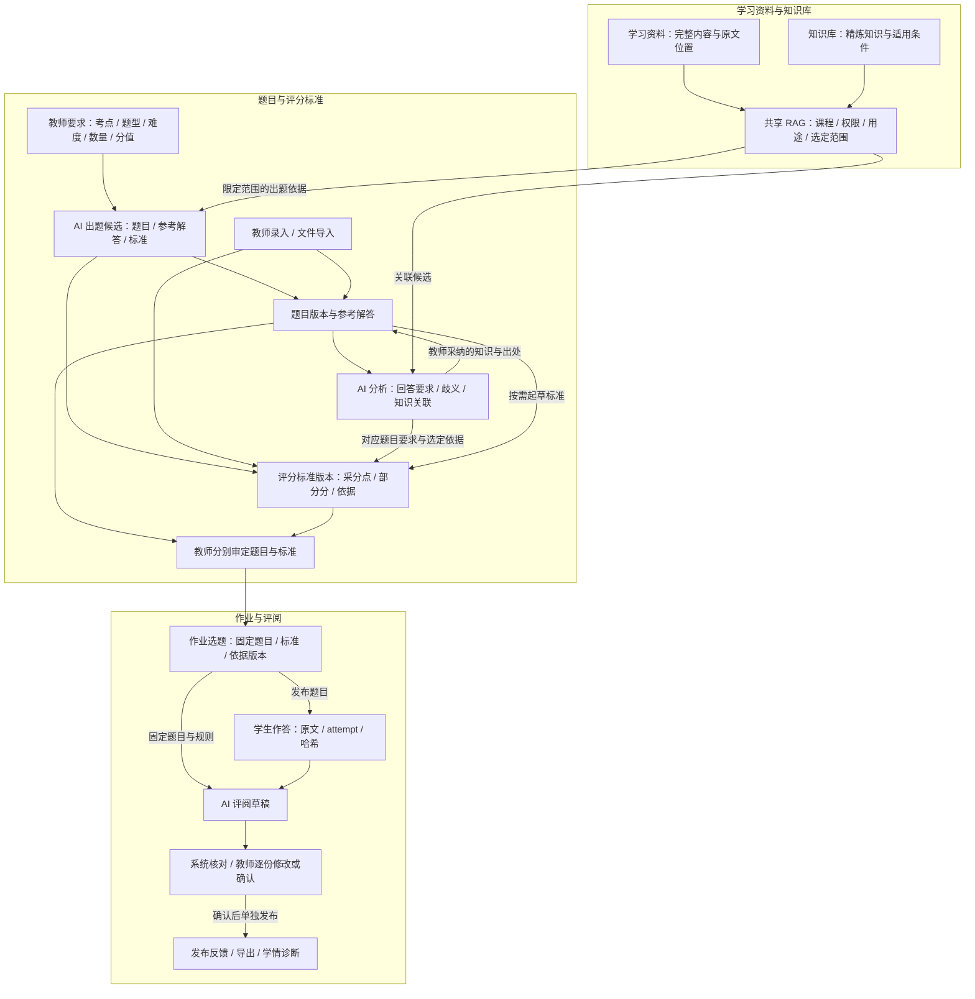
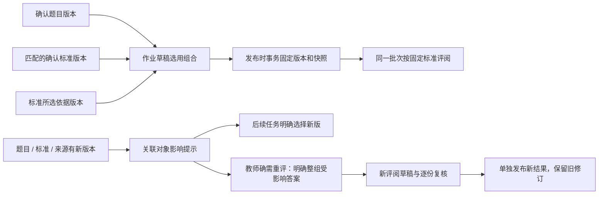
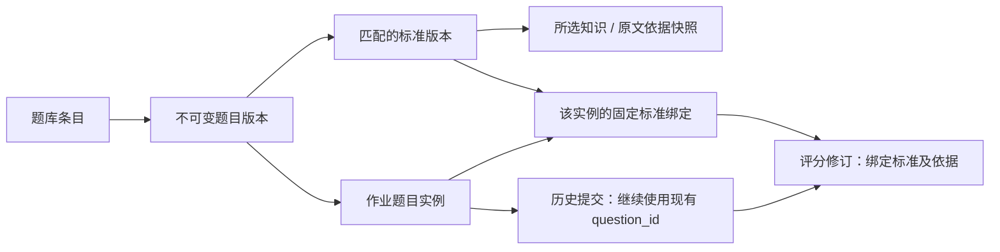

# 题库与评分标准：接入方案 v1

2026-11-12增量准备见[三模块完善与验收方案](three-module-acceptance-plan.md)：跨页图文拆题、题库筛选与采纳审计、来源影响及整组重评仍待实施，不代表本页首版已具备。

2026-11-11。本版保留讨论确定的设计，并已实施独立题库、AI出题／分析／标准草稿和作业固定版本首版。实际接口及验证以[架构](../architecture.md)、[契约](../contracts.md)和[验证记录](../verification.md)为准。

## 1. 已确定的范围

| 项目 | 决定 |
| --- | --- |
| 题库 | 课程下独立维护、可复用；作业引用确认版本 |
| AI 出题 | 默认生成题目、参考解答和评分标准草稿；可分别编辑、确认、按需重新生成 |
| 分值 | 同一版本使用统一满分；改变分值另建匹配版本，不在作业中静默按比例换算 |
| 标准与作答 | 相互独立；不读取待评答案制定本批次标准 |
| 教师决定 | AI 提出候选；教师审定题目、依据和标准，评阅结果继续逐份复核后发布 |
| 技术边界 | 复用现有单体、共享 RAG、模型 profile、持久任务和预算；不另建题库服务 |

下文流程图保留目标设计，当前实现对应QB-01—03及QB-04的一部分：JSON可导入候选并逐题核对保存，尚无PDF自动分题、完整来源影响通知或批量定向重评。列表目前支持关键词与状态筛选、课程内客户端分页；不宣称设计表中的所有筛选和比较工具均已完成。已有客观测验规则判分保留；逐点标准与AI评阅以文本主观题为主，代码题按文本评阅，不执行代码。

## 2. 模块关系

图中边表示数据依赖，不是必经向导。教师可以先存题目、后补标准；资料、知识、题目和标准独立维护。学生作答没有回到标准制定的连线。

## 3. 数据及输入输出

| 对象 | 核心内容 | 输出与消费者 |
| --- | --- | --- |
| 题库条目 | 课程、稳定题目 ID、停用标记 | 题库检索、使用记录 |
| 题目版本 | 题干、条件、题型、满分、考查要求、参考解答、知识点标签、来源关联、确认状态 | 作业题目快照、题目分析与标准起草 |
| 标准版本 | 对应确切题目版本、逐点评分规则、教师确认、冻结依据 | 作业固定绑定、逐点评阅 |
| 依据关联 | 知识条目版本或原文片段、连续引文、原文位置、关联理由、教师采纳记录 | 题目详情、评分点依据、来源影响查询 |
| 作业选题记录 | 题目版本 ID、标准版本 ID、顺序、固定快照 | 作答、评分、历史追溯 |

知识点标签用于课程分类和学情统计；知识条目及原文用于支撑判断。两者分别关联，不能用一个标签替代评分依据。参考解答随题目版本保存，题干与参考解答分别记录审定状态，确认其中一项不代替另一项审核。参考解答不是必须逐字匹配的唯一答案；教师修改已冻结的参考解答也产生新版本并核对配套标准。

每个评分点保留现有 `id/title/max_score/rule`，补充对应考查要求、部分分条件、可接受表达、错误或矛盾条件、所选依据引用。初版继续使用现有正整数分值；1—30 点、唯一编号、满分加和检查继续有效。教师自拟规则允许没有外部引用，但须明确标为教师制定，不伪造来源；基于外部知识的规则须能查看其出处。

## 4. 教师与 AI 怎样协作

### 4.1 手工题目与文件导入

教师录入题干、条件、题型和满分；参考解答和标准可以后补。导入复用现有 PDF、DOCX、PPTX、文本和 OCR 解析，解析资料不等于已经完成题目拆分。

题目导入另外保存题目边界、题干、选项、参考解答、标准及原文位置的映射。教师核对后才能保存为确认版本；分题错误、缺失条件、OCR 不确定文字不能被静默补全。原件和解析片段保留在来源模块，题库只引用，不再保存一套文件和索引。题目导入原件默认教师私有，不能因为复用解析就自动发布为学生学习资料或进入学生检索。

### 4.2 AI 辅助出题

教师输入课程、资料章节或知识条目、考查要求、题型、数量、目标难度和分值，并选择服务端已有模型。共享 RAG 只在授权且选定的范围内寻找依据，生成题目、参考解答和标准三个可分开编辑的草稿，同时保存任务输入、所用依据、模型记录和待审核状态。

- 候选题不自动发布；教师可以只采纳部分候选。
- 依据不足时指出缺口，不虚构教材位置，不自行扩大出题范围。
- 检测明显重复题、缺失条件、答案与题干冲突、分值不合计；语义问题交教师判断。
- “难度”是教师目标与 AI 建议标签，不是经学生数据验证的难度结论。
- 每次按需重新生成保留为新候选，不覆盖当前教师编辑或已确认版本。

### 4.3 已有题目分析与知识关联

输入题目和教师要求；AI 输出考点、回答要求、歧义或缺项，以及知识和原文关联候选。每条候选展示引用和关联理由，教师可采纳、替换、删除或手工补充。

没有匹配知识也可以保存题目草稿，不能伪装为“已有关联”。题目可由教师自主设计；未经 RAG 检索不是禁止使用题目的理由。存在未解决的题意歧义时，须由教师修改或明确说明后审定，AI 不替教师默默选择解释。

### 4.4 标准起草与审定

输入确切题目版本、考查要求、可选参考解答与教师选定依据。输出逐点评分草稿；手工标准使用相同结构，无需先调用模型。

系统检查编号、分值、加和、出处和题目版本；教师判断给分语义、部分分公平性、替代解法和规则之间是否重复扣分。确认标准时冻结选定依据，不直接冻结整次检索命中的所有内容。

例：年龄 18—60 的题目只要求测试输入、合法性分类和范围外测试目的，标准就围绕这些要求设置；即使检索到了测试脚本知识，也不能新增“未编写脚本”的扣分项。

## 5. 版本、发布与变更

- 题目与标准分别为 `draft → confirmed`；确认版本不可原地改写。题库条目停用后不能加入新任务，旧作业仍可追溯。
- 标准属于一个明确题目版本。新题干、新条件或新满分须建立匹配版本，不把旧标准自动标为适用于新题。
- 作业草稿可替换选用组合；发布前检查题目和标准均确认、版本匹配、满分一致、来源当前许可和规则完整。发布与绑定在一个事务中完成，防止检查后对象被替换。
- 同一作业题目对所有作答使用相同绑定；评分页不能随意选择另一套新标准。客观题固定选项及教师答案规则，沿用规则判分。
- 来源变更只产生影响提示；归档和撤回许可遵守已有未来使用限制。既有评分快照保留，不能因新检索结果自动增减分。
- 正式任务必要的重评是显式操作，覆盖该规则影响的整组答案；标准依据仍独立于本批次待评作答，不针对个别作答临时改规则。保留原因、范围、新旧绑定与结果历史；新草稿不抹去旧正式反馈，发布进度明确可见。

## 6. 页面落位

教师端新增课程上下文中的“题库”入口，不把作业编辑页复制成另一套题目管理。

| 页面或入口 | 内容与操作 |
| --- | --- |
| 题库列表 | 按题型、知识点、确认状态筛选；新建、导入、AI 出题、停用；查看已有版本 |
| 题目详情 | 四区：题目与参考解答、知识与来源、评分标准、使用记录；分别编辑、确认与比较版本 |
| AI 出题面板 | 选资料或知识与考查要求；任务进度、错误、候选预览、分别采纳 |
| 资料／知识详情 | “据此出题”“查看关联题目”，携带确切来源与课程上下文 |
| 作业编辑 | 从题库选确认题目和匹配标准，预览固定组合；直接新建题目后仍回到同一题库 |
| 评分工作台 | 展示本次固定标准、出处、作答和历史；沿用草稿保存、教师确认、发布 |

资料或知识更新后的影响清单放在其详情及关联题目中，不能仅用一个无法点回对象的通知提示。

## 7. 权限与失败处理

- 题库、标准、参考解答、出题任务和评分用途依据仅课程教师可见；读对象后检查课程归属，写请求保留 CSRF 校验。题库确认不等于学生可见。
- 学生通过已发布作业读取题干和选项，不取得内部参考解答、标准规则和模型原始输出。共享学生检索不索引这些内部内容；反馈只按既有 released 输出规则提供。
- 用户资料内容只作为证据，不作为模型系统指令；来源片段不能触发工具、修改权限或要求泄露标准。
- AI 功能复用持久任务的输入快照、取消、显式重试和刷新恢复。模型关闭或预算不足时，手工录题、标准制定和评阅继续可用。
- 确认或采纳时核对编辑版本；任务完成期间题目、选定依据或要求已变化，保留旧候选并提示不适用，不能覆盖新编辑。
- 超时和未知计费沿用保守预算记账，不自动无限重试；本版不触发真实模型调用。

## 8. 与当前代码的衔接

| 已核对的入口 | 当前能力或限制 | 计划衔接 |
| --- | --- | --- |
| [assessment.go](../../backend/internal/learning/assessment.go) | 题目随作业保存；编辑草稿删除并重建题目，手工 rubric 文本必填 | 增加独立题库；现有 questions 保留为作业实例，按版本创建快照，草稿替换不删除题库主数据 |
| [rubrics.go](../../backend/internal/learning/rubrics.go) | 标准归属于作业题目 ID；有确认版本和分项校验 | 扩展为题库版本标准及实例绑定；新作业校验固定绑定，旧作业保留原兼容路径，不复制两套评分逻辑 |
| [jobs.go](../../backend/internal/rag/jobs.go) | 已有标准起草和逐点评阅；标准按题干检索，依据是任务整体 refs | 增加 AI 出题、题目分析与范围过滤；教师选依据并逐点评分点绑定；评阅仍不追加检索扣分项 |
| [assessment.tsx](../../web/src/live/assessment.tsx)、[rubrics.tsx](../../web/src/live/rubrics.tsx) | 题目与标准入口依附作业 | 新增题库管理入口；作业改为选用，复用标准编辑与任务恢复交互 |

先兼容已有作业和提交，不能把历史题目换成新 ID，也不重写历史得分。独立题库版本和作业实例建立明确映射；现有标准的旧归属保留，新标准支持题库版本归属。评分校验由新实例的固定绑定决定，不能仅判断“是否为本题任意已确认版本”。

首版增量迁移为00011，已在本地执行，不修改00001—00010。SQL查询经sqlc生成store；接口已登记到contracts。题库生成候选保留在持久任务及模型调用日志，评分采纳绑定job_id；独立题目/标准尚未新增反向跳转到采纳任务的审计索引。

## 9. 实施顺序与验收

QB-01—03已接入本地首版，QB-04按上文边界部分完成；下表保留原验收目标，运行结果另记verification。

| 卡片 | 交付范围 | 必须验证 |
| --- | --- | --- |
| QB-01 | 独立题库、题目与参考解答版本、教师录入、确认、停用和历史兼容 | 无作业也能存题；确认后另建版本；另一课程和学生拒绝访问；旧提交仍可读 |
| QB-02 | 依据关联、逐点标准、题目详情与 AI 分析／出题候选 | 同一选定范围生成三类草稿；分开采纳不覆盖；错引或缺字段拒绝；无模型仍可手工操作 |
| QB-03 | 作业选题、固定版本、评分绑定与导出追溯 | 同一题用于两次作业；新版不改变旧任务；学生不见规则；人工／AI 评阅都拒绝错绑标准 |
| QB-04 | 文件分题、来源影响清单、明确范围重评 | 解析错分可修正；来源撤回限制新使用；重评保留旧修订，未发布草稿不改变正式反馈 |

最小贯通场景：用已确认的边界值知识出一道 10 分题，教师审定三个草稿；两次作业引用同一组合并分别收取作答；发布其中一次评分；另建题目或标准版本，核对旧作业不变。再验证错误课程、来源不可用、过期候选、错绑标准、模型失败和浏览器刷新恢复。验收优先 Docker 和隔离测试课程，不清理现有业务数据，不涉及公网发布。
