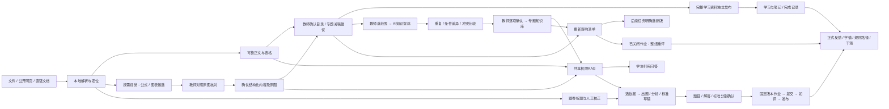
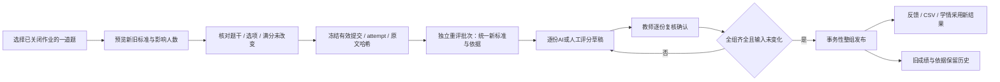

# 三模块完善与验收方案

2026-11-12。状态：**业务选择已确认，增量尚未实施、未验收**。现有代码基线为`f4bfb31`；当前实现见[架构](../architecture.md)，既有验收见[verification](../verification.md)，原图见[diagrams](../diagrams/README.md)。本页区分用户确认的范围与拟定的工程／验收细节，不以计划代替完成记录。

## 1. 已确认的范围

| 决策 | 本轮范围 |
| --- | --- |
| 解析 | 延续PDF／DOCX／PPTX／文本、常规表格与中文印刷OCR；增加印刷公式、图表理解；暂不做手写 |
| 视觉 | 本地解析＋第三方视觉接口；用户指定DeepSeek；只在服务端使用私密凭据 |
| 加工触发 | 自动解析、目录／分类／关联建议和相似知识检索；教师选定提炼范围；视觉按需触发 |
| 专题组织 | 课程下多个专题库＋标签／课程知识点；资料可关联多个专题库，学习资料目录独立 |
| 知识治理 | AI比较重复、条件差异与冲突，教师逐项决定，不自动裁决 |
| 网页 | 公开单页正文、图片及直链文档；保存快照与原网址，不递归抓整站 |
| 题卷 | 单选、主观题、代码文本；跨页题干、公式与图表；教师可拆分、合并、校正；代码不执行 |
| 普通更新 | 新版提示影响，旧版仍可追溯使用；明确替换停用／归档／撤回许可才限制未来使用 |
| 重评 | 已关闭作业按题冻结整组有效提交、统一新标准、逐份复核、整组发布，保留旧成绩和依据 |
| 重评边界 | 题干或满分改变另建任务，不直接重评旧答案 |

沿用Go／Gin、pgx／sqlc、PostgreSQL／pgvector、Redis／Asynq、React／TypeScript／Ant Design、Docker Compose。沿用本地验收、累计50元模型联调预算；本轮方案准备不发起付费调用，不部署公网，不推送远端。

## 2. 模块边界与交接

| 范围 | 管理内容 | 交接约束 |
| --- | --- | --- |
| 学习资料 | 原始来源、解析修订、校正、完整学习内容、发布与学习记录 | AI解释与转写不冒充原文；目录不等同于专题库 |
| 知识库 | 专题库、精炼条目、条件、关联、审核、用途与可见性 | 业务专题库不等同于Embedding模型／维度空间；不重复存原件与向量 |
| 题目与标准 | 拆题、独立题库、参考解答、标准、选用与审计 | 原卷解答提取与AI生成分开；题卷解析不代表发布 |
| 共享来源／检索 | 正文、公式、图表资产与权限混合检索 | 专题归类不能扩大访问权限；原文直接索引不等待知识提炼 |
| 共享变更处理 | 来源→知识→题目／标准→作业／结果的影响清单 | 普通新版不自动换绑；撤回不删除历史快照 |
| 评阅衔接 | 原固定绑定初评、独立重评批次与整组发布 | 普通评分接口仍禁止换绑；新结果不原地覆盖旧结果 |

以上为可独立操作的分支与汇合点。发布资料不必先提炼知识；手工录题不必先导入资料；专题关联不要求重建向量；来源更新不自动触发评分。

## 3. 学习资料模块

### 3.1 导入、编排与发布

1. 保存文件／抓取快照的原始字节、哈希、来源、许可和版本；同课程重复上传先提示复用／另建明确版本，不泄露其他课程是否有相同文件。
2. 公开URL只抓指定单页及所需图片、直链文档，保存抓取时间和最终URL。限制大小、时长、重定向及目标地址，拒绝内网／自身管理接口；展示清洗后的HTML，不执行来源脚本。不保证登录页面、验证码或浏览器专属交互页面；失败允许上传／补录。
3. 本地优先提取正文、原生表格、DOCX原生公式、PPTX原生图表数据；PDF保留页位置、PPTX保留幻灯片对象、DOCX保留内容块／对象。避免表格被重复当成正文和表格索引。
4. 保留图片、公式及图表资产，支持教师选择页／对象发起视觉识别；不因上传自动处理全部图片。
5. 自动建议目录、专题库、标签、知识点和相似知识，展示候选依据。教师采纳、修改或放弃；不重建或覆盖已有课程目录，不自动创建新专题库。
6. 教师核对正文与视觉结果、确认编排，再选择全文或片段发布。学生阅读正文、公式与图表，保留来源、笔记、收藏及完成记录。
7. 可靠文字直接索引；视觉候选须核对后才能索引、提炼或作评分依据。某图片待核不阻塞无关可靠片段发布；选段发布只开放获准内容和资产。

### 3.2 视觉结果与证据

| 对象 | 具体输出 | 核对重点 |
| --- | --- | --- |
| 印刷公式 | 原图／原页或对象、可编辑LaTeX、符号与条件、任务与模型、确认修订 | 正负号、上下标、分式、括号、变量与单位，正确排版 |
| 原生图表 | 原对象／图像、标题、系列、坐标轴、单位、可读取的内嵌数据 | 优先利用原生数据；不把图像估读伪装成原始数据 |
| 图片图表 | 原图、标题／轴／图例、清晰可读数值、直接可观察趋势、不确定项 | 看不清留空，不补造点位；区分精确值与估计；不外推因果 |
| 流程／结构图 | 原图、节点文字、可读连接与方向、条件分支和不确定连接 | 不凭版面相邻推断存在连线，不虚构步骤 |

保留`原资产 → 模型转写候选 → 教师确认修订`。转写／解释不是逐字原文：文本引用继续逐字校验；视觉引用核验资产、区域／对象、确认版本和用途，界面明确显示为公式／图表转写并可回原图。视觉解释不覆盖原文片段。

工程建议：在现有详情页补原图与结构化结果对照、公式渲染编辑，不引入Office在线编辑平台。图片只发送所选相关区域；前端显示不能依赖公开整份原件URL。识别输入保留足够分辨率、周边标题与坐标轴，不裁掉影响解释的内容。

## 4. 知识库模块

### 4.1 专题库、关联与权限

教师创建、命名、说明、停用专题库。来源和知识条目可多对多关联专题；标签横向筛选，课程知识点用于教学目标与表现统计，学习目录仍管理完整资料的阅读结构。

专题关联不代表资料已发布或知识已确认。停用专题库阻止新增归类／选用该专题，不自动归档来源或删除条目；内容是否继续可用由具体状态／许可决定。专题筛选后的结果仍受课程、学习／评分用途和学生可见性约束。

保留精确向量＋中文FTS＋RRF，不为每个专题复制索引；Embedding空间仍按提供商profile、模型、维度及分块版本隔离。

### 4.2 重复、条件差异与冲突

对候选召回相关知识，AI比较双方原文、适用条件及结论，给出重复／补充／条件不同／可能冲突／无法判断的建议与理由。相似分数只排序，不直接判冲突。教师对照候选、已有知识、原文逐项处理：

| 决定 | 保存与生效规则 |
| --- | --- |
| 不采纳重复项 | 保存处理原因，不生成重复确认条目 |
| 合成新版本 | 新草稿保留多方出处、条件及输入版本，教师确认后生效，旧内容不被覆盖 |
| 按条件并存 | 分别保留适用条件并建立关系，不因措辞相反强制合并 |
| 替换旧条目 | 展示影响，教师明确确认；事务性确认新版并停用指定旧版的未来用途，历史保留 |
| 暂不处理 | 保持候选／待处理，不进入正式用途 |

采纳时复查输入版本，拒绝过期AI建议覆盖新编辑。多条旧知识合成一条时保存多来源／前身关系，不硬塞入单一`supersedes_id`。驳回单条候选不得撤回整份来源许可；合并也不能继承较宽权限而泄露私有内容。

### 4.3 检索质量

拟固定30条查询及人工标注目标片段，覆盖中文同义表达、数字／公式、图表、同名异义、适用条件、跨专题、无答案与私有评分知识。正例、无答案及权限反例分开统计，对比向量、关键词与融合结果。

拟定门槛：可回答正例Recall@5≥90%，权限泄露0，明确停用内容不进入未来用途；引用问答的语义忠实度另行核对，不拿检索命中率充当回答准确率。90%是待测目标，尚无结果。先检查分块、词项、过滤和融合，按实际失例决定是否需要reranker或HNSW。

## 5. 题目与评分标准模块

### 5.1 整卷拆题

题卷原件复用来源模块，默认教师私有，不自动进入学习资料或学生RAG。解析候选保存题号、完整题干、题型、选项、分值、图表／公式、原文位置及不确定项。

教师在原题卷、拆题列表和题目编辑间对照，拆分、合并、重排并校正跨页题目。导入范围内内容须对应题目、公共说明或明确排除记录，不能漏题后仍显示整卷成功。

原件有解答／标准时提取并保留出处；没有则留空，之后显式调用AI起草。提取和生成不能混称原卷答案。单选复用固定答案规则，主观及代码文本复用逐点标准。题干含图表时只向学生开放经过核对的题目区域，不能借整页图片泄露同页答案。

### 5.2 审核、筛选与审计

- 题目、参考解答、标准分别确认，保留统一满分、匹配版本与旧作业固定绑定；AI只产生候选，条件变化后旧候选不能覆盖。
- 从题目／标准反查实际生成／拆题任务、采纳记录、模型与输入依据版本；手工创建不伪造AI来源。
- 服务端按关键词、专题、知识点、题型、确认与停用状态筛选分页，跨页排序、总数和筛选条件一致。
- 资料／知识详情可进入据此出题，题目可独立分析及起草标准；参考解答单独生成入口按需复用任务，不复制一套编排。

## 6. 变更影响与整组重评

### 6.1 影响清单与待处理

按实际引用查询`来源／确认视觉修订 → 知识版本 → 题目与标准 → 作业 → 结果`，展示直接及间接关系、具体版本、草稿／发布／关闭状态并去重。详情与站内待处理事项可互相点回对象，保存无需处理、后续采用、进入重评的决定及理由。

普通新版只提示可升级；明确替换停用／归档／撤回许可才阻断未来检索、新作业选用。旧作业、原始作答、标准和反馈保留；现有规则不从“未来不可选用”推导删除历史。通知首版仅站内，不增加邮件或外部消息。

### 6.2 重评批次

工程规则建议：

1. 创建前展示名单、每名学生一份有效提交、既有结果、改分原因与统一新标准。默认取每名学生最新正式提交；已评和未评的实际提交均列清楚，未交不补0分。
2. 同题规则更正可以新建标准版本；题干、选项／作答条件或满分变化另建任务。标准仍独立制定，不用学生答案反推规则。
3. 普通评分接口保持原绑定。专门重评批次保存新标准／依据，生成新增评分修订，不改写旧作业绑定。
4. 同题只允许一个活动重评批次。提交／发布复查关闭状态、冻结名单、原文哈希、旧结果和编辑版本；作业重开或并行改分时拒绝发布并要求重新预览。
5. 全组草稿完成、逐份确认且无未解决异常后才能事务发布。失败、取消、重试或刷新不能暴露部分新成绩；重复发布幂等。
6. 发布后学生反馈、CSV、个人／班级表现使用同一批正式修订并去重；发布前旧反馈持续可用。客观题答案更正同样整组审定发布，代码不执行。

## 7. 技术落位与实施顺序

不拆微服务、不另建RAG平台。保留现有learning／rag调用链，按新职责拆小文件，避免继续把全部功能塞入materials.go。迁移从00012按实际占用顺序追加；先queries后sqlc生成store，不改已执行迁移。

| 顺序 | 交付 | 验证重点 |
| --- | --- | --- |
| A | 专题库、多对多关联、资产证据及采纳审计 | 旧来源兼容，内容与索引不重复，权限不扩大 |
| B | 网页快照、公式图表、本地解析增强与视觉profile | 原图定位、可编辑转写、人工核对、图片预算与失败恢复 |
| C | 目录／专题建议、知识比较和教师决策 | 条件并存、多来源合并、明确替换、输入版本锁 |
| D | 题卷拆分、题库筛选与反查 | 无漏题、教师校正、解答来源区分、独立确认 |
| E | 影响清单、站内待处理、整组重评 | 固定范围、旧绑定保留、无部分发布、去重口径一致 |
| F | 固定样例、检索质量与端到端收口 | Docker、权限、异常、浏览器、重启，按证据更新原图 |

DeepSeek官方图像理解文档于2026-11-12通过公开HTTP核验：`deepseek-flash`支持OpenAI兼容`image_url`内容块及base64图片输入。现有模型函数仅支持文本，需实际增加图片负载、能力声明、用量与预留逻辑；不把base64字节数当作图片Token或免费调用。密钥有效性、账号权限、真实识别质量仍待联调。参考：https://api-docs.deepseek.com/zh-cn/guides/vision/ 。模型profile由服务端配置，教师选择，Embedding仍走独立profile与维度空间。

## 8. 可复验的验收清单

以下22项及检索门槛是拟定目标，不预填通过。样例、人工参照答案与禁止行为在运行前固定，模型原始回复、自动化采纳操作和独立人工评价分开记录。

| 编号 | 实际场景 | 必须检查的结果 |
| --- | --- | --- |
| M01 | 文本PDF、扫描PDF、DOCX、PPTX、TXT／Markdown、HTML、CSV | 每种有实际对象与定位，不静默丢页、表格或异常 |
| M02 | 公开文章含图片、直链、重定向、失败URL | 快照与地址保留；失败可恢复；内网拒绝、不执行脚本、不递归 |
| M03 | 重复上传、新来源版本、已有目录 | 正确提示重复，建议可修改，不覆盖旧原件／目录 |
| M04 | 分式、上下标、符号和单位公式 | 原图位置、表达式、编辑与排版；校正留新修订，未核对不生效 |
| M05 | 原生图表、柱线图、流程图、低清图 | 轴／单位／数据／方向可核对；缺失不补造，估计与源数据区分 |
| M06 | 发布含公式图表的选段，学生读与记笔记 | 显示正确，不能越权下载其余内容／资产，学习记录持久化 |
| K01 | 两个专题库，一份来源跨专题关联 | 原件／向量不重复，目录、专题、标签、知识点独立可维护 |
| K02 | 重复、补充、条件不同、真实冲突 | 展示双方证据，教师各类决定可执行，候选不自动生效 |
| K03 | AI处理期间候选／旧条目被修改 | 过期建议拒绝覆盖，多来源保留，合并不扩大可见权限 |
| K04 | 普通新版、明确归档／撤回、专题停用 | 普通更新不误停用；明确撤回限制未来；历史可追溯 |
| K05 | 固定30查询，含私有、跨专题、无答案 | 正例Recall@5目标≥90%，泄露0；记录失例，不虚构无依据回答 |
| Q01 | PDF跨页及其他支持格式题卷，三类题型 | 可拆分／合并／重排，范围内无静默漏题，代码不执行 |
| Q02 | 一份有解答、一份无解答的题卷 | 提取与生成明确区分，无解答先留空；学生看不到私有题卷 |
| Q03 | 分别确认题目／解答／标准，多作业复用 | 匹配版本及状态正确，新版不改旧作业，学生不读内部规则 |
| Q04 | 1000条构造题库，多条件筛选翻页 | 服务端当前页、总数、排序一致；实测耗时如实记录 |
| Q05 | 题目／标准反查采用任务和依据 | 人工／AI来源真实，跨课程不可读取教师任务与规则 |
| X01 | 改资料影响知识、题目、标准与两个作业 | 直接／间接关系可点回、去重，决定持久化，不自动替换 |
| X02 | 已关闭作业整组重评并统一发布 | 名单标准固定；发布前旧结果可用，发布后反馈／CSV／学情一致 |
| X03 | 重评失败、取消、并行改分、重开、重复发布 | 无部分泄露、无范围漂移；冲突拒绝，重复请求幂等，旧结果不丢 |
| X04 | 解析／视觉／提炼／索引／拆题任务取消、超时及worker重启 | 旧可用内容保留，未知调用留账，显式重试，不重复最终提交 |
| X05 | 匿名、学生、跨课程教师与CSRF反例 | 权限拒绝；原件、资产、私有知识、答案、标准均无泄露 |
| X06 | 全容器重启，1440px／390px浏览器全链路 | 对象版本、任务、确认与正式结果保留，无阻断错误或编辑丢失 |

公式／图表单列模型初次识别正确率、未识别项及人工校正量。确认后发布的样例必须与人工参照逐项相符，不能靠补录把自动识别失败改记成功；低清及复杂版式可以明确待核，不能无提示跳过。视觉样例集合与量化通过门槛需在真实联调前冻结，当前尚无结果。

## 9. 收口与边界

交付代码、追加迁移／生成物、接口合同、固定样例和脚本、实际调用及费用摘要、浏览器与重启证据，再更新三张流程图和全景实现状态。按影响范围运行Go test／vet、TypeScript／Vite、平台／评分回归、文档及工作区检查；Docker构建与运行检查串行并输出进度。

本轮不纳入手写、整站抓取、视频、代码执行、E4 AI共性错因诊断、全自动个性补练和典型作答匿名化沉淀。精炼知识、相关资料和题目应可检索跳转，但不据此宣称完整AI推荐已实现。阶段完成须同时有正常、权限、异常、实际前后端及重启证据；代码存在、模型返回或文档通过均不能单独代表模块已验收。
