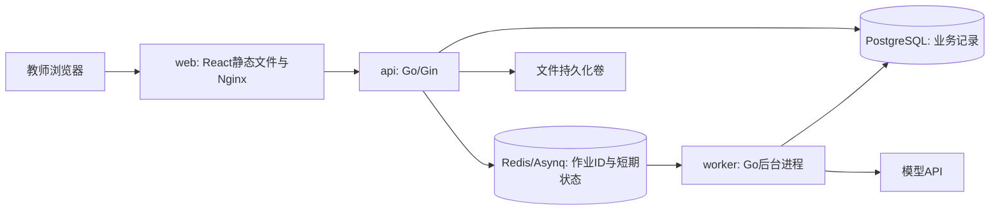

# 架构与技术设计

状态：立项设计，未实现。主线流程为可独立访问的任务工作区，不是强制逐页向导。

## 三块业务能力

| 模块 | 范围 | 依赖与产物 |
| --- | --- | --- |
| A 任务与数据准备 | 多个单题任务；题目、参考资料；标准手填或AI起草、编辑确认；作答导入预览、关联和留存 | 标准与学生作答独立；为B提供题目、选定标准、选定原文 |
| B 智能批改 | 发起作业、按份执行、逐点评阅、字段和引用核对、进度与重试 | 读取A；保留AI原始输出，向C提供草稿或明确失败原因 |
| C 结果复核与导出 | 同屏对照、人工修改、重新核对、逐份确认、选定项重评、导出 | 查询A/B原记录；修改产生修订；仅导出教师确认项 |

AI接入、确定性检查、数据访问与记录由三个模块按需复用。四人分工可跨一项公共支撑，不为了四人而拆出第四个审批阶段。

## 部署拓扑

API与Worker共用项目及镜像；一个后端应用按模块组织，不引入微服务。生产配置与密钥通过环境/受控配置注入，不进入仓库或前端。仅Web入口对外；数据库与Redis位于Compose内部网络。

PostgreSQL为任务和评阅结果的事实源；Redis投递作业ID、控制并发和保存会话/短期缓存。作业先落库再投递；投递失败保持待派发记录，Worker按ID读取输入。重启后通过数据库未完成记录检查是否需要重投，不能只依赖Redis断言业务完成。相同作业重复投递不能覆盖人工修订或产生重复正式结果。

## 数据对象与状态

Task关联题目/满分/资料；Rubric存评分点和确认版本；Answer存编号与不可被评分覆盖的原文；Job记录任务类型及固定输入；Attempt存一次调用的输入快照、模型标识、原始输出、时延和可见token；Review存教师修改及确认；Export保存所包含确认修订的清单。

Job仅区分两种用途：rubric_draft由A发起，只含题目、满分、参考资料和教师要求，不依赖学生答案或已确认标准；grade_answer由B发起，绑定题目快照、确认标准版本和单份答案快照。两者共用Worker及模型接入，手填标准不产生模型调用。排队后编辑材料不改变已派发作业的输入；采用新材料须显式另发作业。

作业执行状态为queued/running/succeeded/failed；执行成功只表示收到可处理结果，不等于内容通过核对或教师确认。评分结果修订使用needs_review/confirmed，检查异常附在结果上并阻止确认。标准草稿另由教师确认后才可用于批改。页面可合并展示处理进度和审核状态，但不得把教师确认当成队列任务完成条件。确认状态由教师操作产生，不接受模型自称已确认；编辑已确认结果产生新待审核修订，原确认历史仍可查。

改标准创建新版本；标准独立于待评作答，不能据个别答案调整尺度。采用新标准重评时明确涉及同题同批次的集合，最终导出标记所用版本，避免把不同标准混作可比成绩。

## 首版实现约束

前端Vite/React Router/TanStack Query负责页面与服务端数据，Ant Design负责表格和表单；Go/Gin接口；sqlc生成查询代码、pgx执行查询与事务、Goose管理迁移；Asynq通过Redis调度。模型只用net/http薄封装，不引入AI编排框架或向量数据库。

第一版使用HTTP轮询进度、CSV导入导出、服务端教师会话与本地文件卷。CSV校验编号/格式，保留空字符串和中文换行；导出防止表格公式被执行。首版不做学生端、OCR、多题拆分、知识孪生和资源推荐。E4与M模块属于学期后续对照，非此首版已实现能力。

计划验证：Compose config/build/up、迁移、数据库/Redis健康检查、一次真实模型调用、失败恢复及教师确认导出。当前没有Dockerfile/Compose实现，以上命令尚不可运行；W4按Sprint 0计划实现。
