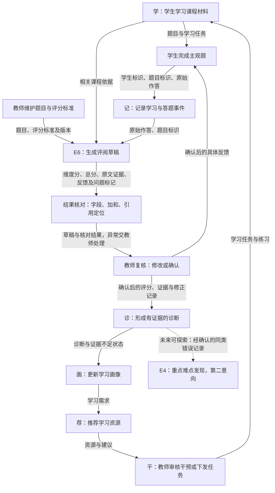

# 平台闭环与 E6 接入位置

本图是本次讨论确认的概念流程，不表示各模块已经实现。

## 同一学生的具体路径

模拟学生提交 A2：“18和60就足够了，只要测试这两个年龄。”
答题事件进入记录模块，E6 读取该答案、题目和评分标准，生成维度评分与反馈草稿。
预期草稿指出缺少17、19、59、61，以及未说明合法性分类与范围外测试目的；上述内容是在实际运行前拟定的人工预期，本次三轮实际输出已与它逐项核对，结果见 `spike/check-results.md`。
教师查看原文依据，修改或确认后，将具体反馈给学生，将本题评分证据交给诊断模块。
诊断只能记录本题暴露的覆盖缺口，不能据此断言学生在整门课程中的能力。
E4 以后可以探索多份已确认错误的汇总；本次不做班级难点统计。

## 输入输出与依赖

- 必需输入：题目标识与原文、评分标准与版本、学生原始答案。
- 草稿输出：答案编号、三维评分、总分、原文引用、问题与建议、待教师审核状态。
- 教师确认后的消费者：学生反馈、学习诊断；教师修改记录保留供后续核对。
- 待第三课澄清：记录与诊断模块接口由谁提供，教师确认状态如何传递，评分标准更新后旧结果怎样处理。

## 本次主架构图

可直接提交的图片为 `platform-flow.png`，以E6为中心展开4块职责：任务与数据（徐铂尧）、AI评阅（李然）、结果核对（张俊超）、教师复核（葛炫毅）。
平台课程和作答记录作为输入边界，学生反馈和诊断作为输出边界，E4为第二意向。详细职责与验收主线见 `E6架构与提交方案.md`。
实际第3轮输出遗漏审核状态，因而结果核对需检查该字段；这里只描述拟定流程，不能写成已实现拦截。
