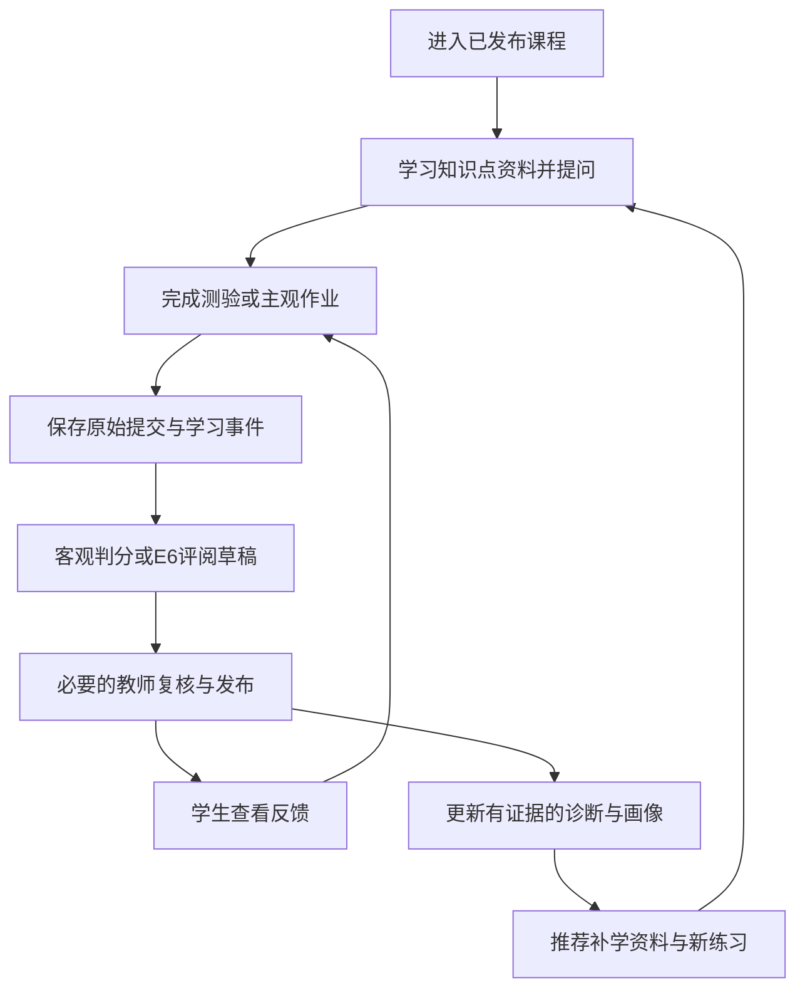
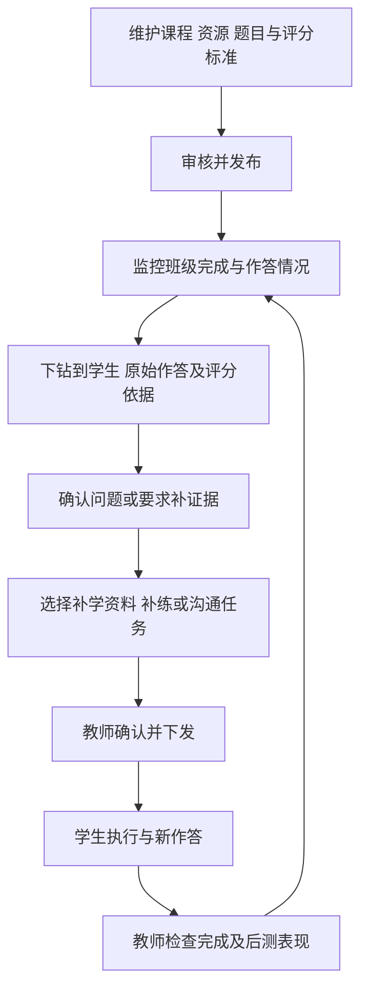

# 第6组课后改进建议：完整学习平台与有据评阅

日期：2026-10-28。用途：课后方向讨论与下一轮需求修订依据。本文件提出建议，不表示相关功能已经实现，也不修改历史提交材料与 PPT。

## 1. 建议先确定的方向

**将项目交付范围改为“学生完整学习流程＋教师完整监控与干预流程”，把 E6 有据主观题评阅作为重点深化方向，E4 班级共性难点分析作为第二个优先考虑的选做方向。**

建议项目名称为“面向学习闭环的智能教学平台——重点研究有据主观题评阅与教师干预”。平台需要具备课程基础功能，研究问题仍可集中在评阅证据是否可靠、反馈能否支持后续学习。基础范围完整与研究重点集中可以同时成立。

首版可限制课程内容规模，例如一门课的一个章节、若干知识点、客观题与文本主观题，但学生学习、教师监控、干预下发和结果回流这些环节需要真实连通。范围缩减应主要缩减内容数量、算法复杂度和自动化程度。

原方案的 A 任务准备、B 智能批改、C 复核导出可以保留为平台内部的 E6 子系统。CSV 导入保留为教师补录入口，同时增加平台作业提交作为正常作答来源。原来的三个流程图保留；后续修订时调整其适用范围，并补全平台级师生流程与证据来源图。

## 2. 课程材料说明了什么

### 2.1 第一课：聚焦的是选做模块

本地第一课现有的是立项意向和选题分析稿，没有找到原始第一课教师讲义。`lesson_01/E6_立项意向表_已填写.md` 已提出 E6 需要读取课程材料、学生作答、教师维护的评分标准，再将审核结果交给学生反馈和学习诊断。它能说明早期研究意向，不能作为“只需完成 E6”的课程授权。

`选做模块E1-E7解构与选题拓展.md` 属于讨论分析材料。其中模拟数据、模块组合和算法建议应作为候选方案，不当作教师要求或已经验证的结论。特别是不能把 LLM 模拟学生的隐藏参数直接当作真实学习收益的真值。

### 2.2 第二课：小探查是阶段任务

第二课原始任务单明确：“本次只聚焦一个关键模块的不确定性，不要求完成整个平台。”同页同时要求保持智能学习平台方向，并沿一名模拟学生解释模块、数据和闭环。

因此，第二课只探查 E6 是合理的阶段安排，但不能据此把后续整个平台交付永久缩减为教师批改工具。第二课最终 `platform-flow.md` 中已有学习、记录、诊断、画像、推荐和教师干预的概念流程，可作为恢复完整范围的起点。

第二课关于“资料不足不编造”“没有答题证据不能直接判低掌握”“干预需引用诊断、选择真实存在的资源、教师审核后下发”的约束，都应继续保留。

### 2.3 第三课：学期范围和本轮切片是两层要求

第三课教师讲义的关键位置：

| 物理页码 | 原文要点 | 对本轮修订的影响 |
| --- | --- | --- |
| p1 | 同一名模拟学生贯穿全链条，聚焦 M1—M10，本组至少两个 E 模块 | 全平台基础能力需要列入交付范围 |
| p3 | 核对十个主线模块及至少两个选做意向，选择一条学生学习流程 | 先建正式覆盖表，再选迭代切片 |
| p5—6 | 说明规则对照、AI 判断依据、资料不足处理和核查办法 | “调用模型”与“有材料引用”都不足以解释评分依据 |
| p10 | M5 测验结果进入 M6 事件，M8 诊断提供证据，M9/M10 连接推荐和教师查看 | 模块之间必须传递真实记录 |
| p11—12 | 数据来源、参照、指标、失败行为、人在回路 | 基础流程与 AI 质量分别验收 |
| p18—20 | 可以按垂直功能逐步推进；本轮不做清单不取消学期必做模块 | 可以分期建设，不能把必做能力长期放到平台外部 |

此前 `课程模块与责任对照.md` 将较多基础模块记作“未来接口／学期责任待确认”；课上演版 v3 的图示说明仍写“平台其他模块，本组不改”“本轮范围不变”。老师本次反馈已经补充了范围要求，这些说法需要在新版本中更新，不能继续作为排除基础功能的依据。

本地目前仅有 lesson_01—lesson_03 目录；未发现第四课及之后的教师原始材料。现有讲义没有完整列出 M1—M4、M7 的正式名称，不能按网页菜单自行编造对应编号。功能设计可以先推进，再拿教师正式清单逐项核对。

## 3. 参考平台实看结果与使用边界

访问日期：2026-10-28。使用用户提供的学生、教师账号登录，仅查看页面及已有记录；未提交作答、修改成绩、发布课程或下发任务。账号密码不写入本报告。

| 端与页面 | 已看到的功能或规则 | 建议吸收的设计 |
| --- | --- | --- |
| 学生首页 `/student/home` | 今日任务、课程知识点、画像摘要、当前路径、教师任务入口 | 学生明确知道当前应做什么，多个页面使用同一套任务记录 |
| 学习中心 `/student/course-content` | 课程目录、知识点绑定资源、作业入口、5E 助教入口 | 资源、题目和助教都绑定到课程与知识点 |
| 作业测验 `/student/homework` | 作业状态、提交记录、AI 建议分、教师终审分、测验入口 | 区分提交、建议、终审和正式反馈 |
| 学生画像 `/student/student-twin` | 薄弱点、趋势、风险、作业证据、证据时间线 | 每个诊断可解释数据来源；访问资源不等于学完；证据不足时不强行归因 |
| 个性化路径 `/student/learning` | 路径版本、依据报告、正式节点与补充项、资源推荐 | 推荐绑定已发布课程内容，记录来源与完成状态 |
| 教师任务 `/student/intervention` | 任务包及执行进度 | 教师安排需要成为学生可执行的任务 |
| 学生互动 `/student/interaction` | 公告、话题与师生提问 | 保留基础交流入口；不一定先做复杂社交功能 |
| 教师看板 `/teacher/dashboard` | 班级概览、学生详情入口、风险、课程热度、干预入口 | 监控能够下钻到个人和具体证据，并接到处置动作 |
| 课程底座 `/teacher/course-twin` | 课程结构、知识点、资源候选、审核与发布、测验和能力映射信息 | 学生侧内容应来自教师发布的课程版本 |
| 作业中心 `/teacher/homework` | 创建、发布、提交列表、AI 建议、教师终审 | 批改接入课程和作业生命周期，保留人工决策 |
| 干预任务包 `/teacher/intervention` | 诊断、草稿、教师编辑推送、执行跟踪等界面 | 从“发现问题”推进到“安排任务和复查” |
| 测验中心 `/teacher/quiz` | 测验列表、新建和 AI 草稿入口 | 教师可以维护并发布测验定义 |

这些是页面观察，并非整个平台功能验收。部分页面有演示数据或空列表，未通过提交和发布动作验证状态流转。不能由菜单或文案推出后台实现质量，也不能把其所有高级栏目都当成课程基础必做项。

两个特别值得吸收的教训：

1. 路径中能看到按知识点关键词匹配的外部资源，部分标题与目标知识点关联不够直接。能搜索到链接不等于内容适合教学，更不等于可作为扣分依据。
2. 某条既有判题记录同时显示“该题未作答”和已有 AI 分数、教师分数与完整性评语。这是展示层可观察的不一致；后台原因、数据是否齐备尚未核查。你们应要求评分绑定不可变的原始提交版本，缺原文时明确标记证据缺失。

## 4. 基础内容的建议验收范围

下表是结合材料与网页提出的功能分解，**不是 M1—M10 正式名称表**。基础功能应有实际数据保存、权限和状态变化；算法可先采用透明规则。

| 能力 | 学生侧最低可用行为 | 教师侧最低可用行为 | 可检查的结果 |
| --- | --- | --- | --- |
| 身份、课程与班级 | 登录并进入所属课程 | 查看本班学生，维护课程关联 | 学生只能访问本人记录，教师只能查看授权班级 |
| 课程结构与资料 | 浏览章节和知识点，打开已发布资料 | 录入／导入课程结构，绑定资料并发布 | 学生读取的是同一个发布版本，草稿不可见 |
| 学习与提问 | 学习资料、提问、查看有来源的回答 | 维护助教依据，查看必要的学习记录 | 回答有资料定位，资料不足时明确说明 |
| 测验与作业 | 保存、提交、查看状态和反馈 | 建题、定标准、发布、查看提交、评分 | 作答绑定学生、题目、提交次数与标准版本 |
| 学习事件 | 可查看个人记录和待办 | 可检查学习与作答事件 | 访问、完成、作答、评分等事件分开保存 |
| 诊断与画像 | 查看薄弱点、依据与不确定性 | 查看个体和班级情况，追溯原始证据 | 无数据、低分、未作答、调用失败分别处理 |
| 推荐与路径 | 得到明确下一步资源或练习，继续学习 | 可查看与调整推荐内容 | 推荐来自实际资源，说明与诊断的关系 |
| 教师监控与干预 | 接收补学／补练任务，提交复查结果 | 从班级下钻到个人，确认并下发任务，跟踪复查 | 任务有目标、对象、资源、检查办法、状态与结果 |

教师监控首版优先做：完成与未完成、作业提交和终审状态、知识点评价依据、需帮助学生、待处理干预。复杂预测雷达图、职业能力映射、教师数字孪生、自动教研报告不能替代这些基础动作，其必做程度需要再对照正式任务书。

基础画像可先显示知识点的已确认答题表现、样本数和最近时间。若使用加权分数，公开公式、纳入记录和版本，称为“表现指标”或“掌握度估计”；不能把任意加权和直接称为真实能力概率。

## 5. 两条需要真实跑通的流程

### 5.1 学生学习闭环

主观题正式结果建议继续要求教师确认。客观题可按教师发布的答案规则自动判分并记录规则版本。学习过程的即时提示与正式成绩分开；提示不能无条件展示教师专用答案。

### 5.2 教师监控与处置闭环

看板的终点应是具体教学动作。若只能看图表、不能查看依据或安排后续任务，教师流程仍未闭合。

## 6. “评据从哪里来”必须拆成五类

### 6.1 不同资料承担不同职责

| 依据种类 | 来源和审核者 | 在系统中的作用 | 不能直接推出什么 |
| --- | --- | --- | --- |
| 课程知识依据 | 教师上传或认可的讲义、教材节选、课程资料 | 解释概念、支持参考答案与评分点 | 有课程相关片段就能任意增设扣分项 |
| 评分规范 | 教师制定或审核的 rubric、部分分规则、反例与等价表达 | 确定每个评分点、分值及给分条件 | 模型起草后即可直接生效 |
| 学生作答证据 | 平台原始提交；CSV 补录需保留来源 | 证明本次作答包含、遗漏或错述什么 | 单题低分等于整门课能力差 |
| 评分结论与复核 | AI 逐点草稿、规则检查、教师修订与确认 | 形成可发布评价及后续诊断输入 | 引用存在就代表语义判断成立 |
| 独立评测参照 | 教师独立评分，条件允许时双评及分歧处理 | 检查模型误差、逐点一致性与反馈质量 | 用本模型生成的参考验证本模型就证明有效 |

补学资源单列管理：外部文章与视频可作为学习材料候选，经教师选择后进入资源库；未经审核的网络搜索结果不能自动成为评分权威。

### 6.2 建议把标准建立流程写成可操作步骤

1. 教师确定教学目标、知识点、题目、满分，关联已审核资料和具体页码／片段。
2. 教师手填评分细则，或让模型基于题目、资料和教师要求起草。起草请求不读取本批学生答案。
3. 为每个评分点写给分条件、部分分、可接受等价表达、常见反例、对应知识点和资料出处。
4. 教师检查标准与题目一致、总分正确、不同维度不会重复扣分，必要时用少量校准样例修订。
5. 发布标准版本。校准样例与独立评测集分开管理，独立集不参与提示调优。
6. 某次评阅固定题目、标准、课程资料和学生提交快照，不能在排队期间悄悄改用另一版。
7. AI 按评分点给分，引用作答原文，标记不足与疑点；规则检查字段、加和、范围和引用定位，教师核查语义与给分是否成立。
8. 教师确认后发布反馈，并生成后续诊断可消费的确认记录。修订已发布结果时产生新版本，标明替代关系并重算受影响统计。

资料缺失、资料互相冲突、题目与标准不一致时，先由教师补充或裁决。检索模型的相似度不能替代这个决定。

### 6.3 RAG 应具体说明检索什么

题目级评分标准应按题目 ID 和已发布版本精确读取。课程材料才按课程、知识点和审核状态检索。不要让向量相似度在多个版本的评分标准之间随意选取。

首版材料较少时，优先采用教师给题目绑定资料片段的方式，或按知识点进行简单检索。材料规模确实超过人工绑定能力后，再考虑全文检索、混合检索、重排或向量索引。

材料管理最低要求：保存文档标识、版本、页码／片段定位、原始文本、审核状态及关联知识点。不能把一次性将全部资料拼进提示词称为已经实现完整 RAG。

每个评分点最好能回答四个问题：“按哪条标准”“依据哪份课程资料”“学生哪句支持或反驳”“教师最终怎样处理”。缺少某要点的判断需要核对完整作答与标准覆盖情况，不能伪造一段‘未出现内容’的原文引用。

### 6.4 用已有年龄边界题讲清证据链

已有自拟题：年龄 18—60，只接受整数，列边界输入、区分合法性、解释范围外测试目的。A3 为“测试17、18、19、59、60、61，这六个年龄都合法，系统应该全部接受”。

按历史 v1 的自拟标准：覆盖维度 6 分，分类维度 1 分，目的维度 0 分，合计 7 分。这个结果只对应该标准；不把它冒充教师已经确认的课程标准。

完整链路应能展示：题目与标准出处、课程片段、A3 原始提交、三个评分点及各自引用、规则核查、教师确认、反馈，以及“范围外合法性混淆”的诊断记录。下一步推荐教师认可的边界分析资料和新范围题，完成后保存新证据。

旧题的 0 分作答可按评分标准记 0，但未作答、上传失败、模型失败、资料不足要分开；诊断不能把这些情况统一当成低掌握。

## 7. 开源项目参考：借鉴点与采用顺序

本轮实际查阅了下列 12 个项目的仓库 README，以及可访问的相关官方文档。没有克隆、部署或跑其评测；下列是功能和设计借鉴，不是集成兼容性结论。网络检索日期均为 2026-10-28。

| 项目 | 核实到的相关能力 | 对本组的具体启发 | 建议采用方式 |
| --- | --- | --- | --- |
| [Moodle](https://github.com/moodle/moodle) | 完整开源学习平台；仓库有 completion 和 rubric 相关模块 | 课程、学习完成条件和评分细则应有明确职责 | 参考业务结构；本次未访问成功的 Moodle 文档不作为细节依据 |
| [Open edX](https://github.com/openedx/openedx-platform) | Studio 内容制作与 LMS 交付分开；ORA 使用共同 rubric，支持教师终评和提交状态 | 发布课程、学生作答、统一标准和教师评阅分属清晰生命周期 | 重点读 ORA 文档；暂不整套部署其多组件架构 |
| [Canvas LMS](https://github.com/instructure/canvas-lms) | rubric、criterion、rating、assessment、submission attempt 等明确对象 | 标准与某次评分分开；评价绑定具体提交次数 | 参考数据关系与教师评阅组织，不直接移植其全栈 |
| [Kolibri](https://github.com/learningequality/kolibri) | 资源、课、测验、学生组；教师可从班级进度下钻到个人与题目，分配学习内容 | 最贴近基础“学—测—看—干预”闭环 | 基础平台优先借鉴；内容规模先小 |
| [PrairieLearn](https://github.com/PrairieLearn/PrairieLearn) | 题目、作答与人工评分；AI 按 rubric 评分，解释可检查，人工可修改，AI／人工结果可并列比较 | 最贴近 E6 的现成产品流程；实际请求可追溯，先小批校准后扩量 | E6 优先参考，保留 AI 草稿与人工结果，不先抄多模态和高并发功能 |
| [nbgrader](https://github.com/jupyter/nbgrader) | 生成学生版、发布、收集、自动／人工评分、反馈 | 作业是一套发布到反馈的生命周期，教师专用内容需要区分 | 参考生命周期；只有确定做 Notebook 作业才引入工具 |
| [Learning Locker](https://github.com/LearningLocker/learninglocker) | 实现 xAPI 的学习记录库 | 学习记录应有谁、做了什么、对象和结果的统一描述 | 借鉴事件结构；首版保存在现有数据库，不额外部署 LRS |
| [RAGFlow](https://github.com/infiniflow/ragflow) | 文档理解、分块、可干预的片段、可追溯引用 | 资料入库与引用展示是独立流程，来源必须可回查 | 资料量大或复杂 PDF 成为瓶颈后再评估 |
| [LlamaIndex](https://github.com/run-llama/llama_index) | 检索／查询接口；CitationQueryEngine 暴露来源片段，可调整引用粒度 | 检索片段与生成结论分别保存，教师能点开出处 | 与 RAGFlow 按实际需求比较选一个方向，不同时引入两套 |
| [Langfuse](https://github.com/langfuse/langfuse) | 请求追踪、提示版本、数据集、人工标注、实验比较 | 把教师修订、输入输出和提示版本联结起来，形成可复现实验 | 先建少量必要日志字段；确有调试需要时增加一套观测工具 |
| [Promptfoo](https://github.com/promptfoo/promptfoo) | 固定样例、JSON 与自定义断言、提示／模型对比 | 将缺引用、越界分、资料不足和回归错误变成可重复检查 | AI 评测优先考虑，选它或现有简明脚本，不重复建设 |
| [pyKT](https://github.com/pykt-team/pykt-toolkit) | 多种知识追踪模型及标准化数据处理、对比评测 | 画像算法升级需要答题序列、切分和基线 | 数据积累后再用；当前优先透明规则，不先训练复杂模型 |

最值得立即精读的组合：**Kolibri 的师生闭环、PrairieLearn 的 AI／人工评分、Canvas／Open edX 的 rubric 与提交版本、LlamaIndex／RAGFlow 的引用追溯。**

开源参考不意味着全套采用。继续沿用已选 React＋Go＋PostgreSQL 的单应用结构即可，模型调用和后台任务复用现有计划。队列与缓存按实际异步需求使用，不为每个基础模块单独建服务。

如果教师提供了可复用平台代码或可靠接口，先确认可使用范围、所承担的基础模块及验收方式，再决定接入。若只提供示例站点，就按示例抽取需求，不能默认有可调用的后台集成接口。

代码复用前再核实选用版本的许可证及子目录条款。已读到 Moodle 使用 GPLv3，Open edX 与 Canvas 使用 AGPLv3；Langfuse README 区分 MIT 部分与 ee 目录。其他项目此处不作统一许可证承诺。流程借鉴与代码引入是不同决策。

## 8. 聚焦方向建议

### 8.1 基础平台达到可用线

课程与资源、基础答疑、测验作业、学习事件、透明诊断、规则路径、教师看板和人工干预均能完成基本流程。并非每一环都需要复杂模型，也无需先复刻示例站点所有高级栏目。

### 8.2 E6 深化：有据且可修订的主观题评阅

建议研究问题：“在固定教师标准下，显式关联评分点、课程来源和学生作答证据，能否比简单规则或直接 LLM 评分减少无据判断、缩小与独立人工评分的偏差？”

对照方案可设：规则基线、直接 LLM 评分、带 rubric 的评分、增加资料依据与证据约束的评分。保持题目、数据与预算可比；模型输出原稿与教师修订分开统计。优先比较逐点误差、MAE、引用支持情况和教师修改情况；评分等级与样本量适合时再报告 QWK，不从六份构造样例推出普遍可靠。

### 8.3 E4 深化：班级共性难点与处置验证

E4 可消费同一套已确认评分点与知识点映射，形成“哪些知识点、多少名学生、有哪些共同错误、依据在哪里、教师准备怎样处理”的难点清单。

基础看板已经要展示简单正确率。E4 的研究增量应是区分‘不会、没做、证据不足’，处理题目覆盖与样本差异，归纳有依据的错误类型，并用独立标注难点或可核验案例评价结果。只给班级图表换个名称不构成额外研究内容。

如果课程仍要求至少两个选做模块，建议把 E4 从“后续候选”转成有明确产物和验收的第二项；最终模块认定以教师口径为准。

## 9. 开发推进顺序与完成条件

| 阶段 | 应交付的实际产物 | 完成条件 |
| --- | --- | --- |
| 范围与数据对齐 | 基础模块覆盖表、师生流程、资料清单与标准来源表 | 每个必做功能有人负责、输入输出清楚、可映射正式课程要求 |
| 第一条完整学习路径 | 教师发布课程与作业、学生学习提交、教师人工评分、学生反馈、基础诊断及补练 | 一名学生从学习走到补练，记录重开后仍在；可逐条查证据 |
| E6 接入 | AI 草稿、逐评分点依据、检查、人工修订与确认 | 复用相同提交和标准；异常不会成为正式成绩；CSV 与平台提交走同一评阅路径 |
| 班级监控和干预 | 班级概览、个人下钻、难点清单、教师任务包与复查 | 找到问题后能安排真实任务，学生完成后教师可看新证据 |
| 独立验证与修订 | 冻结样例、基线对照、错误分析、成本记录、端到端演示 | 报告实际样本和失败；能够解释结果是否支持研究主张 |

不要先把所有页面画完再接数据，也不要继续把几乎全部人力用于 E6。可以先用人工评分与简单规则跑通基础路径，再将 E6 放入同一条链路。

四人分工建议按用户流程重新分配：徐铂尧主责课程／资源与学生学习记录；李然主责 E6／评分依据与评测；葛炫毅主责教师监控、干预与范围追溯；张俊超主责测验作业生命周期、事件接入与跨端验收。每人继续承担自己模块的界面、接口、保存和自测，共同复核接口。

历史 120 人时与 140 次调用是 E6 局部预算，不能直接改标签作为全平台预算。应先按新增基础工作包重新估算，再按实际剩余周数和成员可投入时间取舍。新增答疑、标准生成、诊断解释、E4 等模型用途分别计量，不将其藏入原 E6 预算。

## 10. 下一次演示的验收脚本

用同一名模拟学生贯穿全部动作，必要的模拟身份和初始记录明确标记。建议至少演示：

1. 教师发布一个知识点的资料、题目与已确认标准，学生能看到，其他草稿看不到。
2. 学生读资料、提问、提交作答，系统保存原始提交及事件。
3. E6 展示逐点建议、课程来源和作答引用；教师修改一项并确认，学生收到正式反馈。
4. 诊断指出本题可支持的具体问题，推荐一份真实资料与一道新练习；没有证据的知识点显示待补充。
5. 教师从班级列表下钻到该学生，核查证据后下发补学任务。
6. 学生完成新练习，教师可看到完成状态和前后表现；没有足够数据时不宣称学习提升。
7. 加入缺原文、资料缺失、模型超时或标准变更中的至少一个异常，展示处理和恢复。

这条脚本同时检验基础完整性、E6 价值和证据链，适合作为下一轮需求与演示的共同基准。

## 11. 建议先修订的已有材料

- 新版立项主文：更新平台定位、基础能力覆盖、聚焦点及实际剩余计划。
- 模块责任表：将现有“平台其他模块／未来接入”改为本组的实际责任、依赖和验收；保留历史版原文。
- 用户故事：增加学生完整学习、教师监控、干预执行及反馈回流，原 E6 故事保留并连接平台提交来源。
- 依据来源表：记录课程资料、评分标准、学生证据、独立人工参照、审核人与版本。
- 流程图：保留原业务、模块、部署三图；补平台双端流程及标准来源流程，旧图不再承担整个平台覆盖的表达。
- 验证与预算：分别覆盖基础功能、AI 质量、人工审核与运行成本。

待讨论的三个高影响决策是：是否有可复用平台源码／接口、首个验证章节选什么、E4 是否作为第二个明确交付的选做模块。其余基础需求和证据来源梳理可以立即推进。

## 12. 查阅来源

### 本地课程材料

- [第一课 E6 立项意向](../../lesson_01/E6_立项意向表_已填写.md)。
- 第一课：`F:/vibe-coding/school/2026.9 智能软件工程/lesson_01/` 下三份选题／意向 Markdown。
- [第二课最终平台闭环](../../lesson_02/第6组_第2次课启动包/platform-flow.md)。
- 第二课原始任务单：`C:/Users/23396/Downloads/本科生_第2次课_项目启动任务单与评价量表_学生填写版.html`。
- [第三课教师讲义](../第6组_第三课_完整提交包_proposal-v1/evidence/course/第三课学生讲义.pdf)，重点 p1、p3、p5—6、p10—12、p18—20。
- [第三课任务单](../本科生_第3次课_项目立项任务单与评价量表_学生填写版.html)。
- [原模块对照](../第6组_第三课_完整提交包_proposal-v1/requirements/课程模块与责任对照.md)、[原数据交接](../第6组_第三课_完整提交包_proposal-v1/design/图示与数据交接.md)、[课上演版图示说明](../第6组_立项汇报_课上演版_v3/图示说明.md)。

### 平台与开源官方文档

- [参考平台](http://139.9.243.199)，具体实看路由见第 3 节。
- [Kolibri 教师监控](https://kolibri.readthedocs.io/en/latest/coach/index.html)、[学习任务管理](https://kolibri.readthedocs.io/en/latest/coach/lessons.html)。
- [PrairieLearn 人工评分](https://docs.prairielearn.com/manualGrading/)、[AI 评分与复核](https://docs.prairielearn.com/aiGrading/)。
- [Canvas Rubrics API](https://canvas.instructure.com/doc/api/rubrics.html)、[Submissions API](https://canvas.instructure.com/doc/api/submissions.html)（页面提示官方文档正在迁移；本次仍可读）。
- [Open edX ORA 概念](https://docs.openedx.org/en/latest/educators/concepts/exercise_tools/about_OpenResponseAssessments.html)、[教师评分流程](https://docs.openedx.org/en/latest/educators/references/course_development/exercise_tools/ORA_Staff_Grading.html)。
- [nbgrader 作业创建与评分](https://nbgrader.readthedocs.io/en/stable/user_guide/creating_and_grading_assignments.html)。
- [LlamaIndex 引用查询与来源检查](https://developers.llamaindex.ai/python/examples/query_engine/citation_query_engine/)。
- [Langfuse 评测与人工标注](https://langfuse.com/docs/evaluation/overview)。
- [Promptfoo 断言与指标](https://www.promptfoo.dev/docs/configuration/expected-outputs/)。

资料边界：第一课原始教师讲义和后续课程材料未在该课程目录发现；未把本组方案稿冒充原始课程要求。部分 Moodle 文档访问返回 403，个别猜测文档地址返回 404，相关内容改用可访问仓库／官方文档核查。GitHub 后续许可证查询遇到限流，不将未核实条款写成确定结论。
